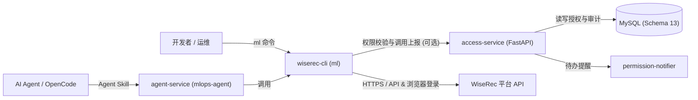

# WiseRec CLI (`platform-cli`)

[](LICENSE)
[](https://github.com/mossexplore/platform-cli/releases/latest)
[](pyproject.toml)

面向 **WiseRec 机器学习/深度学习平台**的命令行工具（`ml`）及配套企业级权限治理套件，用于在终端中完成算法管理、训练任务、分布式训练、数据集管理、在线推理服务部署、资源监控与 Jupyter 远程开发。

> [!NOTE]
> **平台依赖与运行前提**
> - 本项目为 **WiseRec 平台**配套客户端与治理套件，使用业务命令前需具备可访问的 WiseRec 平台环境与账号。
> - `ml login` 默认通过浏览器完成登录；Windows 交互式登录依赖 **Microsoft Edge**（或按环境配置使用服务端登录方式）。
> - 若暂未接入真实平台，可使用仓库内 `devtools/mock-platform` 搭配 `access-service` 体验合成业务数据，详见 [CLI 演示环境使用指南](docs/CLI演示环境使用指南.md)。

---

## 核心特性

- **全流程平台 CLI（`ml`）**：覆盖环境与租户切换、算法创建/克隆、单机与分布式训练、执行实例与角色日志归档下载、数据集管理、模型评估、推理服务部署、容器监控及交互式 Jupyter 会话管理。
- **集中式权限治理（`access-service`，可选）**：提供基于 FastAPI + MySQL 的独立权限管理服务，支持人员/环境授权、到期控制、版本准入策略、环境禁用命令清单（如禁止特定子命令组）与调用审计看板。
- **AI Agent 技能集成（`agent-service`，可选）**：支持 OpenCode 等 AI Agent 调用 `ml` 命令完成平台操作，并提供 `mlops-agent` CLI 与统一管理流程。
- **权限通知助手（`permission-notifier`，可选）**：面向管理员的桌面通知服务与审批提醒客户端。
- **本地命令历史**：支持 `ml history` 查看近期命令、`ml history clear` 清理历史，或通过 `ml --no-history COMMAND` 跳过单次记录。

---

## 架构概览



---

## 快速开始

### 1. 安装 CLI

#### 方式 A：Windows 安装包（推荐终端用户）

前往 [GitHub Releases](https://github.com/mossexplore/platform-cli/releases/latest) 下载对应版本的安装包并解压安装：

- **联网版**：`wiserec-cli-<version>-windows-py3-online.zip`（需 Python 3.9+）
- **离线版**：`wiserec-cli-<version>-windows-x64-py312-offline.zip`（面向 Windows x64 + Python 3.12 离线环境，不含 Python 本体）

安装与升级细节请参阅 [Windows 安装说明](scripts/windows/INSTALL.md)。

#### 方式 B：通过 `pip` 安装（macOS / Linux / 开发者）

从 [GitHub Releases](https://github.com/mossexplore/platform-cli/releases/latest) 下载 Wheel 安装，或从源码安装：

```bash
# 从源码可编辑安装（需要 Python >= 3.9）
git clone https://github.com/mossexplore/platform-cli.git
cd platform-cli
pip install -e .

# 验证安装
ml --version
ml tree
```

### 2. 登录与环境初始化

```bash
# 查看或切换平台环境（例如 dev / prod 等已配置环境）
ml env list
ml env use <ENV_NAME>

# 登录平台账号
ml login

# 选择当前业务空间 / 租户
ml business list
ml business use --tenant <TENANT_ID>

# 查看当前上下文与权限状态
ml context
ml access status
```

更多命令参数与完整示例请参阅 [WiseRec CLI 使用手册](docs/WiseRec%20CLI%20使用手册.md)。

---

## 仓库组件与版本管理

本仓库采用统一版本清单 [`versions.toml`](versions.toml) 管理以下四个独立组件（正式交付版本与附件清单以 [GitHub Releases](https://github.com/mossexplore/platform-cli/releases) 为准）：

| 组件 | 目录 | 当前源码版本 | 说明 | 文档入口 |
| --- | --- | --- | --- | --- |
| **WiseRec CLI** | `src/wiserec_cli/` | `1.0.9.5` | 核心命令行工具（`ml`） | [使用手册](docs/WiseRec%20CLI%20使用手册.md) · [维护说明](docs/CLI使用与维护说明.md) |
| **权限管理系统** | `access-service/` | `1.0.9.1` | 授权、版本准入与审计管理台 | [README](access-service/README.md) · [Docker 部署指南](docs/权限管理系统Docker安装部署与调试指南.md) |
| **Agent 服务** | `agent-service/` | `1.0.9.1` | AI Agent 集成与部署工具 | [README](agent-service/README.md) · [配置示例](agent-service/config.example.json) |
| **权限通知助手** | `permission-notifier/` | `1.0.9.1` | 权限申请桌面通知客户端 | [README](permission-notifier/README.md) |

> 维护者更新 `versions.toml` 后，需运行 `python scripts/sync_versions.py` 同步派生文件，并通过 `python scripts/sync_versions.py --check` 校验一致性，详见 [版本号管理说明](docs/版本号管理说明.md)。

---

## 配置与安全说明

- **配置目录**：CLI 运行时配置默认保存在系统用户配置目录中，也可通过环境变量 `WISEREC_CLI_CONFIG_DIR` 指定自定义目录。
- **环境与认证信息**：登录状态、Token 与当前选定的业务空间保存在本地配置目录中，请勿将真实配置文件、密钥或 `service.env` 提交到版本库。
- **权限与命令限制**：当接入 `access-service` 后，管理员可按环境配置版本准入规则与禁用命令列表，CLI 会在执行对应命令前自动校验并提示。

---

## 部署权限管理系统（可选）

`access-service` 提供离线容器镜像与标准化 Docker 部署方案，默认搭配外部 **MySQL** 运行。当前代码要求数据库结构版本为 **Schema 13**：

- **首次部署**：下载 Release 中的 `cli-access-<version>-linux-amd64.tar.gz`，按 [权限管理系统 Docker 安装部署与调试指南](docs/权限管理系统Docker安装部署与调试指南.md) 完成建库、初始化与启动。
- **已有环境升级**：若当前数据库为 Schema 12，必须先完成备份与显式迁移，再切换新版本镜像，详见 [权限管理系统结构 12 升级至 1.0.9.1 指南](docs/权限管理系统结构12升级至1.0.9.1指南.md)。
- **运维与发布**：参见 [Linux 部署与运维手册](docs/权限管理系统Linux部署与运维手册.md) 与 [Docker 部署与发布指南](docs/权限管理系统Docker部署与发布指南.md)。

---

## 文档索引

- **用户与开发文档**
  - [WiseRec CLI 使用手册](docs/WiseRec%20CLI%20使用手册.md)
  - [CLI 使用与维护说明](docs/CLI使用与维护说明.md)
  - [Jupyter 本地开发指南](docs/Jupyter本地开发指南.md)
  - [CLI 演示环境使用指南](docs/CLI演示环境使用指南.md)
- **版本与发布说明**
  - [版本号管理说明](docs/版本号管理说明.md)
  - 近期变更：[1.0.9.5](docs/RELEASE_NOTES_1.0.9.5.md) · [1.0.9.2](docs/RELEASE_NOTES_1.0.9.2.md) · [1.0.9.1](docs/RELEASE_NOTES_1.0.9.1.md)

---

## 问题反馈与开源协议

- **问题反馈**：如遇使用问题或有功能建议，欢迎前往 [GitHub Issues](https://github.com/mossexplore/platform-cli/issues) 提交反馈。
- **开源协议**：本项目基于 [MIT License](LICENSE) 开源。
