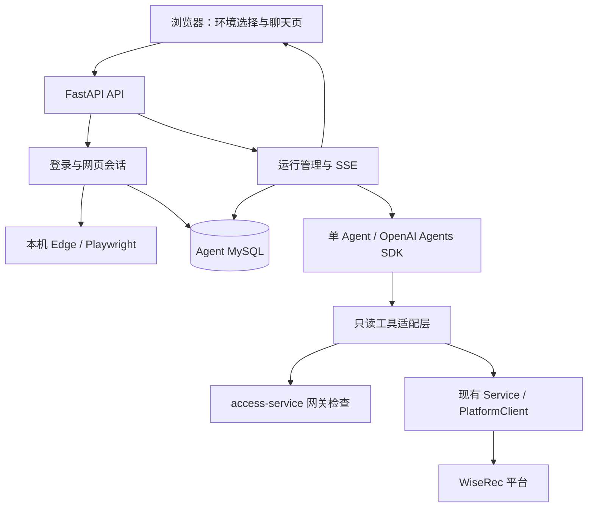

# WiseRec Agent 本地首版详细设计

日期：2026-10-29
状态：开发设计，尚未实现或完成联调
目标：指导后续代码开发，先在本地验证真实平台查询，再考虑云端登录和容器化

## 1. 已确认决策与范围

| 项目 | 决策 |
| --- | --- |
| Agent | OpenAI Agents SDK，单 Agent |
| 模型接入 | OpenAI 兼容 API；地址、模型名、密钥与 API 模式写入配置 |
| 后端 | FastAPI，兼任网页后端、登录管理、Agent 运行和工具执行 |
| 前端 | 轻量聊天页，由同一个 FastAPI 服务提供；SSE 输出 |
| 存储 | MySQL；使用独立 Agent 数据库，不直接改写 access-service 数据表 |
| 平台认证 | 本地 Edge 登录，获取 Cookie、csrftoken，由后端验证身份 |
| 凭据保存 | 首版按用户、环境、登录会话明文保存；后续考虑加密 |
| 权限 | 必须接入现有 access-service，不提供默认绕过开关 |
| 环境 | 登录前必须选择；一次登录固定一个环境，退出后可重新选择 |
| 运行平台 | Windows 为真实目标；macOS 开发及联调不能替代 Windows 验收 |
| 部署 | 首版本地单进程启动，不要求 Docker、Redis或任务队列 |
| 业务能力 | 模型列表、详情、溯源；训练任务查询；服务状态、日志查询 |

首版不开放训练启动、取消、部署、克隆、删除、上传、代码执行、任意 HTTP 请求或 shell 工具。只读工具可能使用 POST 请求，按业务语义判断副作用，不能只按 HTTP 方法判断。

暂不实现：多 Agent、向量知识库、在线环境切换、跨环境汇总、账号密码注册系统、运营管理后台、生产部署、浏览器关闭后的无人值守任务恢复。

验收主线：准备配置 → 启动 FastAPI → 打开网页 → 选环境 → Edge 登录 → 验证真实身份 → 选择业务并通过权限检查 → 连续对话查询真实数据 → 退出后不能再调用。

## 2. 关键前提与设计默认值

1. 本地 FastAPI 与使用者处于同一台有桌面会话的电脑，可启动已安装的 Microsoft Edge。
2. 该电脑能够访问测试平台、模型接口、MySQL 和 access-service。
3. access-service 已配置 gateway_token，测试账号已获目标环境授权；密钥由管理员提供，不自动修改权限策略。
4. 网页只负责引导登录，不能通过普通跨域跳转读取其他域名 Cookie。实际凭据获取由本地 Playwright 适配器完成。
5. 默认 Python 3.12，独立虚拟环境；实际依赖版本在实施时安装、验证后锁定。不得改变 CLI 自身支持的 Python 范围来满足 Agent。
6. 默认只监听 127.0.0.1。配置请求公共网卡监听时首版应拒绝启动并提示暂不支持；远程访问属于后续阶段。
7. 一次浏览器登录会话只允许一个活动 Agent 运行。本地首版只允许一个正在进行的 Edge 登录流程，避免弹出多个窗口。
8. 未填写连接信息时给出清晰配置错误，不自动降级为假数据。模拟模式仅用于测试，并显式显示“模拟数据”。

以下限额、超时和目录是设计初值，不是已验证的性能承诺；实施时通过配置和实测调整。

## 3. 总体架构



FastAPI 进程拥有运行状态；Agents SDK 负责模型与工具循环，不负责业务用户认证。前端不能访问模型密钥或平台凭据，也不能指定任意平台 URL。

工具适配层首版是 Python 模块，不额外部署 HTTP 工具服务，不要求 MCP。后续有其他调用方时再增加协议层。

## 4. 现有代码复用与改造边界

| 现有代码 | 可复用内容 | 必须处理的边界 |
| --- | --- | --- |
| `src/wiserec_cli/models.py` | Profile、Credentials | Agent 的有效期策略独立明确，不能把本地 TTL 当作平台真实到期时间 |
| `src/wiserec_cli/client.py` | Cookie、csrftoken、referer、businessid 注入与错误处理 | 同步 HTTP 客户端在线程池执行；每次工具独立客户端，结束时关闭 |
| `src/wiserec_cli/services/model.py` | ModelService | 输出筛选、权限检查、工具参数转换在 Agent 层完成 |
| `src/wiserec_cli/services/train.py` | TrainService 的查询方法 | 不暴露 start、cancel、delete、clone、update 等写方法 |
| `src/wiserec_cli/services/service.py` | ServiceCatalog 查询与日志方法 | 日志需限定时间、条数和字符数；不能推断不存在的状态字段 |
| `src/wiserec_cli/auth.py` | Edge 登录、请求捕获、用户信息解析思路 | BrowserAuthenticator 会保存凭据、刷新本地业务文件并输出终端进度，不能原样挂到网页请求 |
| `src/wiserec_cli/business.py` | 目录解析、BusinessSelection 校验语义 | Agent 用 MySQL 保存选择；不改写用户 CLI 的 business.json |
| `src/wiserec_cli/client_metadata.py` | 当前包版本、调用关联头 | 安装标识使用 Agent 专属状态目录；每次工具正确建立 invocation 上下文 |
| `src/wiserec_cli/execution.py` | 识别现有执行依赖 | `_current` 是进程全局对象，不能用它保存用户、环境、凭据或在请求间切换 |
| `access-service/app/access.py` | `/api/v1/gateway/check` | 调用方先确认平台身份与业务归属；服务端密钥不能交给浏览器 |
| `skill/wiserec-platform/` | 业务术语、分页、重名处理、结果核验规则 | 改写 CLI/Windows shell 操作方式；不整包照搬为云端提示词 |

登录适配优先提取无存储副作用的核心逻辑，保留 CLI 原有行为。如果需要改动共享模块，先写回归测试；不得借本次工作重构全部 CLI。

现有 CLI 继续从当前环境的 business.json 读取业务选择。Agent 是独立执行入口，按本设计从自己的 MySQL 会话/对话获取已经验证的业务选择，并构造 BusinessSelection；这不改变 CLI 的业务请求头规则。

所有平台注册 URL 来自环境配置 api_endpoint。现有 Profile.base_url 会提取 origin；实施时核对实际部署路径，不能未经验证拼接重复前缀。

## 5. 推荐目录与模块职责

```text
agent-service/
  pyproject.toml
  requirements.lock                 # 实施时生成并验证
  config.example.json
  README.md
  scripts/
    setup.ps1
    start.cmd
    start.ps1
    start.sh
  app/
    main.py                        # 应用装配与生命周期
    settings.py                    # 配置校验与环境变量覆盖
    db.py                          # 数据库连接、事务
    models/                        # ORM 数据模型
    repositories/                  # 数据访问，不返回公开响应
    api/                           # auth、business、chat、runs、health
    auth/                          # 本机登录、会话、凭据存取
    platform/                      # 客户端工厂、身份和业务校验
    permissions/                   # gateway/check 客户端
    agent/                         # Agent 定义、模型工厂、上下文、运行器
    tools/                         # 模型、训练、服务、日志工具
    runtime/                       # 运行管理、事件、取消与清理
    prompts/                       # 业务指令与按需说明
    static/                        # HTML、CSS、JS
  migrations/
  tests/
```

建议单模块小于 500 行；接近 800 行时必须按职责拆分。Agent 独立依赖现有 CLI Python 包，不从命令入口导入 Typer 命令，不通过 shell 执行 ml。

不把 Agent 的依赖加入 CLI 的默认 dependencies。开发期以本地包依赖方式安装 CLI；打包阶段再确定分发方式。本设计不新增 CLI 命令，不触发 CLI 版本递增或正式发布。

## 6. 配置设计

实际配置默认使用 `agent-service/config.local.json`，可通过 `WISEREC_AGENT_CONFIG` 指定绝对路径。真实配置、浏览器目录、状态目录和日志加入忽略规则。相对路径统一相对配置文件目录解析，不依赖启动时的工作目录。

```json
{
  "server": {"host": "127.0.0.1", "port": 8000, "workers": 1},
  "database": {
    "host": "MYSQL_HOST", "port": 3306,
    "database": "wiserec_agent", "username": "AGENT_DB_USER",
    "password": "MYSQL_PASSWORD", "charset": "utf8mb4"
  },
  "llm": {
    "base_url": "https://MODEL_API_HOST/v1",
    "model": "MODEL_NAME", "api_key": "MODEL_API_KEY",
    "api_mode": "chat_completions", "timeout_seconds": 120,
    "tracing_enabled": false
  },
  "environments": [
    {"id": "dev", "name": "开发环境", "enabled": true,
     "api_endpoint": "https://PLATFORM_HOST/ai/", "verify_ssl": true}
  ],
  "access_control": {
    "url": "https://ACCESS_HOST/cli-permission",
    "gateway_token": "GATEWAY_TOKEN", "timeout_seconds": 15
  },
  "login": {
    "provider": "local_edge", "browser_channel": "msedge",
    "timeout_seconds": 600, "profile_root": "./var/browser-profiles"
  },
  "session": {
    "idle_timeout_seconds": 1800, "absolute_timeout_seconds": 28800,
    "credential_ttl_seconds": 1800, "cookie_name": "wiserec_agent_session"
  },
  "runtime": {
    "state_dir": "./var/state", "platform_timeout_seconds": 30,
    "max_turns": 12, "max_tool_calls": 20, "run_timeout_seconds": 180,
    "max_page_size": 50, "max_auto_pages": 5,
    "max_tool_output_chars": 20000, "max_log_lines": 200,
    "max_history_messages": 40, "max_history_chars": 60000,
    "event_retention_hours": 24, "history_retention_days": 30
  }
}
```

配置说明：

- api_endpoint 必须是管理员配置的入口；接口固定路径由 Service 定义。前端和模型不得提交 base_url。
- 模型 base_url、model、api_key 可按用户要求写在真实配置文件中。环境变量显式覆盖，例如 WISEREC_AGENT_LLM_API_KEY、WISEREC_AGENT_DB_PASSWORD、WISEREC_AGENT_GATEWAY_TOKEN；不要自动展开任意字符串或执行配置内容。
- api_mode 只允许 chat_completions 或 responses；明确选择 SDK 对应模型适配器，不依赖 SDK 默认 API 模式，不自动尝试第二种模式重放请求。
- OpenAI 兼容不保证工具调用、工具结果回传、流式事件、结构化参数全部兼容。真实服务必须单独验证。
- 本地 HTTP 的网页会话 Cookie 使用 HttpOnly、SameSite=Lax、Path=/，Secure=false；仅限 loopback。未来 HTTPS 部署必须启用 Secure。
- credential_ttl_seconds 是 Agent 本地保留/使用上限。平台可以更早撤销会话，成功请求不自动无限延长期限。
- tracing_enabled 默认关闭，尤其不得把第三方模型密钥当成 OpenAI 追踪密钥。后续开启前验证 SDK 实际行为及脱敏策略。
- 配置在启动时校验，修改后重启生效。页面只读取脱敏的环境 id、name、enabled 等必要字段。
- 启动时输出配置文件位置和依赖状态，不打印连接密码、完整 DSN、Cookie 或模型密钥。

## 7. 登录、身份、业务和退出

### 7.1 状态机

```text
anonymous → logging_in → identity_verified → business_required → ready
                 ↓               ↓                 ↓             ↓
            failed/cancelled   denied            denied       expired

任意登录态 → logout → anonymous
```

identity_verified 只是平台身份已确认，不代表业务权限已通过。只有 ready 可发送业务对话。

### 7.2 首次登录

1. GET session 创建或返回匿名浏览器会话；前端显示配置中的环境列表。
2. POST login-attempts 只接收 environment_id。后端校验启用状态、同源请求和并发限制，创建短期登录尝试记录。
3. 通过受控后台工作线程启动 Playwright。同步 Playwright 对象必须在创建它的线程内使用和关闭，不跨线程共享。
4. 每次尝试创建独立临时浏览器 profile；不能复用用户 CLI 或日常 Edge 的 profile。
5. 打开配置的环境地址，用户在 Edge 完成平台/SSO 登录。页面轮询登录状态，不需要平台改造 redirect URI。
6. 仅捕获与选定环境 `/ai/user/info` 相匹配的请求，获取 Cookie、csrftoken；沿用现有代码的解析语义。
7. 后端使用取得的凭据主动访问平台用户信息接口，检查业务成功码和非空 username。只有平台结果可决定身份；忽略客户端提交的用户名。
8. 登录结果必须仍属于当前匿名会话和未过期、未取消的 attempt。用户退出或取消后迟到的登录结果必须丢弃。
9. 事务内创建/更新环境内用户、保存凭据、轮换网页会话 token；旧匿名 token 立即失效。
10. 登录成功或失败均关闭 Edge context 并删除专属 profile，避免磁盘残留额外登录凭据。删除失败记录不含秘密的诊断并重试，不能报告已完全清理。
11. 获取当前用户可选业务目录；多个业务时要求选择，一个有效业务时自动选择，没有业务时显示原因并禁止对话。
12. 使用选定业务调用 gateway/check，通过后进入 ready。由于网关要求 businessid，不能在未选择业务前伪造 ID 做“最终授权”。

登录尝试由网页会话绑定，不向其他浏览器暴露状态或凭据。首次登录和重登都使用新的临时 profile；操作系统 SSO 可能仍自动认证，不能承诺已退出企业 SSO。

### 7.3 用户与业务模型

用户唯一键采用 `(environment_id, platform_username)`，不假定不同环境的同名账号天然为同一身份。无需独立账号密码表。

业务目录从平台获取，复用现有目录解析。页面提交选择标识后，后端核对成员关系和可用状态，构造 BusinessSelection；不能直接信任任意 businessid。

每段对话固定 environment_id 和 business_id。切换业务时创建新对话，旧对话保留原标签；运行中禁止修改当前业务。环境切换首版必须退出后重新登录。

新登录可以查看相同平台用户及环境的历史；恢复某历史对话执行前必须重新校验其业务仍可访问。权限撤销不应通过旧对话或缓存绕过。

### 7.4 过期、退出和清理

- 网页 session、凭据本地 TTL、平台认证三者都必须有效。SSE 心跳和无操作轮询不应无限延长用户空闲期。
- 明确认证拒绝时标记 expired、删除凭据、关闭对话输入并提示重新登录。普通资源权限 403 不应不加判断地宣称 Cookie 过期；可对平台身份做一次受控探测再分类。
- POST logout 在事务内撤销会话并删除凭据，随后取消登录尝试和运行、清理浏览器 profile，清除浏览器会话 Cookie。
- 退出或过期后不再启动模型请求和平台请求；已经发出的 HTTP 调用不能保证撤回，迟到结果不再进入模型或发送给已退出的连接。
- 正在运行的工具可能短暂持有内存凭据副本，完成后关闭客户端、释放引用；不宣称数据库删除能立即清除所有内存副本。
- 退出是退出 Agent，不自动登出其他平台网页或企业 SSO。不删除已有审计和非敏感历史。
- 启动及定期任务清理过期凭据、过期 attempt 和遗留 profile。备份可能仍含历史明文，不能宣称删除当前表记录即销毁所有备份副本。

## 8. MySQL 数据设计

使用独立数据库、utf8mb4、SQLAlchemy 和显式迁移。时间以 UTC 存储，展示为北京时间 `YYYY-MM-DD HH:mm:ss`。用户名和环境身份键使用大小写敏感比较，避免默认排序规则把不同账号合并。

以下为逻辑表与必要字段，开发时生成 ORM 与迁移，不要求照搬为单个大模型文件。

| 表 | 核心字段 | 约束/索引 |
| --- | --- | --- |
| agent_users | id、environment_id、platform_username、display_name、department、created_at、updated_at | 环境与用户名唯一 |
| web_sessions | id、token_hash、user_id 可空、environment_id 可空、selected_business_id 可空、status、created_at、last_activity_at、expires_at、absolute_expires_at | token_hash 唯一；status/到期时间索引 |
| login_attempts | id、session_id、environment_id、status、expires_at、error_code、created_at、finished_at | session/status 索引；不保存 Cookie |
| platform_credentials | id、session_id、user_id、environment_id、cookie_text、csrf_token、acquired_at、expires_at、last_verified_at | session_id 唯一；到期索引；首版明文 |
| conversations | id、user_id、environment_id、business_id、business_name、title、created_at、updated_at | 用户/环境/更新时间索引 |
| messages | id、conversation_id、run_id 可空、role、content、status、sequence、created_at | conversation_id/sequence 唯一 |
| agent_runs | id、session_id、conversation_id、client_message_id、status、started_at、finished_at、error_code、cancel_requested、usage_json | conversation/client_message_id 唯一 |
| tool_calls | id、run_id、tool_name、safe_arguments_json、status、permission_request_id、invocation_id、duration_ms、safe_result_summary、error_code | run_id/created_at 索引 |
| run_events | run_id、sequence、event_type、safe_payload_json、created_at | run_id/sequence 唯一；按时间清理 |

补充约定：

- 网页 session token 为高熵随机值，浏览器持有原值，数据库保存哈希。这与用户已同意的“平台凭据明文保存”不是同一项设置。
- SDK 所需结构化历史单独采用经过验证的存储适配或增加 agent_history 表，不能仅用展示文本重建 tool_call/tool_result；具体方案在 SDK 接入阶段锁定。脱敏后持久化，不保存请求上下文和凭据。
- 数据库事务保持短小，不跨模型调用、平台 HTTP 或 SSE 等待持有事务。
- 存储字段采用显式白名单 DTO；凭据 ORM 对象不直接序列化或 repr 到日志。
- Cookie 使用 TEXT 类字段，不假定所有 Cookie 都小于某个短 VARCHAR；接受时设置合理的总长度上限。
- 用户退出保留 user、conversation、message 和审计；credential 删除，session 撤销。数据库外键不得因退出级联删除审计。
- 若实现数字统计，Decimal 和 None 在响应边界按语义转换，覆盖真实 MySQL 序列化测试，不能使用 default=str 掩盖类型。

## 9. 网页 HTTP 接口契约

统一前缀 `/api`。接口默认需要有效会话；只有 health、公开环境列表、匿名会话建立和登录流程允许未完成认证。所有 ID 的查询都检查归属，不能仅凭 UUID 访问。

| 方法与路径 | 输入/作用 | 输出/限制 |
| --- | --- | --- |
| GET /api/health | 进程存活 | 不返回秘密；数据库就绪另由本地诊断检查 |
| GET /api/environments | 无 | 启用的环境 id、name |
| GET /api/session | 获取/建立匿名会话 | 身份、环境、业务、状态、CSRF token，不含平台凭据 |
| POST /api/login-attempts | environment_id | 202，attempt_id；已有登录冲突返回 409 |
| GET /api/login-attempts/{id} | 本会话 attempt | pending/awaiting_login/verifying/succeeded/failed/cancelled |
| POST /api/login-attempts/{id}/cancel | 取消登录 | 幂等；防止迟到回调恢复登录 |
| GET /api/businesses | 获取平台可选业务 | 服务端过滤后的目录 |
| POST /api/business-selection | 业务选择标识 | 校验后的业务及准入结果 |
| POST /api/logout | 退出 | 幂等撤销；清理错误只显示安全说明 |
| GET /api/conversations | 本人、当前环境历史 | 分页列表 |
| POST /api/conversations | 当前有效业务 | 固定环境/业务的新对话 |
| GET /api/conversations/{id}/messages | 本人对话 | 分页消息 |
| POST /api/conversations/{id}/runs | message、client_message_id | 202，run_id；重复提交返回原运行 |
| GET /api/runs/{id} | 查询状态 | 状态、最终回答、错误与必要关联信息 |
| GET /api/runs/{id}/events | SSE，支持 Last-Event-ID | 本会话当前运行事件 |
| POST /api/runs/{id}/cancel | 取消后续执行 | 幂等，已完成返回现有状态 |

状态修改接口校验 Origin 和网页 CSRF token；这个 token 与平台 csrftoken 分开命名和管理。默认不开放跨域 CORS，不提供任意 Cookie 上传公共接口。

错误格式统一：

```json
{
  "error": {
    "code": "AUTH_REQUIRED",
    "message": "登录已失效，请重新登录",
    "request_id": "REQUEST_ID",
    "retryable": false
  }
}
```

状态码：400 参数错误，401 网页认证缺失/失效，403 权限拒绝，404 资源不存在或不可见，409 并发/状态冲突，429 超限，502 上游响应异常，503 依赖不可用，504 超时。日志与前端错误均不得直接拼接包含凭据的上游响应全文。

## 10. SSE 与运行生命周期

采用“POST 创建运行 + GET SSE 订阅”，避免 EventSource 无法直接提交 POST 正文的问题。SSE 是展示通道，不能将重新连接解释为再次执行任务。

事件契约：

| 事件 | 主要内容 |
| --- | --- |
| run.started | run_id、环境/业务显示信息 |
| tool.started | tool_call_id、工具名、安全的动作描述 |
| tool.completed | tool_call_id、耗时、条目数/截断提示 |
| answer.delta | 回答文本片段 |
| run.completed | 最终完整回答、usage、结束状态 |
| run.failed | 安全错误码和提示 |
| run.cancelled | 取消状态 |

每个业务事件带递增 sequence，SSE id 使用该 sequence。心跳使用 SSE 注释，不写 MySQL。文本增量适度合并后批量持久化；最终完整回答必须保存，不能每个 token 一次数据库提交。

重连按 Last-Event-ID 回放仍在保留期内的事件，客户端按序号去重；历史事件清理后改为查询最终消息，不承诺无限回放。先持久化合并事件再发布，避免重连时不可恢复的序号空洞。

运行状态：queued → running → completed/failed/cancelled/interrupted。单进程 RunManager 管理活动任务；同会话原子占用运行槽位，竞争返回 409。线程内取消属于协作取消，在下一次调用前和调用返回后检查；同步 HTTP 设置有限超时。

浏览器暂时断线可在本轮运行超时内重新连接；不自动创建第二次运行。进程重启后将遗留 queued/running 标为 interrupted，首版不自动重放工具，也不承诺持久任务恢复。启动脚本使用单 worker；正常演示关闭 auto-reload，避免登录或对话中断。

## 11. Agent、模型和上下文

### 11.1 Agent 输入

指令由三部分组成：固定角色与边界、当前环境和业务的非敏感描述、业务工具说明。凭据、数据库配置、模型密钥、gateway_token 不得进入 instructions、messages 或工具 schema。

工具执行上下文仅在服务端持有：session_id、user_id、environment_id、business_id、conversation_id、run_id 和依赖工厂。优先保存凭据引用，在实际工具执行时重新检查会话并读取凭据，避免跨运行长期缓存。

模型不知道 Cookie，不自行挑选账号。用户文字要求切换环境、修改身份或执行写操作时，说明当前限制，不执行。

### 11.2 模型兼容性

显式使用 SDK 的 Chat Completions 或 Responses 模型适配器。开发时根据锁定 SDK 版本核对实际类和参数，不把本设计当作可直接复制的 SDK 调用代码。

联调必须覆盖：一次工具调用、工具结果后的回答、同轮多次工具调用、中文参数、工具异常、流式文本、正常结束标记、用量缺失。若上游不支持某种 schema 特性，在工具定义层简化并验证，不能静默改成模型编造结果。

默认关闭并行工具调用，并在执行层限制并发，即使模型返回多个工具也按受控顺序处理。max_turns 与 max_tool_calls 分别限制模型循环和工具总数；max_turns 不是工具调用次数。

### 11.3 历史与输出

按用户/环境/对话隔离历史，采用一种明确的 SDK session/历史管理方式，不同时叠加本地全量重放和服务端 previous_response_id 造成重复上下文。

历史超限时按完整用户轮次裁剪，保持工具调用与结果成对。首版不额外启动摘要 Agent。页面历史仍可完整分页查看，模型上下文可以是有界子集。

所有业务数据回答应标明环境、业务、资源完整 ID 和查询时间。默认说明分页范围，不能把第一页当作全部。名称匹配不唯一时要求用户选择；ID 类型不能混用。

时间正确转换为北京时间；资源 ID 不截断。网页列表可用独立复制按钮和不换行 ID 列，不照搬终端表格宽度实现。日志、名称及接口文本视为外部数据，不执行其中的指令。前端 Markdown 需清洗，禁用任意 HTML 执行。

## 12. 首批工具清单

所有工具均由显式白名单注册，名称和参数只代表业务含义。环境、凭据和业务 ID 由后端注入，模型不能覆盖。

| 工具 | 主要参数 | 现有实现/适配方式 |
| --- | --- | --- |
| list_models | name、page、page_size | ModelService.list_models |
| get_model | model_id | ModelService.detail |
| get_model_source | model_id | ModelService.source |
| get_model_training | model_id | ModelService.train_task |
| list_train_tasks | name、page、page_size | TrainService.list_tasks |
| get_train_task | task_id | TrainService.find_task；明确其可能分页查找，加入页数/时间边界 |
| list_train_instances | task_id、page、page_size | find_task 后调用 list_instances |
| list_train_history | task_id | TrainService.list_history |
| list_services | name、model_name、page、page_size | ServiceCatalog.list_services |
| list_service_hosts | service_id、page、pod_ip 可选 | ServiceCatalog.list_hosts，现有每页大小固定为 10，不虚构可调参数 |
| get_service_deployments | service_id | ServiceCatalog.list_deployments；用于状态解释 |
| list_service_log_files | 已验证主机标识 | ServiceCatalog.list_pod_log_files |
| search_service_logs | 主机标识、日志文件、关键词、时间范围、限额 | ServiceCatalog.search_pod_log；开发前逐项核对真实参数 |

服务状态由服务列表、主机与部署视图的实际字段组合解释；不承诺有单独 service detail 接口。日志工具必须先由当前服务的主机查询获得可信 pod/cluster 上下文，不允许模型随意指定其他集群或路径。

实施时核对日志方法和 CLI 命令中的参数转换、时间语义、分页及文件选择。服务日志不等于训练日志，首版不扩展训练日志下载。

统一工具结果包含 ok、data、pagination、truncated、warnings 和 fetched_at；失败包含稳定错误码。限制数据体积但不截断 ID；记录截断原因与后续查询方法。只把任务所需字段返回模型，删除 Secret、Token、签名链接等字段。上游新增字段不应导致整个接口失效，不把示例看作完整 schema。

## 13. 权限检查与工具执行顺序

一次工具执行顺序：

1. 校验 session 有效且未取消，确定后端绑定的用户、环境、业务。
2. 校验工具白名单和参数，检查业务可用性；目录缓存必须设短有效期，平台仍保留最终资源权限裁决。
3. 建立工具 invocation_id、request_id；调用 access-service `/api/v1/gateway/check`。
4. 仅在明确 allowed=true 后创建平台客户端并调用 Service。
5. 转换/脱敏结果，再次检查会话及取消状态，记录执行结果，返回 Agent。

网关请求使用 Authorization Bearer gateway_token、businessid 和现有客户端元数据头。body 的 username、environment、platform_origin 由后端构造，不转发客户端同名字段。

command 映射为实际 CLI 对应语义，例如 ml model list、ml train list 等；开发时以实际命令树核对，不把不存在的命令当作审计事实。full_command 使用脱敏说明，不记录原始 Cookie 或全部用户消息。

版本头报告实际安装的 CLI 包版本，不硬编码旧版本，不用 Agent 自身版本冒充 CLI 版本。Agent 构建信息在自己的运行记录中保存。gateway/check 已记录 source=gateway；首版无需为区分 Agent 强行修改 access-service schema，通过 invocation/request ID 关联 Agent 审计。

网关返回 denied、超时、错误或未配置时停止执行；版本拒绝与认证过期分开处理。复合工具内多个平台调用应分别经过受控执行边界，至少在每次请求前检查撤销/取消状态，不能因顶层通过后无限继续。

网关检查记录“是否允许”，Agent tool_calls 记录“实际是否执行成功”。两者不互相替代。

登录身份探测和业务目录获取属于认证引导，不应伪造业务 ID 调用网关；除此之外的业务工具必须经网关。该例外必须限制在固定平台身份/目录接口，不能扩展为任意查询通道。

## 14. 首版页面

页面状态：环境选择、登录等待、业务选择、对话、认证失效。未 ready 时输入框禁用，后端仍做同样检查，不能仅依靠按钮禁用。

聊天页包含：当前账号/环境/业务、新建对话、历史列表、消息区、工具状态、停止按钮、退出按钮。环境只显示不提供在线切换；业务切换建立新对话。

登录等待页显示“请在打开的 Edge 中完成登录”，支持取消和重试，错误不显示浏览器底层完整响应。权限拒绝显示原因及联系管理员提示。

流式回答失败时保留部分文本并明确标记未完成；工具拒绝或日志为空不能显示为成功诊断。显示实际读取的时间范围、分页和截断提示。

## 15. 本地启动与平台差异

建议后续提供：

- Windows setup.ps1：创建独立虚拟环境并安装已锁定依赖，检查 Python/Edge，提示复制配置示例。
- Windows start.cmd/start.ps1：使用已有虚拟环境运行，显式指定配置文件、绑定 loopback，不每次重新安装依赖。
- macOS start.sh：同一应用入口，差异限于环境与路径处理。
- 单独数据库迁移命令：只迁移 Agent 数据库，启动时检查迁移状态，不自动执行破坏性变更。

脚本具体命令在实施阶段形成，本文路径为交付要求，当前不存在即不应宣称可执行。启动失败时退出码非零并提供可操作提示；端口占用不静默换端口造成 Cookie/Origin 不一致。

同步 PlatformClient 和登录工作在线程执行，限流并设置超时，避免阻塞 FastAPI 事件循环。Playwright Windows 事件循环/子进程行为须真实测试，不能仅凭 Mac 运行成功确认可用。

Edge 使用 msedge channel，保持与项目现有方式一致，不自动改用另一浏览器。路径用 pathlib，不拼接 Windows 专属反斜杠，不写死用户目录。

本地 HTTP Cookie 与跨域模型/平台请求无关：模型和平台由后端访问，不需要向前端开放跨域直连。access-service 可使用已有开发实例，无需首次启动 Agent 时自动启动或配置它。

## 16. 故障与限制

| 情况 | 首版行为 |
| --- | --- |
| Edge 未安装/无法启动 | 显示安装或路径诊断，登录失败，清理临时目录 |
| 用户关闭 Edge/登录超时 | attempt 失败或取消，可重新发起 |
| 登录后无业务 | 显示空目录，禁止发送业务对话 |
| 平台会话过期 | 删除凭据，要求重新登录，不让 Agent 自动索取密码 |
| access-service 不可用/拒绝 | 阻断平台业务工具，给出具体原因 |
| 模型不支持工具或流式格式不兼容 | 返回明确兼容性错误，不降级编造数据 |
| MySQL 不可用 | 登录/新运行失败；不能只存内存后宣称已持久化 |
| 重复发送消息 | client_message_id 去重，返回原 run_id |
| 同一会话并发发送 | 409，要求等待或停止当前运行 |
| 平台超时 | 只读调用允许有限重试，总时长仍受运行期限约束 |
| 日志过大 | 分页/裁剪并标记，不把全量日志塞进模型 |
| 服务进程重启 | 遗留运行 interrupted；不自动执行未完成工具 |
| 退出时请求已发出 | 阻止下一步，丢弃迟到输出，不宣称请求被撤回 |

运行超时、工具超时、SDK 重试必须统一预算，防止叠加产生数分钟无提示等待。同步线程不能被强制安全终止时，以有界 HTTP 超时和取消检查收敛。

## 17. 开发顺序与阶段交付

| 阶段 | 工作 | 完成条件 |
| --- | --- | --- |
| A 基础骨架 | 独立项目、配置、MySQL迁移、静态页、会话框架 | 本地一条启动入口打开页面；缺配置时清晰报错 |
| B 登录闭环 | 本机 Edge、用户探测、凭据存取、业务选择、退出 | 真实账号可登录；退出及过期阻断；不改动 CLI 文件 |
| C 权限与工具 | 网关检查、客户端工厂、首批只读工具 | 人工调用工具可得到真实数据，拒绝时零业务调用 |
| D Agent 对话 | 模型适配、结构化工具、历史、运行管理、SSE | 连续两轮查询、跨接口溯源、实时工具状态 |
| E Windows 验收 | 安装/启动脚本、Edge、中文路径、异常处理 | Windows 真机或对应 Windows VM 完成主线与负向用例 |
| F 交付整理 | README、配置示例、测试记录、限制清单 | 可按说明复现；明确哪些是真实联调、哪些是模拟 |

先用少量工具跑通再扩展完整首批列表，不以聊天模型能回复一句话当作 Agent 完成。整个首批范围均满足后才宣称首版交付。

## 18. 测试与验收

### 18.1 自动化测试

- 配置校验、环境地址白名单、秘密不输出、API 模式选择。
- 登录用户信息解析、错误 code、缺 username、取消后的迟到结果、跨会话 attempt 隔离。
- 会话轮换、归属校验、绝对/空闲期限、平台凭据过期、退出删除；使用真实 MySQL 验证事务与大小写身份键。
- 业务目录与选择，错误环境/业务不能进入工具；没有授权时平台请求次数为零。
- gateway_token 缺失、401/403/503、超时、版本拒绝和元数据关联。
- 工具参数、分页、重名、ID完整性、北京时间转换、扩展字段、日志截断与脱敏。
- SDK 模拟模型工具调用闭环、上下文无秘密、工具白名单、循环次数限制、取消。
- SSE 断线重连、事件去重、最终回答恢复、重复 POST 幂等、并发槽位释放、进程恢复标记。
- 原 CLI 登录/Service/客户端行为回归，尤其不得写用户 CLI credentials.json/business.json 或改变现有版本策略语义。

### 18.2 真实联调清单

| 场景 | 通过标准 |
| --- | --- |
| 模型供应商 | 工具调用和结果回传成功，中文 SSE 正常结束；不止普通文本补全 |
| 首次登录 | 必须选环境；Edge 登录后显示平台真实账号 |
| 业务选择 | 单业务自动选择，多业务要求选择；无业务不能对话 |
| 模型查询 | 列表筛选、详情、溯源与平台可见数据一致 |
| 训练查询 | 任务列表、任务识别、实例/历史按实际返回展示 |
| 服务查询 | 服务列表、主机/部署状态与真实平台一致 |
| 日志 | 能选主机和日志文件，按范围查询，空数据及截断有提示 |
| 权限拒绝 | 无授权/撤权后工具停止，平台业务接口未执行 |
| 会话隔离 | 两个独立浏览器会话不会混用身份、业务、凭据或历史 |
| 退出 | DB 当前凭据删除，会话失效，旧请求和旧 SSE 不能继续获得数据 |
| 重登 | 不复用已删除的凭据或旧运行；环境可重新选择 |
| Windows | 依赖安装、启动、Edge、中文路径、流式和退出全部验证 |

Windows 平台网络/SSO 只在真实环境通过才标记已验证。Mac、模拟接口和 SQLite 测试不能替代 Windows、真实平台和 MySQL 验收。

开发期间按变更运行适用测试；提交前遵守仓库要求。涉及共享代码时执行 CLI 回归，涉及权限服务时执行其测试及浏览器时间预设测试。所有提交前检查 git diff --check。仅设计文档变更做结构、路径、内容和差异检查，不新增无意义测试。

## 19. 后续演进边界

容器化可以复用配置、数据库、Service、Agent 和页面，但 local_edge 登录不能直接搬成云端用户登录。服务器无法启动访问者电脑上的 Edge；需另选平台授权交接、扩展或可交互远程浏览器，并独立设计隔离与取消流程。

多进程/多副本时需把运行互斥、取消通知和事件发布改为跨进程机制，再决定是否引入 Redis/队列。不能只增加 uvicorn workers。

后续加密通过 CredentialRepository 统一实现；存储格式增加方案标识/密钥版本并迁移存量明文。首版不预先实现加密或要求额外密钥管理。

写操作后续单独设计：目标及参数绑定的确认、幂等、审批状态、远端完成核验；不能只往首版工具表增加一个函数。

## 20. 开发启动前所需输入与资料

需要在本地填写：测试环境 api_endpoint、模型接口信息及 API 模式、MySQL 配置、access-service 地址和网关密钥。需要管理员为测试平台账号授予环境访问权限。秘密不在聊天或设计文件中填写。

剩余技术核验：真实日志参数与字段；登录适配能否无副作用复用现有捕获逻辑；模型服务兼容性；Windows Edge 启动行为；SDK session 持久化适配。上述均为开发验证事项，不需要重新进行框架选型。

本文是当前本地首版的开发依据。旧文件 `云侧Agent方案设计.md` 保留作为早期探索参考；其中浏览器池、CLI 子进程优先、强制先建设 MCP 或旧版源码能力结论不作为本次实现要求。

参考资料（本轮方案讨论已核对官方页面；实施时再次核对锁定依赖版本）：

- [OpenAI Agents SDK](https://developers.openai.com/api/docs/guides/agents/sdk)
- [Agent 运行、流式输出与暂停恢复](https://developers.openai.com/api/docs/guides/agents/running-agents)
- [会话上下文管理](https://developers.openai.com/cookbook/examples/agents_sdk/session_memory)
- [Cookie 的域、路径与 HttpOnly](https://developer.mozilla.org/en-US/docs/Web/HTTP/Guides/Cookies)

本设计不代表已经安装依赖、运行 Agent、连接模型、登录平台或完成 Windows 验收；不包含代码开发、提交、推送、发布或生产部署授权。
