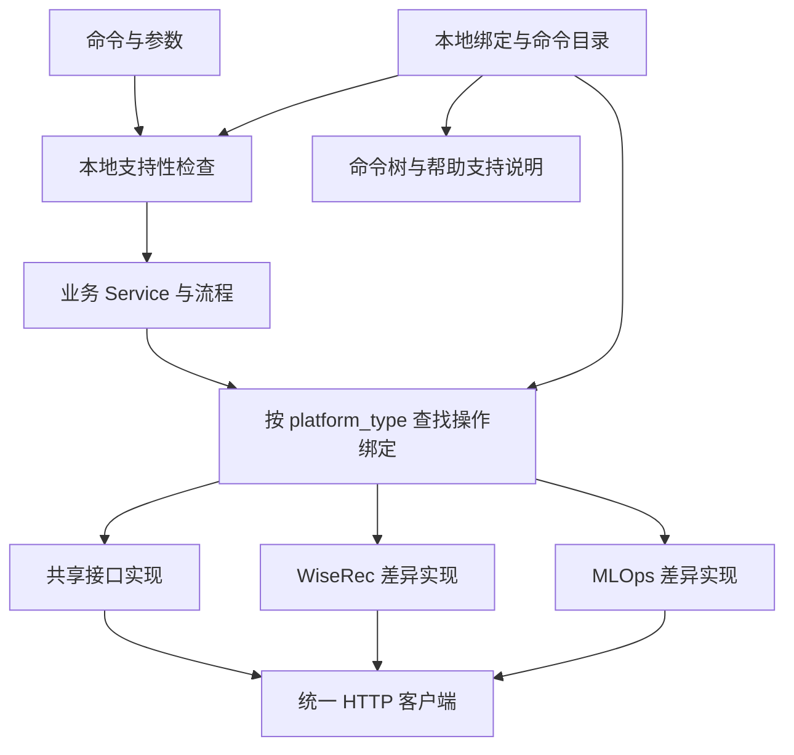

# CLI 双管理台接口适配设计方案

## 1. 目标与范围

CLI 同时适配新的搜推广管理台和老 MLOps 管理台，保留一套业务命令，通过当前环境选择接口实现。训练任务作为首个改造模块，后续按相同方式扩展其他模块。

本文是后续开发设计，不表示功能已实现或 MLOps 接口已验证。本次仅新增设计文档，不修改命令、配置、版本或正式发布产物。

### 1.1 已确认决策

| 项目 | 决策 |
| --- | --- |
| 平台类型 | `wiserec` 表示新管理台，`mlops` 表示老管理台 |
| 配置位置 | `config.json` 的每个 profile 增加 `platform_type` |
| 旧配置兼容 | 缺少该字段时按 `wiserec` 处理 |
| 用户命令 | 保留统一业务命令，通过环境切换选择平台 |
| 支持状态 | 仅“支持”和“不支持” |
| 默认命令树 | 只展示当前环境支持的命令，隐藏空分组 |
| 完整命令树 | `ml tree --all` 展示全部非隐藏命令及支持情况 |
| 接口关系 | 本地 Python 绑定表，随 CLI 安装包交付，由开发者维护 |
| 接口复用 | 已确认兼容的操作显式绑定同一实现 |
| 首次试点 | 训练任务，逐个命令开放 |

尚未适配、待验证和平台本身没有能力，对用户统一显示“不支持”。支持表示当前 CLI 已适配该平台，不代表账号已授权、认证有效或服务实时可用。

### 1.2 本阶段边界

完成环境类型、绑定与能力计算、命令树过滤、执行前拦截，以及训练任务的逐项适配。登录、业务选择、权限和保活属于调用链前提，需要核实并处理差异。

不建设远程接口配置中心、动态插件下载、自动探测平台或失败后尝试另一平台接口的机制。不创建两套平行 CLI 命令树。

## 2. 现有代码基础

| 文件 | 当前职责 | 计划调整 |
| --- | --- | --- |
| `src/wiserec_cli/models.py` | Profile 与认证模型 | Profile 增加平台类型 |
| `src/wiserec_cli/config.py` | 配置校验、profile 构造、安装配置同步 | 校验平台类型，保留用户环境配置 |
| `src/wiserec_cli/cli.py` | 命令注册、Runtime 初始化与自动保活 | 加入联网前支持性检查，调整保活顺序 |
| `src/wiserec_cli/invocation.py` | 调用入口、参数记录 | 配合完整命令路径解析，保留脱敏与历史行为 |
| `src/wiserec_cli/runtime.py` | 登录、业务选择、权限检查、客户端生命周期 | 创建适配上下文，执行前二次防御检查 |
| `src/wiserec_cli/client.py` | HTTP 请求、认证错误和公共请求头 | 保留通用传输，审查平台响应判断假设 |
| `src/wiserec_cli/commands/tree.py` | 遍历已注册命令输出完整树 | 根据绑定表过滤与标注状态 |
| `src/wiserec_cli/commands/env.py` | 环境展示与切换 | 展示平台类型 |
| `src/wiserec_cli/commands/train.py` | 训练参数、确认、流程与展示 | 调用统一业务入口 |
| `src/wiserec_cli/services/train.py` | 训练接口和部分流程 | 分离协议差异与可复用业务流程 |
| `src/wiserec_cli/services/train_export.py` | 训练配置导出 | 纳入训练适配范围 |

当前根回调对 `tree` 提前返回，不构造 Runtime；其他部分命令初始化时会自动启动保活。开发时必须处理这些入口，不能只在 Service 内判断平台，否则不支持的命令仍可能触发联网。

## 3. 环境配置与状态隔离

### 3.1 配置格式

```json
{
  "current": "wiserec-dev",
  "profiles": [
    {
      "name": "wiserec-dev",
      "alias": "搜推广开发环境",
      "platform_type": "wiserec",
      "api_endpoint": "https://<新管理台域名>"
    },
    {
      "name": "mlops-dev",
      "alias": "MLOps开发环境",
      "platform_type": "mlops",
      "api_endpoint": "https://<老管理台域名>"
    }
  ]
}
```

此示例说明新增字段，其他既有配置继续保留。地址占位符需要替换后才能使用。

规则：

1. `platform_type` 仅接受 `wiserec` 和 `mlops`，缺失才默认 `wiserec`；空值、拼写错误和其他类型应报配置错误。
2. 平台类型绑定具体 profile，不增加全局“当前平台”开关，不按域名猜测。
3. 所有地址来自当前 profile 的 `api_endpoint`，路径由适配实现维护；不得硬编码其他环境地址。
4. `env list/show` 展示环境标识、地址、平台类型；`env use` 继续负责切换。
5. 登录态、浏览器目录、业务选择和缓存继续按具体 profile 隔离；同账号或同域名也不自动共用。
6. profile 的地址或平台类型发生改变时，应使关联旧登录态和缓存失效，或通过上下文指纹拒绝复用。不能仅凭同名 profile 继续使用旧状态。

### 3.2 安装与升级配置保留

现有包配置同步以模板为基础更新，必须审查对用户新增环境的影响。新增字段时同时确定合并规则：保留已有用户 profile 及其平台类型、地址和其他明确设置；补齐缺失默认字段；新增模板环境按 name 合并；不得静默覆盖已有同名环境的连接身份。

该规则需覆盖安装器强制同步与常规同步两条路径。若模板必须改变同名环境的连接身份，明确提示冲突并保留原配置，避免升级后错误连接。

## 4. 架构与职责



命令层负责参数、确认和展示；Service 负责业务流程；适配器负责接口路径、请求和响应转换；客户端负责通用传输。禁止在每个命令中散落平台判断。

适配上下文包含当前不可变 Profile、当前登录账号、已校验业务选择和客户端。一次命令固定使用同一环境快照，不能在中途重新读取已变化的 current 并混用环境。

推荐目录，按实际复杂度逐步建立：

```text
src/wiserec_cli/
├── capabilities/
│   ├── catalog.py             # 完整命令路径到操作依赖的映射
│   └── resolver.py            # 支持计算与统一错误
└── adapters/
    ├── context.py             # 当前平台和调用上下文
    ├── registry.py            # 汇总各业务操作绑定
    └── train/
        ├── bindings.py        # 两个平台的实现绑定
        ├── contracts.py       # 输入与返回结构约定
        ├── shared.py          # 已验证兼容的实现
        ├── wiserec.py         # 新平台差异实现
        └── mlops.py           # 老平台差异实现
```

模块原则上小于 500 行；接近 800 行必须拆分。按请求解析、配置操作、实例操作等清晰职责拆分，避免把整个旧 Service 原样复制两遍。

## 5. 本地绑定表与支持计算

### 5.1 关系表的唯一事实来源

绑定表是包内 Python 源码，不是用户维护的 JSON，不包含真实域名、凭据或业务 ID。两个平台指向同一函数表示复用，指向不同函数表示分别适配，`None` 表示不支持。

以下为结构示例，不表示 MLOps 列表接口已经兼容：

```python
TRAIN_BINDINGS = {
    "train.list_tasks": {
        "wiserec": list_tasks_shared,
        "mlops": list_tasks_shared,
    },
    "train.start": {
        "wiserec": start_wiserec,
        "mlops": None,
    },
}
```

初始 MLOps 绑定必须为 `None`，经验证后才能指向共享或专用实现。不存在的操作或平台按不支持处理，不默认调用 WiseRec 实现。每个操作固定输入输出契约，注册时校验实现和平台键，避免错绑。

不再维护独立的 supported 布尔开关。支持情况从实际绑定计算，开发注释和验证记录可说明未开放原因，但不增加产品状态。

### 5.2 命令与操作的关系

完整命令路径映射到一个或多个必需操作。例如 `train instance list` 依赖任务查找和实例列表；任务查找当前通过训练列表分页实现。复合命令仅在所有必需操作可用且工作流前提已满足时显示支持。

支持计算：平台前提已完成验证，且命令所需操作均有实现。平台前提作为内部依赖建模，不新增用户状态。命令目录只声明依赖，不另存支持结果；所有入口调用同一个 resolver。

本地通用命令显式登记为不依赖业务接口；登录、业务目录、权限检查和保活即使命令名通用，也必须确认各平台协议。不能把所有非训练命令默认为 MLOps 支持。

迁移时为全部现有公开命令登记：WiseRec 绑定既有实现以保持行为；MLOps 默认不支持，再逐项开放。启动或测试阶段检查目录覆盖率，新增命令漏登记时检查失败，运行时拒绝未登记业务命令。

## 6. 接口适配规则

| 差异 | 实现方式 |
| --- | --- |
| 方法、路径、参数、响应及业务语义相同 | 共用一个接口实现 |
| 仅路径不同 | 平台薄封装传入路径，共用请求构造与解析 |
| 请求字段不同 | 分别构造请求，复用可共用的响应解析 |
| 响应结构不同 | 分别解析到统一契约 |
| 操作流程不同 | 分别实现流程所需操作，保持用户命令含义 |

统一输入可使用 dataclass 或有类型的参数；统一返回初期沿用既有 Service 契约，减少展示和脚本变更。例如训练分页当前使用 `count/pageIndex/pageSize/items`，不要误改成其他模块的 `total`。

每个操作在 contracts 中记录必需字段、可选字段、分页语义、错误和副作用。接口包装体、业务 code、任务状态及认证失效判断按实际协议解析，尤其审查客户端当前对 `result.code` 的假设，不把一个平台的成功响应规则强加给另一个平台。

字段处理要求：

- 样本可能省略无关字段；不能根据单份样本缺失而断言接口没有字段。
- 必需字段缺失或类型不符时报协议错误；非必需字段保留缺失语义，不编造值。
- 未知任务状态保留原值；不同业务含义不能强行合并。
- 未知总数不能用当前页数量冒充；若现有命令依赖精确总数，先补齐可靠分页逻辑，否则保持不支持。
- 展示结果与更新、克隆所需完整原始详情分开处理；后者不得因统一展示模型而丢失字段，也不得混入另一平台字段。
- 保持既有 JSON 输出契约；原始扩展信息先保留在内部，不擅自新增对外包装字段。
- 时间表格展示按 UTC+8 转换为 `YYYY-MM-DD HH:mm:ss`；无时区源值需确认源接口约定。
- 首列 ID 固定宽度 36，禁止换行、截断或省略；其他长字段优先换行。

## 7. 命令树、帮助和执行拦截

### 7.1 命令树

`ml tree` 仅读本地配置和绑定，不登录、不查权限、不调用业务接口、不启动保活。必须尊重全局 `--config` 和 `ML_CONFIG`。显示当前环境和平台类型，以及 `ml tree --all` 入口。

默认只展示支持的叶命令，自底向上移除空分组，保留原注册顺序。`--all` 展示所有非 hidden 命令，叶命令标注“支持”或“不支持”；分组只作为容器，不给出容易混淆的整组支持承诺。hidden 命令继续隐藏。

以下仅示意“假设 mlops 仅开放 train list”的展示：

```text
当前环境：mlops-dev
管理台类型：mlops
仅展示当前环境支持的命令
查看全部命令：ml tree --all

ml  WiseRec 命令行工具
└── train  管理训练任务
    └── list  查询训练任务列表
```

```text
ml  WiseRec 命令行工具
└── train  管理训练任务
    ├── list  支持  查询训练任务列表
    └── start  不支持  立即执行指定训练任务
```

真实输出还应包括已登记的通用命令。命令和分组说明末尾不得出现标点；末尾括注改成完整补充说明。状态以文字表达，颜色仅辅助。

配置无法读取时明确报错并非零退出，不伪装为默认平台。缺配置时保留无需环境的 `--help` 和 `--version` 入口；不额外增加无配置 tree 模式。

### 7.2 帮助与参数限制

保留全量命令注册，便于旧脚本获得明确错误，而不是“命令不存在”。帮助可以展示全量语法，并指引 `ml tree` 查询当前环境支持情况；支持说明从同一 resolver 派生，帮助渲染不得联网。

有选项限制的已支持命令仍只有“支持”状态。帮助说明限制，显式使用不支持的选项时在联网前报错，不能静默丢弃筛选或改变操作语义。若命令基本语义无法成立则整体不支持。

### 7.3 拦截顺序

目标执行顺序：解析完整命令路径与选项 → 读取配置与当前平台 → 本地支持和参数限制检查 → 创建认证等运行时依赖 → 自动保活及权限检查 → 调用接口。

根回调不能仅用一级分组判断，必须识别完整叶路径。实现可采用统一命令包装器或 Click 调用钩子；首期应选一个集中入口，避免逐个命令手写检查。先调整 `cli.initialize` 中保活时机，使其晚于检查；帮助和版本不触发业务检查与联网。

Service/适配注册表另做防御性检查，保证 Agent 或其他代码绕过命令入口时，也不能在 MLOps 调用未绑定接口。现有执行上下文钩子和 Agent 调用路径需要加入回归范围。

不支持时向 stderr 输出环境、平台、完整命令与指引，返回非零退出码；stdout 不输出成功 JSON，不触发登录、权限网络请求、保活或业务请求。

## 8. 认证、业务与写操作

每次业务调用的 `businessid` 必须来自 `business.json` 当前具体环境的 `selected.businessId`。缺少业务选择时明确失败；适配器可补充平台所需其他头，但不能覆盖为其他环境的值。

核对两平台 Cookie、CSRF、浏览器存储目录结构、业务目录提取、登录跳转、认证过期响应、保活接口及权限环境登记。保留现有权限门禁，不因老平台适配而绕过授权。平台类型不等于权限环境标识。

文件下载继续按已有可信地址和凭据发送边界处理，不因复用客户端把 Cookie 发往任意外部地址。

启动、取消、删除、克隆、配置更新需逐个审查。明确区分读取阶段和写入阶段；写操作一旦发送后出现超时、连接异常、认证错误或无法确认响应，不自动重放，不切换接口尝试。提示用户查询任务或实例核实结果。

当前 Runtime 有认证重试机制，调用方可能将查询和写入组合在同一闭包。改造时必须拆分阶段，写入调用使用 `retry_auth=False` 或等效明确策略，避免重新登录后重复写入。保留现有确认和 `--yes` 语义；批量取消报告逐项结果和部分失败。

## 9. 训练任务首批改造清单

现有公开命令如下，没有独立 `ml train detail`。下表操作标识为拟议内部命名，最终命名需保持统一。

| 现有命令 | 必需内部操作或流程 | MLOps 初始状态 |
| --- | --- | --- |
| `ml train list` | list_tasks | 不支持，验证后开放 |
| `ml train instance list` | find_task/list_tasks、list_instances | 不支持，验证后开放 |
| `ml train history list` | list_history | 不支持，验证后开放 |
| `ml train start` | start | 不支持，验证后开放 |
| `ml train cancel` | find_task、完整分页实例查询、cancel_instance | 不支持，验证后开放 |
| `ml train delete` | find_task、delete_task | 不支持，验证后开放 |
| `ml train clone` | find_task、clone_detail、clone_task | 不支持，验证后开放 |
| `ml train config export` | 配置导出及文件下载 | 不支持，验证后开放 |
| `ml train config update` | 完整详情查询、保留字段的配置更新 | 不支持，验证后开放 |
| `ml train history logs download` | get_log_url、日志下载 | 不支持，验证后开放 |

WiseRec 上述命令沿用当前能力。命令全依赖通过后才能开放，不能仅因单个最终接口兼容就标记支持。

推荐顺序：先训练列表，再执行记录与实例查询，再日志和配置导出，最后逐项验证写操作。`find_task` 的全量分页、重复页检测、实例完整性校验必须保留。不要用训练列表替代未经验证的老平台详情接口。

### 9.1 接口差异登记模板

开发每个操作前记录以下内容，放入对应模块开发文档或测试样本说明；其支持结论由绑定表表达，避免另建手工能力表。

| 项目 | WiseRec | MLOps |
| --- | --- | --- |
| 操作标识与调用命令 | 待填写 | 待填写 |
| 方法、路径与内容类型 | 按源码核实 | 按实际请求核实 |
| 认证、业务头与请求体字段 | 待填写 | 待填写 |
| 分页、筛选与排序 | 待填写 | 待填写 |
| 成功、错误、认证过期响应 | 待填写 | 待填写 |
| 返回必需字段和状态语义 | 待填写 | 待填写 |
| 副作用、结果核实及重试限制 | 待填写 | 待填写 |
| 脱敏样本与验证记录位置 | 待填写 | 待填写 |

## 10. 开发步骤与交付物

1. 盘点全部注册叶命令、别名与入口；建立命令目录和 WiseRec 既有能力基线，保存实际命令树。
2. 完成 Profile、配置校验、默认值、安装合并和状态隔离；同步环境展示。
3. 实现操作绑定、命令依赖 resolver 和完整覆盖检查，MLOps 默认关闭未核实业务操作。
4. 完成 tree 默认过滤、`--all`、参数限制、统一执行拦截与保活顺序；验证离线可展示。
5. 核实 MLOps 登录、业务选择与权限调用链，准备两平台脱敏请求和响应样本。
6. 以训练列表完成第一次端到端迁移，保持 WiseRec 请求和输出兼容。
7. 逐项补齐其他训练操作；兼容接口共享实现，差异接口分别转换；每开放一项都覆盖依赖和真实调用链。
8. 同步手册、示例与自动化使用方说明，执行适用测试和差异检查，记录真实联调范围。

每一步可以单独评审；不要求训练模块全部适配后才交付已验证的只读命令。涉及未验证的写操作保留不支持绑定。

## 11. 测试与验收

| 范围 | 必须覆盖 |
| --- | --- |
| 配置 | 缺字段默认 wiserec，非法值拒绝，显式配置与环境变量生效，升级保留用户 profile |
| 隔离 | 两平台交替执行不串 Cookie、业务、缓存；同名环境连接身份变化后拒绝旧状态 |
| 能力 | 全部叶命令登记，共享与独立绑定解析正确，缺失绑定拒绝，复合依赖缺一即不支持 |
| 命令树 | 两平台默认过滤、空组隐藏、完整树两种状态、hidden 保留、说明末尾无标点 |
| 离线行为 | tree、帮助和版本不登录、不保活、不联网；非法配置按约定失败 |
| 直接执行 | 不支持命令及不支持选项在任何联网前失败，stderr 提示，stdout 无成功内容 |
| 协议 | 两平台真实脱敏样本分别解析，业务错误不当成功，缺必需字段拒绝，未知状态保留 |
| 展示 | 原有 JSON 契约、北京时间转换、完整 ID、分页总数及筛选一致 |
| 写操作 | 发送后异常不重放，认证重试不重复写入，部分批量失败正确报告 |
| 调用方 | 现有执行上下文与 Agent 路径同样遵守绑定和环境检查 |

复用接口也需要两平台样本，不能仅把 WiseRec 样本改名。真实验证记录环境、命令、结果和限制，不提交真实 Cookie、Token、业务配置或敏感响应。写操作仅在获准的测试环境与测试任务上验证。

沿用并扩展 `tests/test_tree.py`、`test_config.py`、`test_runtime.py`、`test_train.py`、`test_train_actions.py`、`test_train_start.py`、`test_train_config.py` 等相关测试；新增能力解析和安装配置合并测试。断言用户行为与关键请求，不写仅复述字典常量的测试。

代码阶段执行项目适用测试、`git diff --check`，并检查实际 `ml tree` 和 `ml tree --all` 输出。若涉及正式出包，按 AGENTS.md 完成完整门禁；本次纯设计文档仅做结构、路径、命令和差异检查。

## 12. 文档、版本与发布约束

实现时同步 `docs/WiseRec CLI 使用手册.md` 的环境配置、命令树和训练相关章节，逐章保持“命令格式、参数与选项、说明、示例”四类小节，检查整份手册；不得写入版本或发布信息。设计文档不能替代用户手册。

新增命令时按仓库规则将 CLI 补丁号统一递增一次；版本仅修改根 `versions.toml`，运行 `python scripts/sync_versions.py` 及其 `--check`，派生文件一并提交。新增选项和内部重构的版本安排按实际交付范围确定，不因本次设计文档生成而递增版本。

只有测试和验证通过后才能提交，提交时按文件选择；若推送只允许 main。正式发布、草稿复核与附件交付遵守 AGENTS.md，不将源码能力登记等同于正式发布。

## 13. 待核实事项与完成标准

尚待提供或采集：MLOps 环境配置、登录和业务选择协议、训练各操作脱敏请求响应、任务状态语义、分页与过滤能力、权限环境登记以及允许执行写操作的测试任务。未取得证据前保持对应 MLOps 绑定不支持，不阻塞基础框架和 WiseRec 回归开发。

首批可交付标准：

- 两个平台字段、旧配置默认值和配置保留规则生效。
- 完整命令目录可用，只有支持与不支持两种状态。
- 命令树和实际执行使用同一个支持计算结果。
- 不支持命令在联网前被拦截，已支持命令仍正常执行原权限门禁。
- 至少一个训练只读命令完成 MLOps 全调用链验证，WiseRec 对应行为通过回归。
- 接口关系可从本地绑定直接看出，兼容实现不会复制成两份。
- 用户手册与实际命令一致，测试范围和未验证限制有记录。
