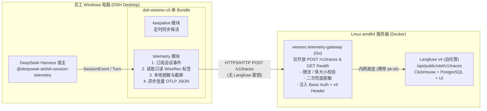
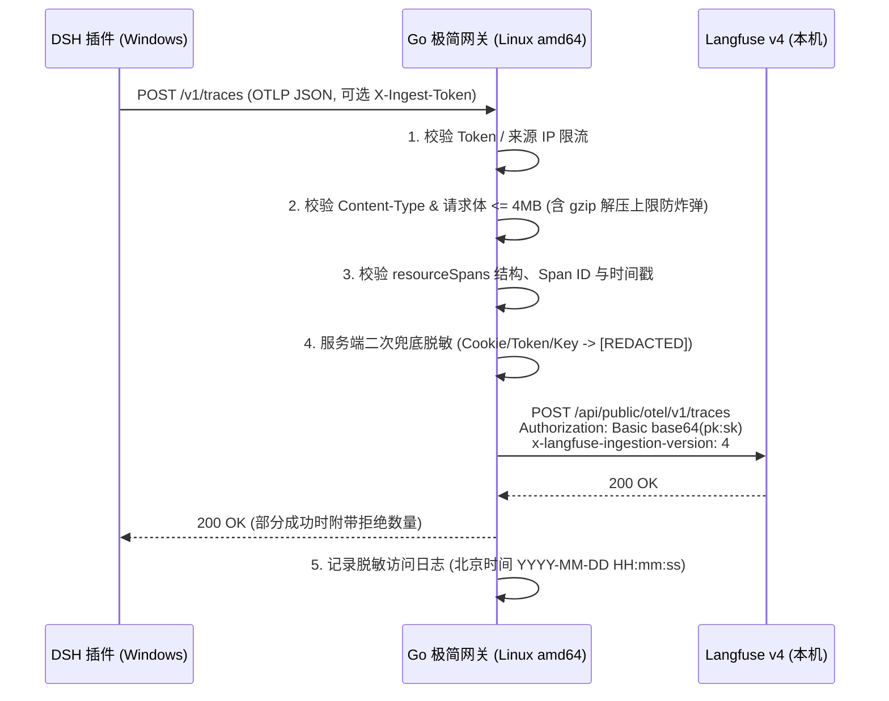

# DeepSeek Harness 插件可观测性与 Langfuse 极简网关设计方案

## 1. 背景与目标

### 1.1 业务背景

在完成 [Go CLI DeepSeek Harness 保活插件设计与分发方案](Go%20CLI%20DeepSeek%20Harness%20保活插件设计与分发方案.md) 规划后，团队希望进一步扩展 `dsh-wiserec-cli` 插件能力，实现 **DeepSeek Harness（DSH）会话可观测性**：自动采集用户的提问、模型回复与工具调用过程，统一上报至内网自托管的 **Langfuse v4**，用于分析用户高频诉求、排查 `ml` 命令调用失败原因，并持续优化 `skill/wiserec-platform/` 与 Go CLI 体验。

直接使用第三方社区插件直连 Langfuse 存在三类工程痛点：
1. **密钥暴露风险**：Langfuse `Secret Key` 具备项目级查询/删除权限，不能直接下发到每位员工电脑；
2. **配置与兼容性成本高**：社区插件默认关闭、字段不统一、依赖外网拉包，且不携带 WiseRec 自身的账号/环境/业务标签；
3. **协议与分发割裂**：DSH 官方内置导出器 `@deepseek-ai/dsh-session-telemetry-otel` 仅发送 OTLP Logs（`/v1/logs`），无法直接对接 Langfuse 的 OTLP Traces 接口（`/api/public/otel/v1/traces`）。

因此，本方案采用 **“客户端自研统一插件 + 服务端 Go 极简前置网关 + 自托管 Langfuse v4”** 架构，将保活与可观测性收口在同一个 Windows 独立离线插件包中，并在服务端实现密钥隔离与安全兜底。

### 1.2 设计目标

1. **单 Bundle、员工零配置**。员工只需在 DSH 插件管理器安装 `dsh-wiserec-cli`。完整包内部复用 DSH 宿主提供的官方遥测库，构建时从仓库 `config.json` 读取并写入内网网关地址。员工无需另装官方遥测插件、编辑 Profile 或填写地址与密钥。
2. **保活与可观测性独立交付**。`dsh-wiserec-cli` 默认同时打包保活和可观测性。可观测性出现兼容性或运行问题时，可通过 `config.json` 重新构建仅保活的插件包。两种产物均支持离线安装，完整包的遥测库由宿主提供。
3. **业务上下文完备**：上报的 Trace 自动附带 WiseRec 业务标签（当前 `ml` 登录用户名、会话环境、业务 ID、CLI 与插件版本），支持在 Langfuse v4 中按人、按环境、按版本深度分析。
4. **最小采集与双层脱敏**。默认只上报元数据。可按环境名单或显式通配符通过 HTTPS 上报脱敏文本。网关独立配置 trace 与正文的转发范围，再执行校验和脱敏。网关只暴露写入和健康检查接口。
5. **极简低耗服务端网关**：使用 Go 开发极简网关，编译为静态单二进制并打包为 `< 20MB` 的 `linux/amd64` Docker 镜像，与 Langfuse v4 同机部署，维护成本极低。

### 1.3 范围与非目标

- **客户端平台**：仅面向 **Windows** 平台，重点适配 **DeepSeek Harness Desktop（桌面版，`profiles\desktop`）**，兼容 `profiles\web`；暂不考虑 macOS / Linux。
- **服务端平台**：仅面向 **Linux `amd64`**（Docker 部署，与自托管 Langfuse v4 同机或同内网）。
- **代码边界**。Go CLI 继续提供现有保活协议和只读 `ml context --json`。插件及网关分别交付，插件独立于 Go CLI MSI 分发。
- **非目标**：本网关不替代 Langfuse 做复杂报表存储，不提供查询或管理 UI，所有问答回放、检索、标注与评测能力均由 Langfuse v4 原生提供。

---

## 2. 总体架构与职责边界

### 2.1 端到端架构



### 2.2 职责边界划分

| 组件 | 核心职责 | 明确禁止事项 |
| --- | --- | --- |
| **客户端插件 `dsh-wiserec-cli`** | 复用 DSH 宿主的官方采集库，注册 WiseRec 遥测后端；构建 OTLP/HTTP Traces JSON；读取只读的 WiseRec 会话标签（用户/环境/业务 ID）；执行本地脱敏与长度截断；异步队列发送并在异常时静默降级 | 禁止持有或配置 Langfuse `Secret Key`；禁止读取 `credentials.json` 中的 `Cookie`/`csrftoken`；禁止同步阻塞 DSH 对话；禁止在员工电脑另行安装官方库或引入宿主共享依赖的第二份副本 |
| **Go 极简网关 `wiserec-telemetry-gateway`** | 接收 `POST /v1/traces`；执行来源/Token 校验、体大小上限与限流；执行服务端二次兜底脱敏；自动注入 Langfuse Basic Auth 与 `x-langfuse-ingestion-version: 4`；转发至本机 Langfuse v4 并记录脱敏访问日志 | 禁止代理转发 Langfuse 查询/删除/管理路由；禁止在日志中打印请求正文、问答内容或任何密钥 |
| **Langfuse v4** | 负责 Trace / Session / Generation / Tool 落库存储、多轮问答回放、全文检索、成本与耗时统计、人工标注与评测集管理 | 不直接向员工电脑暴露 `Secret Key` 或管理 API |

---

## 3. 客户端扩展设计：`dsh-wiserec-cli` 可观测性模块

### 3.1 模块化目录结构

在原有 `dsh-plugin/wiserec-cli/` 结构中新增 `telemetry/` 子目录，与 `keepalive/` 并列、互不耦合：

```text
dsh-plugin/wiserec-cli/
├── package.json
├── config.json                  # 构建范围和插件默认配置
├── cordis.patch.yml             # 保活补丁，完整包构建时追加遥测配置
├── index.js                    # 现有保活入口
├── telemetry/
│   ├── index.js                # 加载宿主提供的 DSH 遥测库
│   ├── collector.js            # 接收 DSH 会话事件
│   ├── mapper.js               # 将 Turn、Generation、Tool 映射为 OTLP Trace
│   ├── context.js              # 提取并核对 WiseRec 会话标签
│   ├── redact.js               # 本地脱敏与截断
│   └── exporter.js             # 有界异步队列和批量发送
└── tests/
    ├── plugin.test.mjs
    └── telemetry.test.mjs
```

### 3.2 宿主遥测库与 Bundle 配置

- 完整包在内部从宿主解析 `@deepseek-ai/dsh-session-telemetry`，使用其 `SessionTelemetryCoordinator` 和后端契约接收实时会话事件。WiseRec 自己的后端负责生成并发送 OTLP Traces。宿主自带的 `@deepseek-ai/dsh-session-telemetry-otel` 是按反馈发送 OTLP Logs 的后端。
- 官方采集库和 Cordis 等共享依赖使用 DSH 的宿主模块解析机制。构建时按目标宿主版本验证接口与兼容范围，保留宿主共享模块为外部依赖。员工侧无需执行 npm 安装，完整包也不携带这些模块的私有副本。
- 同一 Profile 只允许一个激活的会话遥测后端。完整包的 `cordis.patch.yml` 由 `dsh.bundle.patch` 自动应用，按已验证的 Profile 行 ID 停用原有后端并挂载 WiseRec 后端。员工自定义 Profile 文件由 DSH 继续管理。遇到无法解析的宿主接口或无法安全接管的后端冲突时，保活应独立运行，并记录遥测停用原因。仅保活包沿用现有保活入口和补丁。

宿主接口和补丁加载方式见 [DSH 会话遥测库](https://github.com/deepseek-ai/deepseek-harness/blob/master/packages/session/session-telemetry/README.md)和 [DSH Bundle 发布指南](https://github.com/deepseek-ai/deepseek-harness/blob/master/docs/user/develop/basic/publish.md)。

以下是完整包生成的补丁示例。示例中的网关地址来自第 6.1 节的构建配置。

```yaml
- insert:
    - id: wiserec-cli-keepalive
      name: dsh-wiserec-cli
      disabled: false

- id: session-telemetry-otel
  disabled: true
- insert:
    - id: wiserec-cli-telemetry
      name: dsh-wiserec-cli/telemetry
      disabled: false
      config:
        mode: full
        endpoint: "https://telemetry.example.internal/v1/traces"
        contentEnvironments: []
```

### 3.3 OTLP Traces 数据模型与 WiseRec 标签映射

插件严格按照 **OpenTelemetry GenAI Semantic Conventions（`gen_ai.*`）** 及 **Langfuse v4 OTLP 识别规则** 组装标准 JSON（`resourceSpans`），核心映射如下：

| DSH 事件粒度 | OTLP Span 形态 | 关键属性（Attributes） |
| --- | --- | --- |
| **Resource（全局）** | `resource.attributes` | `service.name`、`service.version`、`os.type` |
| **共享上下文** | 每个 Span | `langfuse.session.id`、`langfuse.user.id`、`langfuse.environment`、`langfuse.trace.metadata.wiserec_business_id`、`langfuse.trace.metadata.wiserec_cli_version` |
| **一轮对话（Turn）** | 根 Span（`dsh.turn`） | 对话结束状态。允许采集正文时，使用 `langfuse.observation.input` 和 `langfuse.observation.output` 上报用户提问及最终可见回复。 |
| **模型调用（Generation）** | 根 Span 的子 Span | 模型、调用状态、时间和 Token 用量。允许采集正文时，包含该次调用的可见回复。 |
| **工具调用（Tool）** | 对应 Generation 或根 Span 的子 Span | `langfuse.observation.metadata.tool_name`、`tool_status`、`tool_exit_code`、`tool_duration_ms`。Shell 工具返回结构化退出码时才上报该值。允许采集正文时，包含脱敏后的参数及模型可见结果。 |

#### WiseRec 上下文安全读取规则

- 按 Go CLI 的规则定位 `%APPDATA%\ml-go-preview\sessions\<hash>.json`，用 `current` 和 `selections[current]` 获取当前环境与会话绑定。插件通过 `ml context --json` 核对会话和业务绑定，并获取 CLI 版本。
- 插件直接读取会话状态和命令的结构化输出。环境或业务在本轮内发生变化、上下文不可用或无法确认业务绑定时，省略未确认标签，只上报元数据。

### 3.4 本地脱敏、截断与可靠性保障

1. **本地过滤与脱敏**。采集从新的 Turn 开始。默认仅采集元数据，交付人员可在使用 HTTPS 时明确指定允许采集正文的环境范围。只考虑用户可见文本、模型可见回复和工具参数及结果，排除模型推理、系统提示词、注入上下文、附件和工具私有元数据。对允许上报的文本使用以下规则替换已识别的敏感值：
     - HTTP 鉴权与会话头：`Cookie`、`Set-Cookie`、`csrftoken`、`x-csrftoken`、`Authorization: Basic/Bearer ...`；
     - 常见密钥格式：`pk-lf-*`、`sk-lf-*`、`sk-*`、`ghp_*`、PEM 私钥块（`-----BEGIN ... PRIVATE KEY-----`）；
     - 常见字段键值对：`password`、`passwd`、`secret`、`token`、`access_key`、`api_key` 等。
2. **超长内容截断**：
   - 先完成脱敏，再按 `maxPayloadChars`（默认 16384 字符）保留前部并标记截断。超出扫描上限的整段内容直接省略。
3. **异步队列与故障处理**。
   - 完成 Turn 后异步整理并批量发送，使用 Node 内置 `fetch` 和超时控制。待发队列默认上限 50 轮和 4 MiB，单批不超过 1 MiB。队列满时丢弃最旧记录。
   - 对请求失败、超时和部分接收计数，并输出限频状态告警。保活拥有独立生命周期。

---

## 4. 服务端设计：Go 极简 Langfuse 前置网关（Linux `amd64`）

### 4.1 定位与模块拆分（严格遵守 `< 500 LoC`）

在仓库中独立规划 `telemetry-gateway/` 目录（纯 Go 标准库为主，零重型框架依赖），每个模块职责清晰且控制在 150~250 LoC 以内：

```text
telemetry-gateway/
├── go.mod
├── Dockerfile                 # 多阶段构建：golang:1.25 -> distroless/static (linux/amd64)
├── gateway.env.example        # 无真实凭据的环境变量示例
├── cmd/
│   └── gateway/
│       └── main.go            # 入口：加载配置、装配 HTTP Server、优雅退出 (SIGTERM)
└── internal/
    ├── config/
    │   └── config.go          # 环境变量加载与合法性校验
    ├── redact/
    │   ├── redact.go          # 服务端二次兜底脱敏（JSON 遍历 + 正则）
    │   └── redact_test.go
    ├── forwarder/
    │   ├── langfuse.go        # 构造 Basic Auth + v4 Header，连接池转发至 Langfuse
    │   └── langfuse_test.go
    └── server/
        ├── handler.go         # 路由（/v1/traces、/health）、体大小校验、限流、审计日志
        └── handler_test.go
```

### 4.2 HTTP 接口规范

网关**严格白名单路由**，除以下两个端点外，所有其他路径一律返回 `404 Not Found`：

| 方法与路径 | 用途 | 鉴权与限制 |
| --- | --- | --- |
| `POST /v1/traces` | 接收客户端 OTLP/HTTP JSON（支持 `Content-Encoding: gzip`）并转发至 Langfuse `/api/public/otel/v1/traces` | 校验可选 `X-Ingest-Token`、来源网段白名单、单 IP 限流、请求体大小上限（默认 `4MB`） |
| `GET /health` | 容器健康检查与探活 | 返回 `200 OK` 及 `{"status":"ok","version":"..."}`（不含任何密钥或上游凭据） |

### 4.3 请求处理流水线



关键安全细节：
- **防 gzip 炸弹**：当请求携带 `Content-Encoding: gzip` 时，使用 `io.LimitReader` 限制解压后的最大字节数（默认 `8MB`），超限直接返回 `413 Payload Too Large`。
- **上游错误脱敏**：若 Langfuse 返回 `401` 或 `5xx`，网关仅向客户端返回简短错误码（如 `502 Bad Gateway`），绝不将上游响应头或内部地址回传给客户端。
- **访问日志**：访问时间按北京时间（UTC+8）输出 `YYYY-MM-DD HH:mm:ss`，记录 `client_ip`、`bytes`、`spans`、`status`、`rejected_spans`、`filtered_spans` 和 `duration_ms`。挂载容器目录 `/var/log/wiserec-telemetry-gateway` 后，宿主机可同步读取 `gateway.log`。未挂载时通过 `docker logs` 查看。

### 4.4 网关环境变量配置（`gateway.env.example`）

```dotenv
# 监听地址
GATEWAY_LISTEN_ADDR=:8088

# 上游 Langfuse v4 地址（同机 Docker 网络可填 http://langfuse-web:3000）
LANGFUSE_BASE_URL=http://langfuse-web:3000
LANGFUSE_PUBLIC_KEY=pk-lf-replace-me
LANGFUSE_SECRET_KEY=sk-lf-replace-me
LANGFUSE_INGESTION_VERSION=4

# 客户端只写投递校验（留空则仅靠内网隔离；设置后客户端需携带 X-Ingest-Token）
GATEWAY_INGEST_TOKEN=
GATEWAY_ALLOWED_CIDRS=127.0.0.0/8,::1/128
GATEWAY_ALLOWED_ENVIRONMENTS=*
GATEWAY_ALLOW_CONTENT_FOR_ENVIRONMENTS=*

# 安全与限流参数
GATEWAY_MAX_BODY_BYTES=4194304
GATEWAY_MAX_DECOMPRESSED_BYTES=8388608
GATEWAY_UPSTREAM_TIMEOUT_SECONDS=10
GATEWAY_RATE_LIMIT_RPS=20
GATEWAY_RATE_LIMIT_BURST=40
```

---

## 5. Linux `amd64` 部署与运维方案

### 5.1 多阶段 Dockerfile（`linux/amd64`）

```sh
docker build --platform linux/amd64 -t wiserec-telemetry-gateway:0.1.1 telemetry-gateway
```

镜像使用 [Dockerfile](../telemetry-gateway/Dockerfile) 编译静态二进制并以非 root 用户运行。

### 5.2 部署方式

#### 方式 A：并入现有 Langfuse `docker-compose.yml`（推荐）
直接在现有 Langfuse Compose 文件中追加一个服务，通过内部网络直连 `langfuse-web:3000`，无需对外暴露 Langfuse 3000 端口的 OTLP 密钥：

```yaml
  wiserec-telemetry-gateway:
    image: wiserec-telemetry-gateway:0.1.1
    container_name: wiserec-telemetry-gateway
    restart: unless-stopped
    env_file:
      - /opt/wiserec-telemetry-gateway/gateway.env
    ports:
      - "127.0.0.1:8088:8088"
    read_only: true
    cap_drop:
      - ALL
    security_opt:
      - no-new-privileges:true
    logging:
      driver: json-file
      options:
        max-size: "10m"
        max-file: "3"
```

#### 方式 B：独立 `docker run` 部署（离线环境）

将 `WISEREC_LANGFUSE_NETWORK` 设置为现有 Langfuse 容器使用的 Docker 网络名。通过内网 HTTPS 入口转发 `/v1/traces`，并在 `GATEWAY_ALLOWED_CIDRS` 中填写网关直接看到的来源网段。

```bash
# 离线导入镜像
docker load -i wiserec-telemetry-gateway-0.1.1-linux-amd64.tar.gz

# 启动容器
docker run -d \
  --name wiserec-telemetry-gateway \
  --restart unless-stopped \
  --network "$WISEREC_LANGFUSE_NETWORK" \
  --env-file /opt/wiserec-telemetry-gateway/gateway.env \
  -p 127.0.0.1:8088:8088 \
  --read-only \
  --cap-drop ALL \
  --security-opt no-new-privileges:true \
  --log-driver json-file \
  --log-opt max-size=10m \
  --log-opt max-file=3 \
  wiserec-telemetry-gateway:0.1.1
```

### 5.3 部署后连通性验收

```bash
# 1. 健康检查
curl -fsS http://127.0.0.1:8088/health

# 2. 验证非白名单接口返回 404
curl -i http://127.0.0.1:8088/api/public/traces
```

在测试用 Langfuse 项目中按第 8.2 节发出带唯一会话标记的完整 Trace，再查验数据与层级。

---

## 6. 客户端零配置分发与安装集成

### 6.1 构建期开关与网关地址

构建人员在仓库的 `dsh-plugin/wiserec-cli/config.json` 中设置 `build.includeTelemetry` 和 `build.telemetryEndpoint`。以下为配置示例，与现有保活及日志字段一起填写。

```json
{
  "build": {
    "includeTelemetry": true,
    "telemetryEndpoint": "https://telemetry.example.internal/v1/traces",
    "telemetryContentEnvironments": []
  }
}
```

| 值 | 打包范围 |
| --- | --- |
| `true`（默认，字段缺失时同样适用） | 打包保活、可观测性模块及配套入口和宿主补丁。必填 `build.telemetryEndpoint`，使用包含 `/v1/traces` 路径的完整网关 URL。 |
| `false` | 只打包保活模块及其入口和宿主补丁。跳过网关地址校验，构建配置如已填地址也不写入产物。包内不含可观测性代码、模块引用、采集配置、网关地址或 Token。 |

`scripts/build_dsh_plugin.py` 在组装前读取布尔开关，并据此选择入口、文件清单和宿主补丁。开关为非布尔值时构建报错。完整包要求地址是包含主机和 `/v1/traces` 路径的绝对 HTTP(S) URL，缺失或格式无效时构建报错。构建脚本把该地址直接写入包内生成的 `cordis.patch.yml` 遥测行中的 `config.endpoint`，运行时由 WiseRec 读取。用户无需从本机 `config.json`、环境变量或安装命令提供地址。网关启用写入 Token 时，由交付方在构建进程设置 `DSH_TELEMETRY_INGEST_TOKEN`，Langfuse 项目密钥由网关持有。

`build.telemetryContentEnvironments` 默认是空数组。填入经允许的环境（如 `["sit"]`）后，对已核对会话及业务绑定的会话允许采集脱敏正文。显式使用 `["*"]` 时，所有已确认环境均可采集脱敏正文，包括生产环境。名单非空须使用 HTTPS。网关以 `GATEWAY_ALLOWED_ENVIRONMENTS` 控制 trace 转发，以 `GATEWAY_ALLOW_CONTENT_FOR_ENVIRONMENTS` 控制正文保留范围。网关按同一批次的 Trace ID 检查环境归属，再执行二次脱敏。

直接安装的 `.tgz` Bundle 和 ZIP 内的 Bundle 使用同一规则。生成包内 `config.json` 时移除源文件的 `build` 段，避免仅保活包通过默认配置携带网关地址。产物元数据和构建日志记录实际的 `includeTelemetry` 值，同版本的两种产物输出到不同目录。更换网关地址或切换打包范围时，由构建人员修改仓库 `config.json`、重新出包并分发替换。

### 6.2 安装、运行时停用与回退

复用[现有保活插件的本地 Bundle 安装方式](../dsh-plugin/wiserec-cli/README.md)。

1. **安装**。员工在 DSH Desktop 的「插件 → 添加插件」选择并启用本地 `dsh-wiserec-cli-<版本>.tgz`。如收到 Windows ZIP，先解压取得同一个 Bundle。插件独立于 Go CLI MSI 分发，DSH 的已安装插件列表只新增 WiseRec 一项。需要重启时，完全退出桌面端及系统托盘后重新打开。
2. **自动配置**。启用完整包时，DSH 加载 Bundle 自带的补丁，WiseRec 使用已写入的网关地址及宿主提供的官方遥测库。员工无需安装或配置官方遥测组件、修改 Profile、填写地址或登录 Langfuse。
3. **临时停用**。完整包可通过 `telemetry.mode: "off"` 停用本插件的可观测性，继续使用保活。按宿主提示重载配置或重启，无需重新打包。
4. **回退**。将仓库 `config.json` 的 `build.includeTelemetry` 改为 `false` 后重新出包。在插件管理器移除完整包，再安装仅保活的 Bundle。DSH 移除完整包的补丁层后重新应用原有配置，用户和其他插件的配置继续按原规则生效。

---

## 7. Langfuse v4 侧分析落地建议

接入完成后，建议在 Langfuse v4 中重点围绕 4 个维度分析用户问答：

1. **Session 多轮回放**：按 `session.id`（即 `DSH_SESSION_ID`）还原完整排查链路，看清用户在第几轮提问卡住。
2. **按业务标签切片**。按环境、用户和 `wiserec_cli_version` 筛选。高频提问主题需要提供获准采集的正文。
3. **工具调用失败归因**。筛选 Tool Span 的 `tool_status=error` 与 Shell 退出码。通过获准采集的参数和结果摘要排查 `ml` 调用失败。
4. **评测数据集闭环**：将高频失败问答一键加入 Langfuse Dataset，结合 Langfuse v4 的 Skill Management / Evaluations 能力，在每次更新 Skill 或切换模型前跑回归验证。

---

## 8. 测试与验收方案

### 8.1 自动化测试

1. **Go 网关单元测试**（`(cd telemetry-gateway && go test ./...)`）：
   - 仅 `/v1/traces` 与 `/health` 放行，其他路径（如 `/api/public/traces`）返回 `404`；
   - 超大请求体、gzip 解压超限返回 `413`，非法 JSON 返回 `400`，错误 Token 返回 `401`，超速返回 `429`；
   - 服务端二次脱敏覆盖 `Cookie`、`csrftoken`、`sk-lf-*`、`Bearer`、`password`；
   - 转发上游时正确注入 `Authorization: Basic ...` 与 `x-langfuse-ingestion-version: 4`，日志不泄露敏感值。
2. **插件单元测试**（`node --test dsh-plugin/wiserec-cli/tests/telemetry.test.mjs`）：
   - DSH 事件正确映射为 OTLP `resourceSpans`（包含 `session.id`、`user.id`、`wiserec.env`、`gen_ai.*`）；
   - 验证本地脱敏和截断，验证未知环境和 `metadata_only` 模式丢弃正文，以及通配符可在有效绑定的生产环境发送脱敏正文；
   - 网关不可达/超时时静默降级、队列有界不泄漏内存。
3. **打包验证**。验证开关缺失、`true`、`false` 和非法值。完整包缺少有效地址时应拒绝构建，地址变更后重新出包应反映新值。解包检查 `.tgz` 和 ZIP 内 Bundle 的文件清单、入口引用、宿主补丁及产物元数据。确认完整包地址来自仓库 `config.json`，且未包含宿主共享库的副本。设置 `false` 时，无网关配置亦可构建，即使源配置已填写网关地址，产物仍只包含保活功能。

### 8.2 端到端实机验收标准

在真实 **Windows DSH Desktop + Linux `amd64` 网关 + Langfuse v4** 环境中完成：

1. Linux `amd64` 启动 `wiserec-telemetry-gateway` 容器，`/health` 返回 `200`，`/api/public/traces` 返回 `404`。
2. 在目标 Windows DSH Desktop 版本上使用全新 Profile 和空插件依赖缓存，限制外部 npm 源访问并保持内网网关可达。通过插件管理器只安装并启用 `dsh-wiserec-cli-<版本>.tgz`，确认已安装列表只新增 WiseRec，并在重启后确认官方遥测库从宿主解析、Profile 的用户补丁未被改写。
3. 在测试环境新建 DSH 会话，执行 `ml env use <ENV>`、`ml login`、`ml business <TENANT_ID>`，随后发起 2~3 轮问答，包含测试环境的 `ml` 工具调用。验证正文模式时，使用以 HTTPS 网关地址和测试环境白名单构建的 Bundle，并加入合成的 `csrftoken=secret123` 测试文本。
4. 确认插件请求发往打包时写入的网关地址，在 Langfuse v4 的 **Tracing → Sessions / Traces** 中验证：
   - 完整出现多轮 Session 与每一轮的 Turn → Generation → Tool Span；
   - 每个 Span 均可按确认后的用户、环境、业务 ID 筛选。
- 在允许正文的测试环境，模拟值已被替换为 `[REDACTED]`。在默认元数据模式、未知环境或会话中途切换环境时，检查根 Span 和子 Span 均无正文。使用通配符后验证稳定绑定的生产环境正文仍经过脱敏。
5. 临时停止网关容器，在 DSH 继续正常对话 3 轮，确认 DSH 响应速度无感知下降、无弹窗或报错。
6. 将完整包的 `telemetry.mode` 设为 `off`，确认保活正常且本插件停止向 WiseRec 网关上报。再通过插件管理器替换为仅保活包并重启 DSH，确认原有遥测配置恢复、用户补丁保留、保活正常，以及本插件没有向 WiseRec 网关发起请求。

---

## 9. 分阶段实施计划与风险控制

### 9.1 分阶段实施

| 阶段 | 主要内容 | 交付物 |
| --- | --- | --- |
| **阶段 1：Go 极简网关落地** | 开发 `telemetry-gateway/`、编写单测、构建 Linux `amd64` Docker 镜像并与现有 Langfuse v4 完成实机联调 | `telemetry-gateway/`、`gateway.env.example`、Docker 镜像 |
| **阶段 2：客户端 `telemetry` 模块** | 验证目标 Windows Desktop 能从宿主解析官方遥测库，在 `dsh-wiserec-cli` 中实现 WiseRec 后端、OTLP Traces 映射、业务标签、本地脱敏与异步队列 | `dsh-plugin/wiserec-cli/src/telemetry/` 及 Node 单测 |
| **阶段 3：与保活整合及零配置打包** | 通过仓库 `config.json` 选择打包范围并写入完整包的网关地址，验证单 Bundle 离线安装和回退 | 独立 `.tgz` Bundle、Windows ZIP 与安装说明 |
| **阶段 4：小范围试点与推广** | 在团队内部 Windows DSH Desktop 试点 1 周，核查脱敏效果与 Langfuse 存储增长，确认无误后推广 | 试点验收记录、使用与隐私告知说明 |

### 9.2 风险与缓解措施

| 风险点 | 影响 | 缓解措施 |
| --- | --- | --- |
| 问答或工具输出意外包含敏感凭据或生产数据 | 敏感信息进入 Langfuse | 默认只上报元数据。正文要求 HTTPS、明确的环境范围和稳定的会话业务绑定，网关独立筛选并执行二次脱敏 |
| DSH 升级后 `@deepseek-ai/dsh-session-telemetry` 接口或事件字段调整 | 采集字段缺失、启动或运行报错 | 采集异常时停用上报。出现加载或兼容性问题时，通过 `build.includeTelemetry: false` 重新出包并回退到仅保活包 |
| Langfuse 服务宕机或内网抖动 | 客户端积压或卡顿 | 插件侧采用有界内存队列（上限 50 条）+ 4 秒短超时 + 失败静默丢弃；网关侧加限流与超时控制 |
| 网关被误扫或恶意写入垃圾数据 | Langfuse 存储膨胀 | 仅开放内网访问 + 单 IP 限流 + `4MB` 请求体上限 + 可选只写 `X-Ingest-Token` |
| 员工合规顾虑 | 对后台采集产生抵触 | 明确透明告知采集范围与脱敏机制；保留 `telemetry.mode: "off"` 开关，允许按需关闭而不影响保活 |
