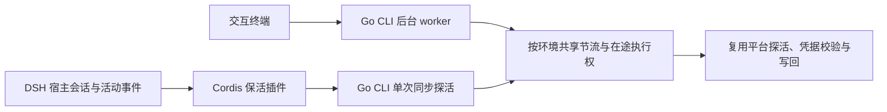

# Go CLI DeepSeek Harness 保活插件设计与分发方案

## 1. 背景与目标

DeepSeek Harness（DSH）会话此前由非交互 Shell 拉起 Go CLI 后台 worker，并用最近一次 CLI 活动刷新会话登记。新方案取消 DSH 会话的 CLI worker 和滑动登记，由安装并启用的 DSH 插件在宿主内调度，调用 Go CLI 完成单次同步探活。

| 使用场景 | 调度方式 | 用户可见行为 |
| --- | --- | --- |
| 普通交互终端，包括使用 `ML_SESSION_ID` 建立隔离的交互终端 | Go CLI 后台 worker | 按终端进程登记并保留 PID。同一环境有符合条件的 DSH 插件时待命 |
| 已安装并启用插件的 DSH | DSH 宿主定时调度单次探活 | 登录并选择业务后，由插件对该会话绑定的环境调度保活 |
| 未安装、停用或卸载插件的 DSH | 无自动保活 | 登录和业务命令照常使用，登录有效期按平台规则自然到期 |

首版面向 Windows DSH Desktop。Web 版须独立验证后再列为支持范围。插件独立离线分发，Go CLI 目标版本为 **1.1.1**。平台强制失效、宿主退出、长时间休眠或断网都可能使登录到期。插件按宿主进程生命周期运行，调度过程不创建会话消息或模型请求。

## 2. 总体架构与职责



- **DSH 插件**根据宿主提供的会话身份和生命周期确定调度目标，管理定时器、子进程、取消和脱敏日志。宿主插件作为用户显式安装的本地代码运行，入口不注册为 Agent 工具。插件只传递宿主会话身份，平台地址、业务选择和凭据由 Go CLI 解析。
- **Go CLI**维持 DSH 环境与租户隔离，按会话定位目标环境和业务，检查配置与停止状态，复用终端 worker 的平台探活和写回逻辑。两种调度来源共享环境级节流、请求互斥及登录失效判定。
- **分发与安装**负责生成离线包、验证适用的 DSH 和 CLI 构建、注册目标 Profile，以及升级和卸载时恢复配置。插件不随 Go CLI MSI 或便携 ZIP 分发。

## 3. Go CLI 配套改造

### 3.1 移除 DSH 后台 worker 路径

- 终端 worker 启动条件限定为交互终端、有效登录及已选业务。`SessionModeDSH` 优先排除，即使某次 DSH Shell 提供 TTY，也不会创建或加入后台 worker。`ML_SESSION_ID` 的交互终端保留现有行为。
- 核对 `login`、`env use`、业务选择、业务请求成功和 `auth ping start` 各入口。移除 DSH 对 `SessionActivity`、后台 worker 启动和旧会话登记续期的依赖。保留业务请求成功后的凭据续期，并记录实际平台活动，供两类调度共同节流。
- 移除 DSH 作为终端 worker 所有者的运行时逻辑。读取历史 `ping-go.json` 时，按已有文件锁清理旧 DSH 登记，让终端进程继续按 PID 身份登记。同一环境同时存在交互终端与 DSH 时，终端 worker 只使用终端所有者的上下文，插件只使用 DSH 上下文。会话状态清理应保护仍有有效宿主登记的 DSH 会话。
- 旧 worker 的识别使用内部协议及 PID 身份，不依赖公开版本号。Windows MSI 替换复用现有的 worker 暂停流程，保留用户停止标记。便携安装先退出旧 worker 并替换旧二进制。插件发现同一环境仍由旧协议 worker 运行时，跳过该环境并给出更新提示。

### 3.2 单次探活接口

```text
ml auth ping tick --capabilities
ml auth ping tick --json
```

- `--capabilities` 是插件启动时使用的本地兼容性检查，输出调度协议 `dsh-keepalive-v1`、CLI 版本和单次调用的时间预算。此检查无需登录，无网络请求，也不修改保活登记。
- `--json` 每次只处理一个由宿主指定的 DSH 会话。插件通过标准输入传入有长度限制的 JSON，包含协议标识、宿主实例标识、宿主提供的会话 ID 及操作 `tick` 或 `release`。`tick` 报到并按需探活，`release` 只撤销对应宿主的会话登记和执行权。CLI 校验输入及会话标识，协议、字段或会话身份无效时不执行探活。该输入用于定位本地会话，不作为鉴权凭证。
- CLI 保持普通命令对 `DSH_SHELL` 和 `DSH_SESSION_ID` 的原有隔离约定。插件作为宿主调用方使用独立的结构化输入，启动子进程时按 Windows 大小写不敏感规则移除继承的三个会话变量 `DSH_SHELL`、`DSH_SESSION_ID`、`ML_SESSION_ID`。
- 探活结果以一条有版本的 JSON 返回，区分已确认成功、未到期、未绑定、登录不可用、手动停止、正在执行、会话失效和瞬时失败。明确约定退出码、结果字段、可空字段与失败分类。给用户展示的时间按北京时间 `YYYY-MM-DD HH:mm:ss` 格式输出，内部时间比较用时间戳。诊断只记录必要的状态、请求 ID 和耗时。
- `login_expired` 单独表示本地可识别的凭据已到期，`expired` 表示平台登录态失效。可选字段 `last_confirmed_at`、`retry_pending` 和 `context_changed` 分别提供环境最近续期时间、重试等待和上下文已变更的提示。旧构建缺少这些字段时按实际已知状态显示。

### 3.3 目标及请求规则

1. 用宿主提供的会话 ID 定位既有 DSH 会话，通过 `LoadSessionState` 验证来源及身份，再取该会话的当前环境。无绑定、状态损坏或校验失败时跳过；候选范围就是该会话，不遍历历史会话、其他环境或全局业务。
2. 检查 `auth.auto_ping`、目标环境的 `policy.deny` 及持久化的手动停止标记。禁止 `auth ping start` 或 `auth ping tick` 均禁止插件探活；检查在发请求前和提交时生效。
3. 使用当前环境的有效登录及 `KeepaliveTarget` 复核租户和团队选择，以该会话当前环境的有效选定 `businessId` 设置请求头 `businessid`。业务目录和选择按现有本地状态校验路径读取，平台地址取自相应环境的 `config.json` 中的 `api_endpoint`。
4. 在 CLI 中复用 `platform.Session.Probe` 调用 `POST /ai/backend/mep/tenant/queryTeamList`。平台确认且本地更新通过后才续期。明确会话失效时暂停当前凭据代际的探活，凭据由重新登录替换后才允许再次尝试。连接异常等瞬时故障只记录失败并按退避时间重试。

### 3.4 节流、互斥和结果提交

- 按环境在 `ping-go.lock` 下检查最近活动、下次允许尝试时间及在途执行权。普通业务成功也会刷新环境最近活动，默认空闲满 `auth.ping_interval_minutes`（10 分钟）才允许发起探活。
- 终端 worker 和插件 tick 均须先取得在途执行权。记录请求 ID、执行来源、进程身份和截止时间后释放文件锁，再进行网络请求。固定冷却负责控制重试频率，在途记录负责防止重叠请求。
- 终端 worker 在申请执行权时检查同环境的 DSH 登记、插件策略、有效登录和会话业务选择。存在符合条件的会话时进入待命。已取得执行权的请求可以完成，后续请求由插件优先执行。最后一个符合条件的会话解除登记、切换环境、失去资格或报到满 10 分钟未续期后，仍有有效终端所有者和业务上下文的 worker 自动恢复，继续遵守同一环境的空闲间隔及重试时间。
- 写回沿用现有的状态、会话、登记加锁顺序。复用 `TryExtendKeepaliveCredentials` 校验凭据快照和业务上下文，再核对请求 ID、执行权、调度资格和手动停止标记。旧请求被替换、会话切换或注销后，其返回不能续期、覆盖新凭据或改写新请求的结果。
- 子进程超时、崩溃或被取消时，执行权在确认进程身份已失效或超过有界期限后回收。超时后发起的新请求属于重试；远端是否已处理上次请求需要结合请求 ID 查询。
- 处理凭据与登记文件两次写入之间的部分失败。凭据写入成功、登记写入失败时，下轮用新的凭据快照重新判断，不重放上次返回的 Cookie，不把失败的登记写回当成平台探活成功。

### 3.5 启停与状态展示

- **交互终端**的 `ml auth ping start` 继续登记终端并按需启动 worker。`ml auth ping status` 在待命时显示「DSH 托管，终端待命」及 worker PID，`ml auth status` 同步展示待命状态。
- **DSH** 的 `ml auth ping start` 仅在当前会话已有近期有效插件登记且环境和业务校验通过时，解除当前环境的手动停止，等待插件下次调度；无有效登记时提示安装、启用或检查插件。该命令始终不会在 DSH 中启动后台 worker。
- `ml auth ping stop` 继续作用于当前环境的两种调度来源，即使尚未创建该环境的保活记录也应保存停止标记。插件可继续报告自身存活，但不得探活；在途结果失去写回资格。注销及时取消相关登记或在途资格，`logout --all` 覆盖所有受影响环境。
- `ml auth ping status` 只读。DSH 侧按当前会话展示插件托管、手动停止、等待环境或业务、会话失效、调度过期或尚未登记。未绑定环境时仍可显示调度状态。分别展示插件最近报到、上次平台确认成功、下一次预计探活和最近错误；插件报到成功仅表示调度器可用。终端 worker 的存在不得显示为 DSH 插件已接管。
- 文件按职责拆分为调度入口、请求准入与提交、状态展示，尽量复用现有模块。新模块原则上小于 500 LoC。

## 4. DSH Cordis 插件

### 4.1 宿主会话与调度

- 先在目标 Desktop 版本验证宿主可通过服务或事件获取与 Shell 注入的 `DSH_SESSION_ID` 一致的会话 ID，并能识别恢复、用户活动、关闭和宿主重启。以宿主确认的会话状态为依据，普通对话可以刷新会话活动窗口，会话文件的修改时间不参与调度判断。
- 首版以宿主明确报告的当前会话及其活动时间调度。会话关闭或超过空闲窗口后暂停，恢复活动且仍有有效登录时继续。热重载后从宿主重新获取会话。无法确认事件能力、会话身份或当前活跃范围时暂停调度并记录原因。
- 通过 Cordis 生命周期管理事件、定时器和子进程。每个插件实例最多保留一个在途 `tick`，多个候选按轮转处理；同一会话合并重复触发。热重载、关闭会话、进入空闲暂停或卸载时取消对应调用，`AbortSignal` 必须传入子进程。宿主仍可调用 CLI 时按实例撤销登记；意外退出时由 CLI 按有界报到期限判定过期。报到期限至少覆盖一次正常轮询和调用预算，且不能用于启动 worker。多宿主间的去重由 CLI 的环境级执行权负责。
- 默认每 120 秒检查一次，宿主会话空闲窗口默认 120 分钟。插件对子进程设置外层超时，按 CLI 报告的单目标 HTTP 与写回预算加余量计算，覆盖默认 30 秒 HTTP 超时。构建时定义超时范围并验证短于该预算的配置会被拒绝。

### 4.2 可执行文件与日志

- 优先使用用户配置的 `mlPath` 绝对路径，随后读取 `HKCU\Software\WiseRec\CLIGo` 下的 `Path` 安装目录，最后检查当前 MSI 默认路径 `%LOCALAPPDATA%\Programs\WiseRecCLIGo\ml.exe`。便携安装使用显式路径。
- 使用绝对路径和固定参数数组调用 `execFile`，不经 Shell，设置 `windowsHide: true`，限制标准输出和标准错误的缓冲区。启动时和路径变更时先做协议探测，旧构建、缺失二进制或协议不兼容时暂停并限频告警。
- 通过带名称的 Cordis `ctx.logger` 记录调度启动、平台确认或未确认、登录失效和 CLI 异常。文件导出器只写本插件的指定事件，在 `%LOCALAPPDATA%\WiseRec\dsh-plugins\wiserec-cli\logs\` 按宿主 PID 保存 JSONL。文件按 256 KiB 轮转，正常跳过保持静默。
- 插件启动后及每 24 小时后台清理一次。仅清理该目录下符合插件命名且可确认宿主已退出的普通日志文件，按最后修改时间保留 7 天。插件日志总量超过 10 MiB 时从最旧的符合条件文件开始清理。保留运行中或无法确认已退出的宿主日志。并发清理通过同目录内的原子重命名取得文件清理权，中断或删除失败留下的临时文件纳入后续检查。卸载保留日志。
- 每轮结束向同一 JSONL 写入一次宿主级 `log_cleanup_completed`（`info`）或 `log_cleanup_failed`（`warn`）。记录 `trigger`（`startup` 或 `periodic`）、`expired_deleted`、`capacity_deleted` 和 `deleted_kb`，后三个字段只统计本轮确实删除的文件。按 1 KB = 1024 字节换算，结果最多两位小数。失败摘要保留已删除量，并记录 `scan_failed` 或 `delete_failed`。另外一个宿主已删除的文件正常跳过。清理记录省略路径、原始错误、会话及请求字段。
- 会话级事件记录宿主提供的 `session_id`，环境 `env` 取自 CLI 实际解析结果，`request_id` 取自实际探活结果。未取得的字段省略。异常只使用固定错误分类，原始凭据、接口响应和子进程输出不进入日志。
- 随包 `config.json` 集中维护保活和日志默认值。Windows 首次启用时在 `%LOCALAPPDATA%\WiseRec\dsh-plugins\wiserec-cli\config.json` 预填日志参数，保留旧 Profile 的保活设置。显式用户字段优先于旧 Profile，再使用包内默认值。重启宿主读取新设置，升级保留用户文件。
- `logging` 配置日志子目录、单文件轮转阈值、目录容量上限、日志保留分钟数和清理间隔分钟数。写入与清理使用同一子目录。日志配置无效或文件不可读取时发出字段级 `config_invalid` 告警并暂停自动清理，保活和日志写入继续运行。Windows 快速测试时使用独立的 `logs-test`，保留 2 分钟，每 1 分钟清理一次。

### 4.3 包与依赖

插件源码维护在 `dsh-plugin/wiserec-cli/`，按需拆分入口、宿主活动和子进程调用模块。交付包包含预构建的 ESM、`package.json`、`cordis.patch.yml` 和使用说明。Bundle 在 `dsh.bundle.patch` 声明入口，并在 `engines.dsh` 中声明最低宿主版本。目标 Desktop 已验证的版本、Cordis API 和加载方式在验收记录中列明。

优先仅使用 Node.js 内置模块，宿主类型依赖在构建时擦除。若运行时保留 Schemastery 等宿主依赖，应验证目标 Desktop 对本地包的解析和版本兼容；可离线解析的运行时依赖及来源应写入分发说明。构建环境可安装锁定的开发依赖，最终用户安装和加载不依赖全局 Node.js、pnpm 或外网。

### 4.4 会话行标识

- Bundle 的 `./client` 模块用 DSH 自带的 React 和客户端插槽在会话行尾注册状态图标，在会话悬浮卡片注册文字详情。使用宿主的 `sessionId` 定位。
- 客户端每 10 秒从 DSH 已认证、仅宿主所有者可访问的只读接口获取状态。宿主把最近一次检查结果保存在内存中，关闭会话时移除，超过三个调度间隔的检查结果显示为灰色。浏览状态不会触发平台请求或激活历史会话。
- 绿色表示保活正常，红色仅用于本地登录已到期或平台明确返回失效，黄色表示网络、检查或重试等待期间暂未确认。未绑定、未登录、未选业务和暂停使用灰色。悬浮卡片展示实际已知的环境和北京时间，不包含凭据、请求 ID 或业务数据。

### 4.5 会话自动标题

- 插件通过 `ml context --json` 读取已打开会话的本地状态。登录有效时使用 `{环境标识}环境`，有有效租户名称时使用 `{环境标识}环境 · {租户名}`。选择团队时，租户名取团队所属的租户。缺少租户名称时仅显示环境。登录过期或退出后保留最近一次确认的标题。
- 会话打开、操作结束和定时刷新时触发读取。插件按宿主的会话 ID 查询，并在改名前确认当前仍是同一个会话。改名使用 DSH 的 `sessionTitle.rename` 服务，宿主据此持久化并固定标题。
- 插件记录自己写入的标题事件，用户手动改名后优先保留该标题，重启后也按同一规则处理。标题功能包含在两种打包范围内。宿主缺少标题服务或 CLI 未提供相关字段时跳过标题更新。

## 5. 版本和离线分发

- 本次 Go CLI 实施按指定版本 **1.1.1**，`components.cli_go`、`ml --version`、MSI 与便携 ZIP 的版本元数据保持一致。插件兼容性以单次探活协议探测为准，`1.1.1` 的旧构建可能缺少该能力。已正式发布的同版本标签及附件按仓库发布规则保持不可变。
- 插件使用独立版本 `components.dsh_plugin`，首版规划 `0.1.0`，由 `scripts/sync_versions.py` 同步到插件包元数据，并由 `--check` 校验。当前设计修订不变更版本源文件。
- `build.cmd` 直接生成 `dsh-wiserec-cli-<版本>.tgz`，供 Desktop 插件管理器本地安装。包内 `release.json` 记录插件版本、所需 CLI 调度协议和版本、DSH 版本范围、Windows 架构及源提交。打包窗口输出文件路径和 SHA-256。
- Windows CI 执行插件、CLI 和打包检查，校验 `.tgz` 的目录、内容、哈希和版本一致性。Desktop 本地加载与保活结果由实机验收确认。

## 6. Windows 安装、升级和卸载

1. **先验证宿主的本地安装入口。** 在目标 Desktop 版本通过插件管理器安装本地 Bundle，断网且无全局 Node.js/pnpm 时验证加载、事件订阅和无网络的 CLI 能力探测。确认实际使用的 DSH_HOME 与 Profile，Desktop 和 Web 各自登记。默认目录与本地安装形式以目标版本实测结果为准。
2. **准备适用于受控环境的脚本路径。** 若已验证的宿主不支持所需离线本地安装，才采用精确挂载 Profile 的工具。将包放入稳定的用户安装目录，例如 `%LOCALAPPDATA%\WiseRec\dsh-plugins\wiserec-cli\<版本>\`，用 URL 库生成绝对文件 URL，并验证打包后的 Desktop 可以解析。默认只操作用户选定的 Profile。脚本用与宿主配置兼容的解析器修改指定条目，保留其余条目，备份后以 UTF-8 无 BOM 原子写入；配置或文件更换失败时恢复原状态。在宿主可能同时写配置时要求其先完全退出。
3. **升级使用版本化目录。** 先部署并验证新包，再切换指定 Profile 的注册，保留上一目录和配置用于回滚。按目标 Desktop 版本的行为提示完全退出，包括托盘，再重启验证插件加载和 CLI 能力探测。
4. **卸载以 Profile 为单位。** 从选定 Profile 移除登记，只有其他 Profile 均未引用该版本才清理共享文件。卸载后 DSH 自动保活停止，用户仍可执行正常登录和业务命令；交互终端的保活入口继续可用。

## 7. 实现时同步的文档与 Skill

- `docs/WiseRec CLI 使用手册.md` 更新命令树、`auth ping` 章节及环境切换相关说明，明确终端与 DSH 的启停条件、插件依赖、状态含义和示例。维持“命令格式 / 参数与选项 / 说明 / 示例”结构，版本写在发布材料。
- 同步 `skill/wiserec-platform/SKILL.md` 和 `references/session.md`，清理 DSH 旧 worker 和滑动登记说明。`tick` 标注为插件接口，Agent 不应把它当作业务命令调用，也不手工构造宿主会话标识。更新 `scripts/skill_index/commands.md.in` 后运行生成与 `--check`。
- README、CLI 安装说明和相应分发说明记录离线包入口、兼容性探测、安装及卸载后的行为。实现时检查实际 `ml tree` 各层级说明的末尾标点、版本同步及打包元数据一致性。

## 8. 验收与实施顺序

### 8.1 先验证 Desktop 能力

使用目标 Windows Desktop 版本和全新 Profile。断网安装最小预构建 Bundle，验证宿主能加载、取到可对应的会话 ID、收到活动和关闭事件、调用 CLI 能力探测及正确执行卸载清理。以此结果确定支持范围和离线安装方式，再进入业务联调。

### 8.2 CLI 与插件回归

- 覆盖 DSH 的登录、切换环境、选择业务、成功业务请求及 `ping start`，确认均不拉起后台 worker。覆盖普通交互终端和 `ML_SESSION_ID` 交互终端的保活、PID 展示及手动启停。
- 验证插件只请求指定会话的环境及选定业务。未知、未绑定、损坏或已关闭的会话，以及停用策略命中的环境，不发送探活请求。分别在同一环境和不同环境建立不同租户的会话，断言实际请求使用该次调度对应会话的 `businessid` 和环境地址。
- 覆盖两个宿主实例、终端与插件并发、慢请求、子进程强制终止、登记写入失败、同环境切换业务、手动停止、注销、平台失效和重登。并发用例核对平台实际请求次数，确认在途旧响应不能提交、执行权能回收，新登录可以按用户启停状态恢复。
- 验证同一环境同时使用 CMD 和 DSH 时只由有资格的 DSH 会话发起到期探活。最后一个有资格的 DSH 会话退出、报到过期或切到其他环境后，确认同一个终端进程按间隔接手，并使用终端所选业务。
- 验证早于首个 tick 的手动停止、老版本登记读取、同版旧二进制被识别，以及插件挂载、热重载、取消、退出、配置保留、重复安装和按 Profile 卸载。

### 8.3 Windows 实机端到端

1. 先以未安装插件的 DSH 会话完成登录及业务选择，验证没有 worker PID、没有后台平台探活，业务查询可正常执行。
2. 安装并启动插件，在同一环境做两轮测试。一轮持续普通对话，一轮完全空置，每轮超过原有默认登记周期且持续至少 40 分钟，期间不执行业务命令。记录多轮平台确认的时间和请求 ID，再检查登录状态与业务查询。
3. 覆盖关闭会话、超出空闲窗口、恢复会话、停止后重新启用、卸载及宿主重启。检查预期的停发和恢复；连接断开后只对仍符合条件的目标重新探活。
4. 同时使用两个宿主实例和一个交互终端。验证同一环境只有一个在途请求，切换环境或卸载一个 Profile 不影响其他仍有资格的来源。Web 版须独立完成适用场景的离线安装和实机验收后再公布支持。

实施顺序为 **Desktop 能力验证 → 单会话探活与终端 worker 改造 → 并发和启停回归 → 独立离线包与实机验收**。本文记录设计和验收条件，实机结果在执行后另行记录。
