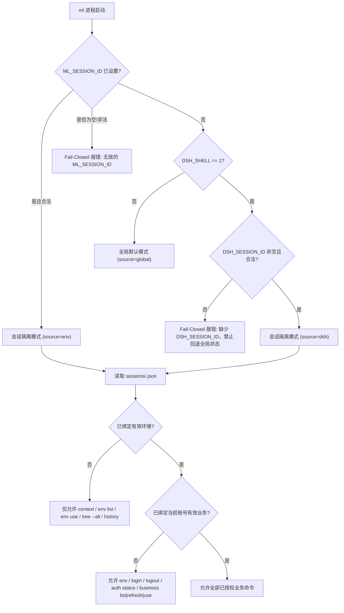
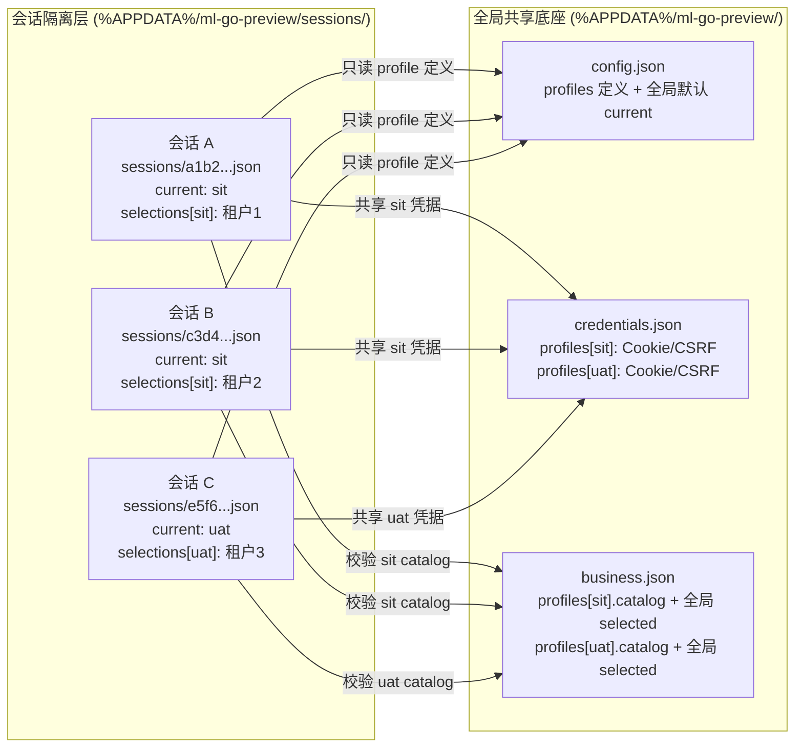
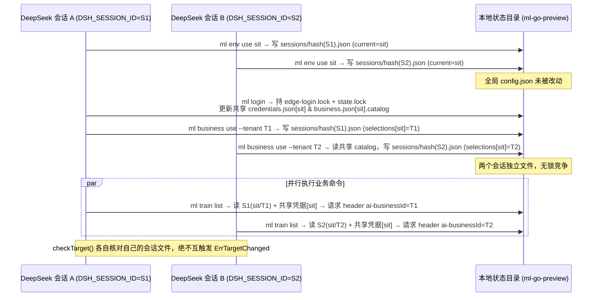

# Go CLI 多会话环境与租户隔离设计方案

> **适用范围**：Go 客户端（`cli-go`）与配套技能说明（`skill/wiserec-platform`）。
>
> **设计定位**：本文档为开发前完整设计方案，覆盖问题背景、核心原理、基本功能、详细模块设计、并发边界、Skill 同步与测试验收方案。本方案**无需二次开发或改造 DeepSeek Harness**，也**不新增 CLI 命令行参数**。

---

## 一、背景与问题分析

### 1.1 业务诉求

随着用户广泛通过 **DeepSeek Harness** 搭配 WiseRec Go CLI（`ml`）与 `wiserec-platform` Skill 执行平台研发、训练、部署和排查任务，出现了强烈的**多会话并行作业**诉求：

- 用户希望在 DeepSeek Harness 中同时开启多个独立会话（例如会话 A 操作 `sit` 环境的租户 1，会话 B 操作 `uat` 环境的租户 2，会话 C 操作 `product` 环境的只读排查）。
- 多个会话并行执行时，各自的环境与租户上下文必须严格隔离、互不干扰，避免频繁手动来回切换，更不能出现写操作误打到错误环境或错误租户的事故。

### 1.2 现状架构与串台根因

分析当前 `cli-go` 的本地状态架构（`%APPDATA%\ml-go-preview\`），状态文件实际上分为两类性质完全不同的数据：

| 状态文件 | 现有结构 | 多会话并发性质 |
| --- | --- | --- |
| `credentials.json` | `profiles[profileName]` 分桶存储登录凭据（Cookie、CSRFToken、Username、StateID、有效期） | **天然可共享**：按环境分桶，同一环境只需登录一次，多会话可共用 |
| `business.json`（`catalog` 部分） | `profiles[profileName].catalog` 分桶存储部门/租户/团队目录 | **天然可共享**：按环境分桶，目录数据所有会话一致 |
| `config.json`（`current` 字段） | 全局唯一字符串，记录当前生效环境 | **全局单例冲突点**：任一会话执行 `ml env use` 都会覆盖全局指针 |
| `business.json`（`selected` 字段） | `profiles[profileName].selected`，每个环境仅保留一份全局选中业务 | **全局单例冲突点**：同一环境下两个会话选不同租户时互相覆盖 |

在现有实现下，多会话并行会导致两类严重问题：

1. **上下文静默串台**：会话 A 执行 `ml env use prod && ml business use --tenant X` 后，会话 B 执行 `ml env use sit && ml business use --tenant Y`，紧接着会话 A 的下一条命令会在毫无察觉的情况下打到 `sit / Y`（反之亦然，甚至把测试命令误打到 `product`）。
2. **并发触发 `ErrTargetChanged`**：`cli-go/internal/platform/session.go` 中的 `API.checkTarget()` 会在执行前后回读全局 `config.json` 与 `business.json`。一旦并发会话修改了全局指针，正在执行中的会话会直接报错中断：`执行期间环境、账号或业务已变化，请重新核对后执行`。

### 1.3 为什么“提示词 + `--session` 参数”不可靠

在设计初期容易想到“给 CLI 加 `--session <id>` 参数，让 Skill 要求 LLM 每次调用都带上”。但该思路存在本质缺陷：

- **LLM 会遗忘参数**：长对话触发上下文压缩（Compaction）或多轮工具调用后，模型极易漏传 `--session` 或传错会话 ID。
- **静默回退极其危险**：一旦模型漏传参数而 CLI 退回全局默认配置，就可能把写操作直接发往全局残留的 `product` 环境。
- **结论**：多会话隔离不能依赖 LLM 的自觉性，必须建立在**宿主运行时强制注入 + CLI 代码层 Fail-Closed 硬拦截**之上。

---

## 二、核心设计目标与已确认决策

### 2.1 设计目标

1. **强制隔离、绝不串台**：多个 DeepSeek Harness 并行会话各自维护独立的环境与租户选择，物理文件隔离，互不覆盖。
2. **对 LLM 零心智负担**：不要求 LLM 记忆或拼接任何额外命令行参数；LLM 仍沿用原有 `ml env use` / `ml business use` / 业务命令用法。
3. **Fail-Closed 安全兜底**：新会话未绑定环境或租户时，CLI 必须在代码层直接报错拦截，绝不静默回退到全局默认配置。
4. **登录态与业务目录共享**：沿用按 `profile` 分桶的 `credentials.json` 与 `catalog`，同一环境只需 `ml login` 一次即可被所有会话复用，无需每个会话重复打开 Edge 登录。
5. **100% 向后兼容人工终端**：用户在普通 PowerShell / CMD / Terminal 中手工运行 `ml` 时，完全保持原有全局配置行为与使用习惯。
6. **并发安全与低侵入**：不破坏现有文件锁机制、命令树（`ml tree`）及后台保活稳定性；模块拆分符合 `< 500 LoC` 的可维护性规范。

### 2.2 已确认的 3 项关键设计决策

以下 3 项设计取舍已明确拍板：

1. **新会话默认策略 —— Fail-Closed（严禁继承全局配置）**
   - 新开启的隔离会话默认处于“未绑定环境、未绑定租户”状态。
   - 任何依赖环境或业务的命令都会被直接拦截并给出明确绑定引导，绝不继承全局 `config.json` 的 `current` 或 `business.json` 的 `selected`。
2. **会话内执行 `ml login` 的租户绑定策略 —— 已有则保留、未绑且唯一则自动绑定**
   - 会话模式下执行 `ml login` 时，刷新共享的 `credentials.json` 和 `business.json` 的 `catalog`（供同环境所有会话复用）。
   - 对**当前会话**在该环境的业务绑定：若当前会话已存在有效绑定（同账号且仍在最新 `catalog` 中），则保持原绑定不变；若当前会话在该环境尚未绑定，且 Edge 页面返回了唯一可匹配的 `browserBusinessID`，则自动绑定到**当前会话**（不影响全局与其他会话）。
3. **环境变量支持策略 —— 同时支持 `ML_SESSION_ID` 与 `DSH_SESSION_ID`，不新增 CLI 参数**
   - 会话标识读取优先级：`ML_SESSION_ID` > `DSH_SESSION_ID`（当 `DSH_SHELL=1` 时）。
   - 不新增 `--session` 等 CLI 全局参数，不改变 `ml tree` 命令结构；`ML_SESSION_ID` 既便于本地单元测试与回归测试，也为未来接入其他 Agent Harness 或人工多终端隔离预留统一入口。

### 2.3 非目标与范围边界

- **不改造 DeepSeek Harness**：不二开 Harness 源码，也不依赖安装额外 Harness 插件或 Hook。
- **不改动权限管理系统与服务端接口**：不修改 `access-service` 或后端接口协议。
- **不改动 Python CLI**：本方案仅针对 Go 客户端（`cli-go`）与配套 `skill/wiserec-platform`。
- **不按会话复制凭据与 Edge Profile**：`credentials.json` 和专用 Edge 浏览器目录继续按 `profile` 维度共享。

---

## 三、核心原理：运行时强制注入与双层状态隔离

### 3.1 DeepSeek Harness 环境变量注入原理

DeepSeek Harness（`@deepseek-ai/dsh`）内置了核心环境管理模块 `@deepseek-ai/dsh-shell-env`（`ctx.shellEnv`）：

- **谁控制**：由 DeepSeek Harness 宿主运行时内置控制，属于框架注册表保留键，不归 LLM 控制，无需用户手动配置。
- **何时注入**：**每一次** Agent 调用 Shell 工具（Windows 下 `dsh-tool-pwsh`、Linux/macOS 下 `dsh-tool-bash`）启动前景或背景子进程时，Harness 在 `spawn` 子进程的那一刻实时注入当前会话的环境变量快照。
- **核心变量（已在 Windows DeepSeek Harness 多会话实测验证）**：
  - `DSH_SHELL=1`：明确标识当前进程运行在 DeepSeek Harness 托管 Shell 中。
  - `DSH_SESSION_ID=<唯一会话ID>`：来自当前会话唯一标识；同一会话内多次工具调用稳定一致，并行会话严格不同。

由于注入发生在操作系统进程创建边界，**LLM 无法遗忘、上下文压缩无法丢失**，从根本上解决了“靠提示词记参数”的不可靠问题。

### 3.2 运行模式判定与决策流程

`cli-go` 进程启动时，在 `localstate` 层统一根据环境变量解析出当前进程的 `SessionScope`：

| 条件（按优先级从高到低判定） | 判定模式 | 会话来源 (`source`) | 行为规则 |
| --- | --- | --- | --- |
| `ML_SESSION_ID` 存在且非空 | **显式会话隔离模式** | `"env"` | 读写 `sessions/<hash("env:" + id)>.json`，Fail-Closed |
| `DSH_SHELL == "1"` 且 `DSH_SESSION_ID` 非空 | **DSH 会话隔离模式** | `"dsh"` | 读写 `sessions/<hash("dsh:" + id)>.json`，Fail-Closed |
| `DSH_SHELL == "1"` 且 `DSH_SESSION_ID` 为空 | **异常拦截模式（Fail-Closed）** | `"dsh-missing"` | **直接报错拒绝执行**，严禁退回全局配置导致多会话串台 |
| 其他情况（普通本地终端） | **全局默认模式** | `"global"` | 沿用现有 `config.json` + `business.json` 全局读写 |

> **说明**：为防止 `ML_SESSION_ID=""` 或仅空白字符绕过校验，若检测到环境变量存在但去除空白后非法（如含控制字符、超长 > 256 字符、或 `ML_SESSION_ID` 已设置但为空白），直接按无效会话标识报错拦截，不做静默降级。



### 3.3 双层状态架构（共享底座 + 独立会话指针）



**架构优势**：
- **互不干扰**：会话 A 与会话 B 即使操作同一个 `sit` 环境、不同租户，也完全读写各自的独立文件，物理隔离。
- **免重复登录**：会话 A 登录 `sit` 后，会话 B 直接复用 `credentials.json` 中的 `sit` 登录态与 `business.json` 中的 `sit` 目录。
- **全局无污染**：会话内的 `ml env use` / `ml business use` 绝不改写全局 `config.json` 和 `business.json`，人工在本地终端的操作也不会被 Agent 会话打断。

---

## 四、基本功能与命令行为规范

### 4.1 四种运行态定义

| 运行态 | 环境 (`current`) | 业务 (`businessId`) | 典型场景 |
| --- | --- | --- | --- |
| **全局默认态** | 来自 `config.json`（含内置默认） | 来自 `business.json` 全局 `selected` | 用户自己在 PowerShell / CMD 手工使用 |
| **会话未绑定环境态** | 空（未绑定） | 空（未绑定） | DeepSeek Harness 新开会话，尚未执行 `ml env use` |
| **会话仅绑定环境态** | 来自 `sessions/<hash>.json` | 空（未绑定或已失效） | 新会话已执行 `ml env use`，尚未选租户（或刚换环境） |
| **会话完整绑定态** | 来自 `sessions/<hash>.json` | 来自 `sessions/<hash>.json` 的 `selections[env]` | 正常并行执行训练、部署、查询、Jupyter 等全部业务命令 |

### 4.2 会话模式下的命令放行与拦截矩阵

| 命令类别 | 具体命令 | 未绑定环境态 | 仅绑定环境态 | 完整绑定态 | 备注 |
| --- | --- | --- | --- | --- | --- |
| **元信息与帮助** | `ml --version` / `--help` / `completion` | ✅ 放行 | ✅ 放行 | ✅ 放行 | 不依赖环境 |
| **上下文诊断** | `ml context [--json]` | ✅ 放行（展示 `未绑定`） | ✅ 放行（业务显示 `未绑定`） | ✅ 放行 | 输出新增会话相关字段 |
| **命令树** | `ml tree --all` | ✅ 放行（展示全量树，环境标 `未绑定`） | ✅ 放行 | ✅ 放行 | 便于新会话查询可用命令 |
| **命令树（按环境）** | `ml tree` | ❌ 报错引导 `ml env use` 或 `ml tree --all` | ✅ 放行 | ✅ 放行 | 依赖具体环境的平台类型与禁用规则 |
| **本地历史** | `ml history list/clear` | ✅ 放行 | ✅ 放行 | ✅ 放行 | 记录当前会话环境（未绑定记 `null`） |
| **环境列表** | `ml env list` | ✅ 放行（无 `*` 标记） | ✅ 放行（`*` 标记当前会话环境） | ✅ 放行 | 不改写任何状态 |
| **环境切换** | `ml env use <NAME>` | ✅ 放行（写入当前会话文件） | ✅ 放行（更新当前会话文件） | ✅ 放行 | 不写全局 `config.json`，不触发 `keepalive.Detach` |
| **环境查看** | `ml env show` | ❌ 报错引导 `ml env use` | ✅ 放行 | ✅ 放行 | 展示当前会话环境 |
| **登录/登出** | `ml login` / `ml logout` | ❌ 报错引导 `ml env use` | ✅ 放行 | ✅ 放行 | 凭据按 `profile` 共享；见 4.4 规则 |
| **认证状态** | `ml auth status` | ❌ 报错引导 `ml env use` | ✅ 放行（`businessId` 为 `-`） | ✅ 放行 | 读取当前会话的 `businessId` |
| **保活管理** | `ml auth ping start/stop/status` | ❌ 报错引导 `ml env use` | ✅ 放行（按 `profile` 查看/控制） | ✅ 放行 | 非交互终端仍不自动启动保活 |
| **业务目录/刷新/切换** | `ml business list/refresh/use` | ❌ 报错引导 `ml env use` | ✅ 放行 | ✅ 放行 | `list` 的 `*当前` 指向当前会话选择；`use` 只写当前会话文件 |
| **当前业务查看** | `ml business show` | ❌ 报错引导 `ml env use` | ❌ 报错引导 `ml business use` | ✅ 放行 | 严格校验会话选择有效性 |
| **全部业务与权限命令** | `train` / `sample-task` / `model` / `deployment` / `resource` / `service` / `dataset` / `featureset` / `feature-task` / `quality` / `algorithm` / `offline` / `mtp` / `jupyter` / `webstudio` / `user info` / `access status` | ❌ 报错引导 `ml env use` | ❌ 报错引导 `ml business use` | ✅ 放行 | 全部经由 `platform.Session.Authorize` 统一门禁 |

**统一错误文案规范**（清晰可操作，便于 LLM 自动识别下一步）：
- 缺少 `DSH_SESSION_ID`：`检测到 DeepSeek Harness 托管环境（DSH_SHELL=1），但缺少有效的 DSH_SESSION_ID，已拒绝回退到全局配置以防多会话串台`
- 未绑定环境：`当前会话尚未绑定环境，请先执行 ml env use <环境名>（可用 ml env list 查看可选环境）`
- 未绑定业务：`当前会话在环境 <env> 下尚未选择业务，请先执行 ml business use --tenant <租户ID>（可用 ml business list 查看可选业务）`
- 会话业务失效（账号切换或权限回收）：`当前会话在环境 <env> 下的业务绑定已失效（账号变化或权限变更），请重新执行 ml business use --tenant <租户ID>`

### 4.3 `ml context [--json]` 输出增强规范

为了便于用户和 Agent 一眼核对当前是全局模式还是多会话隔离模式，`ml context` 与 `ml context --json` 保留所有既有字段，并补充会话可观测字段：

| 字段 Key | 全局默认模式示例 | 会话隔离模式（未绑定）示例 | 会话隔离模式（已绑定）示例 |
| --- | --- | --- | --- |
| `运行模式` | `Go CLI` | `Go CLI` | `Go CLI` |
| `上下文模式` | `全局默认` | `会话隔离 (dsh)` | `会话隔离 (dsh)` / `会话隔离 (env)` |
| `会话 ID` | `-` | `<DSH_SESSION_ID>` | `<DSH_SESSION_ID>` |
| `当前环境` | `sit` | `未绑定` | `sit` |
| `当前业务` | `biz-001`（无则 `未绑定`） | `未绑定` | `biz-001` |
| `CLI 版本` | `1.0.x` | `1.0.x` | `1.0.x` |
| `CLI 路径` | `.../ml.exe` | `.../ml.exe` | `.../ml.exe` |
| `配置路径` | `.../config.json` | `.../config.json` | `.../config.json` |
| `会话文件` | `-` | `.../sessions/<hash>.json` | `.../sessions/<hash>.json` |
| `状态目录` | `.../ml-go-preview` | `.../ml-go-preview` | `.../ml-go-preview` |

> **兼容性注意**：`output.Fields` 输出为键值对数组或表格，新增字段不改变既有字段名（`运行模式`、`当前环境`、`CLI 版本`、`CLI 路径`、`配置路径`、`状态目录`），现有解析脚本与 Skill 校验保持兼容。

### 4.4 关键命令的会话行为细节

1. **`ml env use <NAME>`**
   - 校验 `<NAME>` 存在于内置 `profiles` 中。
   - **会话模式**：仅更新 `sessions/<hash>.json` 的 `current` 与 `updated_at`，**不修改全局 `config.json`**；同时保留该会话在其他环境已保存的 `selections[otherEnv]`（例如会话 A 从 `sit` 切去 `uat` 再切回 `sit`，原本在 `sit` 的租户绑定仍然记住且会重新校验有效性）。
   - **保活防误杀**：会话模式下切换环境**不调用 `keepalive.Detach`**，避免关闭其他并行会话仍在使用的旧环境保活进程。
   - **提示信息**：若新切换的环境在该会话下尚未绑定业务，在 `stderr` 追加提示：`[提示] 当前会话在环境 <NAME> 下尚未选择业务，请运行 ml business use --tenant <租户ID>`。

2. **`ml business use --tenant <T> [--team <K>] [--department <D>]`**
   - 从共享的 `credentials.json` 和 `business.json` 读取当前环境的登录态与 `catalog`，复用 `chooseBusiness()` 做精确匹配与歧义校验。
   - **会话模式**：校验通过后仅写入 `sessions/<hash>.json` 的 `selections[profile.Name]`（附带 `username`），**绝不改写全局 `business.json` 中的 `selected`**。

3. **`ml business list`**
   - 展示共享 `business.json` 中当前环境的完整 `catalog`。
   - `*当前` 标记依据**当前生效上下文**（会话模式读 `sessions/<hash>.json`，全局模式读 `business.json`）；若当前会话未选择业务，列表正常输出但无 `*当前` 标记。

4. **`ml login` 与 `ml business refresh`**
   - 两者均通过 `LockLogin()` 串行保护 Edge 浏览器登录，并通过 `LockState()` 原子更新共享 `credentials.json` 与 `business.json`（更新 `catalog` 和新 `StateID`）。
   - **全局 `business.json` 的 `selected` 保护**：在会话模式下执行 `ml login` / `ml business refresh` 时，全局 `business.json` 的 `selected` 沿用原有规则维护（同账号且有效则保留），不因会话操作破坏人工终端习惯。
   - **当前会话的 `selections[profile]` 处理（已确认决策 2）**：
     - 若当前会话在 `profile` 下**已有**选择，且 `selection.Username == creds.Username` 且仍匹配最新 `catalog`：保持原选择不变。
     - 若当前会话在 `profile` 下**无有效选择**（首次登录、账号变更、或原租户已失效），且浏览器返回了唯一可匹配的 `browserBusinessID`：自动写入当前会话的 `selections[profile]`，并在 `ml login` 输出表中展示该 `businessId`。
     - 若浏览器未返回唯一可匹配业务：清空当前会话在该环境的失效绑定，并提示用户执行 `ml business use --tenant <租户ID>`。
     - 特别地，对于 `ml business refresh`：只刷新目录并在原会话选择仍有效时保留，不因为刷新目录意外篡改已选租户。

---

## 五、详细设计逻辑（按模块拆解）

### 5.1 存储模型与文件布局

#### 目录结构
```text
%APPDATA%\ml-go-preview\
├── config.json                     # 全局默认环境选择（仅全局模式写）
├── credentials.json                # 按 profile 分桶的共享登录凭据
├── business.json                   # 按 profile 分桶的共享 catalog + 全局默认 selected
├── state.lock                      # 共享状态文件锁
├── edge-login.lock                 # Edge 登录互斥锁
├── ping-go.lock / ping-go.json     # 后台保活状态
├── history.jsonl / history.lock    # 命令执行历史
├── edge\                           # 按 profile 隔离的专用 Edge Profile
└── sessions\                       # [新增] 多会话隔离指针目录（权限 0700）
    ├── <sha256_prefix_32>.json     # 会话 A 状态文件（权限 0600，原子 rename 写）
    └── <sha256_prefix_32>.json     # 会话 B 状态文件
```

#### 会话文件名哈希规则
- 为彻底杜绝外部环境变量中的特殊字符（`/`, `\`, `:`, `..`, 空格等）引起路径穿越或 Windows 非法文件名，对会话键做固定前缀 SHA-256 哈希：
  ```go
  // scopeKey = source + "\x00" + sessionID，例如 "dsh\x00sess_abc123"
  sum := sha256.Sum256([]byte(scope.Source + "\x00" + scope.ID))
  filename := fmt.Sprintf("%x.json", sum[:16]) // 32 位十六进制，足够抗碰撞且路径短
  ```

#### 会话文件 JSON Schema
```json
{
  "version": 1,
  "source": "dsh",
  "session_id": "sess_01JXYZ...",
  "current": "sit",
  "selections": {
    "sit": {
      "username": "zhangsan",
      "department_id": "dept-001",
      "tenant_id": "tenant-a",
      "team_id": "team-01",
      "businessId": "biz-1001"
    }
  },
  "updated_at": "2026-11-19T14:55:00+08:00"
}
```

#### 关键设计逻辑说明
1. **为什么 `selections` 记录 `username` 而不绑定 `credentials.StateID`？**
   - `StateID` 在每次 `ml login` 或 `ml business refresh` 都会重新生成。
   - 若会话选择强绑定 `StateID`，则会话 B 帮大家续期登录 `sit` 时，会话 A 会被无故踢断。
   - 改为记录 `username` + 实时核对 `matchesSelection(latestCatalog, sel)`：
     - **同账号续期登录**：`username` 一致且租户仍在目录中 → **所有并行会话无缝续期、零中断**。
     - **切换为另一账号登录**或**该账号某租户权限被回收**：校验立即失败 → **安全拦截、绝不越权或错用**。
2. **为什么不直接把会话文件锁和全局 `state.lock` 混用？**
   - 单会话文件写入采用 `WritePrivate`（临时文件 + 原子替换，且单会话按自身 `<hash>.lock` 或直接原子替换保护），与共享 `credentials.json`/`business.json` 解耦；仅在需要同时校验或写入共享状态（如 `SelectBusiness`、`SaveLogin`）时持有 `state.lock`，避免锁顺序死锁。
3. **惰性 TTL 清理机制（GC）**
   - 每次写入会话文件（`UseEnvironment`、`SelectBusiness`、`SaveLogin`）成功后，执行一次轻量非阻塞惰性清理（失败不影响主流程）：
     - 扫描 `sessions/*.json`；
     - 跳过当前正在使用的会话文件；
     - 若文件 `ModTime`（或内容 `updated_at`）距今超过 **7 天**（可通过常量 `sessionTTL = 7 * 24 * time.Hour` 定义），自动删除该过期会话文件。
   - 防止长期高频开启 DeepSeek Harness 会话导致 `sessions/` 目录无限膨胀。

---

### 5.2 `cli-go/internal/localstate` 改造设计

遵循模块 `< 500 LoC` 原则，新增独立文件 `cli-go/internal/localstate/session.go`，并对既有文件做最小必要改造：

#### 1. 新增 `cli-go/internal/localstate/session.go`（核心会话层，预计 ~220 LoC）
- 定义核心结构：
  ```go
  type SessionMode string

  const (
      SessionModeGlobal  SessionMode = "global"
      SessionModeDSH     SessionMode = "dsh"
      SessionModeEnv     SessionMode = "env"
      SessionModeInvalid SessionMode = "invalid"
  )

  type SessionScope struct {
      Mode   SessionMode
      ID     string
      Err    error // 非 nil 时，所有受控操作 Fail-Closed 报错
  }

  type SessionSelection struct {
      Username     string `json:"username"`
      DepartmentID string `json:"department_id"`
      TenantID     string `json:"tenant_id"`
      TeamID       string `json:"team_id"`
      BusinessID   string `json:"businessId"`
  }

  type SessionState struct {
      Version    int                         `json:"version"`
      Source     string                      `json:"source"`
      SessionID  string                      `json:"session_id"`
      Current    string                      `json:"current"`
      Selections map[string]SessionSelection `json:"selections,omitempty"`
      UpdatedAt  time.Time                   `json:"updated_at"`
  }
  ```
- 核心函数：
  - `DetectSessionScope(getenv func(string) string) SessionScope`：可注入 `getenv`，方便单元测试覆盖全部环境变量组合。
  - `(p Paths) SessionFile() string`：返回 `sessions/<sha256[:16]>.json` 路径（全局模式返回 `""`）。
  - `(p Paths) IsSessionIsolated() bool`：判断是否为隔离会话模式。
  - `(p Paths) LoadSessionState() (SessionState, bool, error)`：读取当前会话文件（文件不存在返回 `exists=false, err=nil`；JSON 损坏或 `version != 1` 或 `session_id` 不匹配返回明确错误，绝不静默回退）。
  - `(p Paths) SaveSessionState(state SessionState) error`：设置 `Version=1`、`UpdatedAt=time.Now()`，使用 `WritePrivate` 原子写入，并触发惰性 TTL 清理。
  - `(p Paths) CleanupExpiredSessions(now time.Time, ttl time.Duration)`：惰性清理过期会话文件。
  - 统一哨兵错误：`ErrSessionEnvUnbound`、`ErrSessionBusinessUnbound`、`ErrSessionInvalid`。

#### 2. 改造 `cli-go/internal/localstate/config.go` 与 `config_seed.go`
- `Paths` 结构体新增字段：`Session SessionScope`。
- `DefaultPaths()` 自动调用 `DetectSessionScope(os.Getenv)` 填充 `Paths.Session`。
- `NewPaths(dir, packaged)` 默认 `SessionModeGlobal`（保持现有大量单元测试零破坏），同时提供 `WithSession(scope)` 辅助方法供测试与 `keepalive` 使用。
- `LoadOrInitializeConfig()` 与 `LoadConfig(paths)`：
  - 若 `paths.Session.Err != nil`：立即返回 `paths.Session.Err`（Fail-Closed）。
  - 若处于**会话隔离模式**：
    - 从 `p.packaged` 加载完整配置与所有 `Profiles` 定义（**不读取也不初始化/改写全局 `config.json`**）。
    - 读取 `LoadSessionState()`：
      - 若会话文件存在且 `state.Current` 存在于 `cfg.Profiles` 中，则设 `cfg.Current = state.Current`。
      - 若会话文件不存在、或 `state.Current == ""`、或 `state.Current` 已不在 `cfg.Profiles` 中，则置 `cfg.Current = ""`（表示未绑定）。
  - `Config` 新增辅助方法：
    - `(c Config) RequireProfile() (Profile, error)`：当 `c.Current == ""` 或找不到对应 profile 时，返回 `ErrSessionEnvUnbound`（而非静默返回空 `Profile{}`）。

#### 3. 改造 `cli-go/internal/localstate/selection.go` 与 `business.go`
- `UseEnvironment(name string) (Profile, error)`：
  - 校验 `Session.Err`。
  - 校验 `name` 存在于 `p.packaged.Profiles` 中。
  - **全局模式**：走原逻辑，持 `LockState()` 写全局 `config.json`。
  - **会话模式**：读/新建当前 `SessionState`，更新 `Current = name` 并 `SaveSessionState(state)`，**不写全局 `config.json`**。
- `BusinessEntry(creds Credentials) (BusinessEntry, error)` 与 `SelectedBusiness(creds Credentials) (string, error)`：
  - **全局模式**：完全保持原实现。
  - **会话模式**：
    - 仍从共享 `business.json` 读取 `catalog` 并校验 `entry.Username == creds.Username && entry.StateID == creds.StateID`。
    - 读取当前 `SessionState`，查找 `sel, ok := state.Selections[creds.Profile]`：
      - 若不存在，将返回的 `entry.Selected` 置为空 `Selection{}`；`SelectedBusiness` 返回 `ErrSessionBusinessUnbound`。
      - 若 `sel.Username != creds.Username` 或 `!matchesSelection(entry.Catalog, sel.toSelection())`，`SelectedBusiness` 返回“当前会话业务绑定已失效”错误。
      - 校验通过则将 `entry.Selected` 填充为会话选择并返回 `sel.BusinessID`。
- `SelectBusiness(profile, creds, department, tenant, team)`：
  - **会话模式**：
    - 持 `LockState()` 核对当前会话环境仍为 `profile.Name`，且共享 `credentials.json` 未更换账号，读取共享 `business.json` 的 `catalog` 调用 `chooseBusiness()`。
    - 将结果写入 `SessionState.Selections[profile.Name]`（带上 `Username: creds.Username`）并保存会话文件，**绝不写回全局 `business.json`**。
    - 返回填充了最新 `entry.Selected` 的 `BusinessEntry` 供命令打印。
- `CurrentEnvironment() *string`（供 `history` 使用）：
  - 会话模式下从 `LoadSessionState()` 读取 `Current`（未绑定返回 `nil`），避免历史记录错记成全局 `config.json` 的环境。

#### 4. 改造 `cli-go/internal/localstate/login.go`
- `SaveLogin(creds, catalog, browserBusinessID)`：
  - 持 `LockState()` 更新共享 `credentials.json` 与 `business.json`（保持全局凭据与目录同步）。
  - 若 `p.IsSessionIsolated()`：
    - 读取当前 `SessionState`；
    - 检查 `existing, ok := state.Selections[creds.Profile]`：
      - 若 `ok && existing.Username == creds.Username && matchesSelection(catalog, existing.toSelection())`：保持 `existing` 不变，返回 `existing.BusinessID`；
      - 否则尝试 `browserSel := selectionFromBrowser(catalog, browserBusinessID)`：
        - 若唯一匹配（`browserSel.BusinessID != ""`）：写入 `state.Selections[creds.Profile]`（含 `Username`）并保存会话文件，返回 `browserSel.BusinessID`；
        - 若未唯一匹配：删除 `state.Selections[creds.Profile]`（清理旧失效绑定）并保存会话文件，返回 `""`。
- 补充 `SaveBusinessRefresh(creds, catalog)` 或通过参数区分 `login` 与 `business refresh`（`business refresh` 同样保留有效会话选择，若无选择可按需同步唯一业务或保持未选）。

---

### 5.3 `cli-go/internal/platform` 改造设计

#### 1. `cli-go/internal/platform/session.go`
- `Session.Authorize(ctx, command, audit)`：
  - 第一步改为 `profile, err := s.Config.RequireProfile()`，未绑定环境时直接返回 `ErrSessionEnvUnbound`。
  - 后续 `s.Paths.LoadCredentials(profile, time.Now())` 读取共享凭据，`s.Paths.SelectedBusiness(credentials)` 读取当前会话（或全局）的 `businessID`；未绑定业务时直接返回 `ErrSessionBusinessUnbound`。
- `API.checkTarget()`：
  - 现状会通过 `localstate.LoadConfig(a.session.Paths)` 回读全局 `config.json` 与 `SelectedBusiness`。
  - 改造后由于 `LoadConfig(a.session.Paths)` 和 `a.session.Paths.SelectedBusiness(credentials)` 均已**会话感知**：
    - `checkTarget()` 自动比对的是**当前会话文件**的 `current` 和 `selections[profile]`，以及共享的 `credentials.json` 和 `config` 策略。
    - 特别校验 `credentials.Username == a.credentials.Username`（注意：若执行期间同账号续期更新了 Cookie/ExpiresAt 而 `StateID` 未变，或同会话自身运行期间 `StateID` 不变，校验通过；若换了账号或当前会话被修改了环境/租户，立即返回 `ErrTargetChanged`）。
    - **并发效果**：会话 B 切换环境、切换租户或提交任务时，完全不会导致会话 A 触发 `ErrTargetChanged`！

#### 2. `cli-go/internal/platform/ping.go`
- `API.RecordActivity()`：调用 `a.session.Paths.ExtendCredentials(a.profile, a.credentials, a.businessID, "", "", ttl)`。由于 `ExtendCredentials` 内部调用的是 `p.SelectedBusiness(latest)`，在会话模式下它会核对当前会话的 `businessID`，与 `a.businessID` 完全一致，能够安全延长共享 `credentials.json` 的有效期！
- `Session.Probe()`：仅由 `keepalive` 后台保活 worker 调用，详见 5.4。

---

### 5.4 `cli-go/internal/keepalive` 并发隔离设计

后台保活（`keepalive`）是按 **`profile` 级别**对共享登录态 Cookie 进行续期的，与单个会话无关。必须处理两个隐藏风险：

1. **禁止后台 Worker 继承 `DSH_*` / `ML_SESSION_ID` 环境变量**
   - 在 `cli-go/internal/keepalive/worker.go` 的 `Start()` 中启动 `exec.Command(path, WorkerArg, profile.Name, token)` 时，显式从 `proc.Env` 过滤掉 `DSH_SHELL`、`DSH_SESSION_ID`、`ML_SESSION_ID`。
   - 同时在 `cmd/ml/main.go`（或 `RunWorker` 入口）执行 `WorkerArg` 时，构造的 `Paths` 强制设为 `SessionModeGlobal`，双重保证后台保活进程永远不进入单会话隔离模式。
2. **会话模式下切环境不误杀保活**
   - 在 `cli-go/internal/command/environment.go` 的 `ml env use` 中：仅当 `!paths.IsSessionIsolated()` 时才调用 `keepalive.Detach(paths, cfg.Current)`。
   - 会话模式下，某会话切离 `sit` 不得终止 `sit` 的保活进程，因为另一个并行会话可能正在使用 `sit`。

---

### 5.5 `cli-go/internal/command` 改造设计

| 文件 | 改造点 |
| --- | --- |
| `command/command.go` | 1. `ml context [--json]`：支持在未绑定环境时正常执行，新增输出字段 `上下文模式`、`会话 ID`、`当前业务`、`会话文件`。<br>2. `ml login`：先校验 `cfg.RequireProfile()`，未绑定环境时直接报错引导 `ml env use`。<br>3. `ml tree`：当 `!all` 且未绑定环境时返回明确提示；`--all` 时允许输出全量命令树（顶部展示 `当前环境：未绑定（会话模式）`）。 |
| `command/environment.go` | 1. `ml env list`：允许未绑定环境执行；`*` 仅标记当前会话环境。<br>2. `ml env show`：通过 `cfg.RequireProfile()` 拦截未绑定环境。<br>3. `ml env use`：会话模式下不调用 `keepalive.Detach`；切换后若新环境在当前会话无有效业务，输出引导提示。<br>4. `ml access status`：通过 `cfg.RequireProfile()` 与 `authorized` 自动完成双层拦截。 |
| `command/business.go` | 1. `currentBusiness()`：先调用 `cfg.RequireProfile()` 拦截未绑定环境。<br>2. `ml business list`：展示共享目录，`*当前` 标记使用当前会话选择。<br>3. `ml business show`：未绑定业务时由 `SelectedBusiness` 返回清晰报错。<br>4. `ml business use`：只写当前会话选择，成功输出当前会话业务表。<br>5. `ml business refresh`：先校验 `cfg.RequireProfile()`，刷新共享目录并按规则维护当前会话选择。 |
| `command/auth.go` | `ml auth status` / `ml logout` / `ml auth ping *`：先调用 `cfg.RequireProfile()`；`auth status` 在未绑定业务时将 `businessId` 展示为 `-` 以便排查登录态。 |
| `command/tree.go` | `writeTree()` 适配 `cfg.Current == ""` 且 `all == true` 场景：跳过环境特定 `Policy.Deny` 过滤，清晰标注 `当前环境：未绑定（会话模式）`。 |
| `command/history.go` | `startHistory` / `finish` 自动通过 `paths.CurrentEnvironment()` 获取当前会话环境，未绑定时记录 `null`，不误记全局环境。 |

---

### 5.6 并发一致性与锁策略

#### 锁层级与防死锁原则
- **锁顺序固定**：`edge-login.lock` → `state.lock`（绝不反向加锁），沿用现有顺序，无死锁风险。
- **单会话写入原子化**：`sessions/<hash>.json` 通过 `WritePrivate`（写同目录临时文件 + 原子覆盖）写入，避免读到半写 JSON。

#### 典型并行时序（双会话同环境不同租户）



---

### 5.7 特殊边界与异常恢复

| 边界场景 | 预期行为 | 安全保障说明 |
| --- | --- | --- |
| **DeepSeek Harness Session Fork（分叉会话）** | 分叉出的新会话会获得新的 `DSH_SESSION_ID`，无对应会话文件 | Fail-Closed 拦截，强制重新确认环境与租户，防止分叉会话误改父会话绑定的 `product` 环境 |
| **Sub-agent（子代理）** | 若子代理获得独立 `DSH_SESSION_ID`，默认未绑定；若继承父 `DSH_SESSION_ID`，则与父会话一致 | 逻辑确定且可预测；建议主 Agent 派发子代理时明确告知目标环境与租户 |
| **会话文件损坏或被手工改坏** | `LoadSessionState()` 返回明确解析错误 | Fail-Closed 报错提示修复或重新执行 `ml env use`，绝不回退全局配置 |
| **CLI 升级后某环境从内置配置移除** | `state.Current` 不在 `cfg.Profiles` 中，视为未绑定环境 | 拦截业务命令并提示重新 `ml env use` |
| **会话 A 执行中，会话 B 对同环境换账号重新 `ml login`** | `credentials.json` 的 `Username` 与 `StateID` 变更 | 会话 A 的 `checkTarget()` 与 `SelectedBusiness()` 均校验失败，立刻拦截并提示重新选择业务 |
| **会话 A 执行中，会话 B 用同一账号重新 `ml login` 续期** | 新旧 `Username` 相同且租户仍在最新 `catalog` 中 | 会话 A 后续新命令无缝继续，无需重新 `ml business use`（注：单条命令执行中途恰好换了 `StateID` 时，该条命令仍由 `checkTarget` 保守拦截防请求半途凭据不一致，重试即成功） |
| **同一会话先后在两个环境间来回切换** | `selections` 为 `map[profile]SessionSelection`，按环境分别记忆 | 会话 A 从 `sit/T1` 切到 `uat/T2` 再切回 `sit`，仍记住 `T1`（前提是同账号且仍在目录中） |
| **LLM 尝试手动覆盖 `DSH_SESSION_ID`** | 除 CLI 自身规范校验外，在 Skill 核心红线中明确禁止篡改 `DSH_*` / `ML_SESSION_ID` | 若未来需要更高强度的平台级强制审计，可零侵入叠加 DeepSeek Harness `PreToolUse` Hook 拦截环境变量覆写 |

---

## 六、Skill 与文档同步方案

代码落地时，须在同一次变更中同步更新以下文档与 Skill（遵循 `AGENTS.md` 强制约束）：

### 6.1 Skill 同步（`skill/wiserec-platform/`）
1. **`skill/wiserec-platform/SKILL.md`**：
   - 核心红线补充：严禁手工篡改或伪造 `DSH_SESSION_ID`、`DSH_SHELL`、`ML_SESSION_ID` 等会话环境变量。
   - “最小会话预检与复用”段落改写：
     - 删除旧描述“共用同一套本地 CLI 状态的聊天共享当前环境和已选业务”；
     - 明确在 DeepSeek Harness 中每个会话自动隔离，新会话默认未绑定环境与租户；
     - 首次 `ml context --json` 发现 `当前环境=未绑定` 或 `当前业务=未绑定` 时，按用户指定依次执行 `ml env use <NAME>` 和 `ml business use --tenant <ID>`（用户未指定环境/租户时先询问，不猜测）。
   - 写操作前核对规则补充：核对 `ml context --json` 中的 `上下文模式`、`会话 ID`、`当前环境`、`当前业务` 与目标一致。
2. **`skill/wiserec-platform/references/session.md`**：
   - 补充多会话隔离说明、未绑定报错的恢复步骤、多会话共享登录态与目录的说明，以及 `ml context --json` 新增字段说明。
3. **命令速查校验**：
   - 本次不新增 CLI 命令；若 `scripts/skill_index/commands.md.in` 中有涉及 `context` / `env` / `business` 的上下文说明调整，须运行 `python scripts/sync_skill_index.py` 与 `python scripts/sync_skill_index.py --check`。

### 6.2 使用手册与版本约束
- **`docs/WiseRec CLI 使用手册.md`**：
  - 仅在 `context`、`env`、`business` 及“首次使用”相关章节的“说明”小节补充多会话隔离与 `ML_SESSION_ID` / DeepSeek Harness 自动隔离说明；
  - 严格遵守手册四类小节规范，**不写入任何版本号、发布状态或实现细节**。
- **版本号管理**：
  - 本次变更属于既有命令行为增强、未新增 CLI 命令；是否递增 Go CLI 补丁号按发布计划在根目录 `versions.toml` 统一维护并执行 `python scripts/sync_versions.py`。

---

## 七、测试与验收方案

### 7.1 Go 单元测试矩阵

1. **`cli-go/internal/localstate/session_test.go`（新增）**：
   - `DetectSessionScope` 全分支：普通终端、`DSH_SHELL=1` + 有效 `DSH_SESSION_ID`、`DSH_SHELL=1` + 空 `DSH_SESSION_ID`（报错）、`ML_SESSION_ID` 覆盖 `DSH_SESSION_ID`、`ML_SESSION_ID` 为空白/含控制字符/超长（报错）。
   - 文件路径安全：包含 `../`、空格、中文、冒号、超长字符串的 `SessionID` 均稳定映射为合法 32 位十六进制文件名且落在 `sessions/` 目录内。
   - 双会话独立读写：会话 A 与会话 B 分别 `UseEnvironment` + `SelectBusiness`，互不覆盖，且全局 `config.json` 与 `business.json` 的 `selected` 保持原值。
   - Fail-Closed 校验：新会话未绑定环境时 `RequireProfile()` 失败；仅绑定环境未绑定业务时 `SelectedBusiness()` 失败，即使全局 `business.json` 已有有效 `selected` 也绝不回退。
   - 登录更新规则：会话内 `SaveLogin` 在已有有效选择时保留原选择；未绑定且浏览器返回唯一 `businessId` 时自动绑定到当前会话；账号变化或原租户从目录移除时自动失效拦截。
   - 惰性 TTL 清理：超过 7 天的过期会话文件自动删除，活跃会话及当前会话不被误删。
   - 损坏会话文件：JSON 损坏或 `version` 不匹配时直接报错，不回退全局状态。

2. **`cli-go/internal/platform/` 与 `cli-go/internal/command/` 测试**：
   - `platform.Session.Authorize` 与 `checkTarget()`：双会话并发操作同一环境不同租户，验证请求头 `ai-businessId` 各自准确，且彼此切换环境/租户不触发 `ErrTargetChanged`。
   - `API.RecordActivity()`：验证会话模式下业务请求成功后可正常延长共享 `credentials.json` 有效期。
   - 命令放行矩阵测试：未绑定环境态下 `context --json`、`env list`、`env use`、`tree --all`、`history` 放行；`env show`、`login`、`auth status`、`business list`、`train list`、`tree` 均返回预期报错。
   - `keepalive` 隔离测试：会话模式 `env use` 不调用 `Detach`；后台 worker 启动环境不包含 `DSH_SHELL` / `DSH_SESSION_ID` / `ML_SESSION_ID`。

### 7.2 Windows DeepSeek Harness 实机端到端验收清单

1. **双会话独立初始化**：在 Windows DeepSeek Harness 同时开启会话 A 和会话 B，分别执行 `ml context --json`，确认两者 `会话 ID` 不同、`上下文模式` 为 `会话隔离 (dsh)`、`当前环境` 与 `当前业务` 均为 `未绑定`。
2. **Fail-Closed 拦截验收**：在未绑定的新会话直接执行 `ml train list` 和 `ml business show`，确认被硬拦截，不会误读全局配置。
3. **同环境不同租户并行**：
   - 会话 A：`ml env use sit` → （若未登录则 `ml login`）→ `ml business use --tenant <租户1>`；
   - 会话 B：`ml env use sit` → 无需重新登录 → `ml business use --tenant <租户2>`；
   - 两个会话同时交替执行查询命令，核对返回数据与 `ml context --json` 各自严格对应租户 1 与租户 2，无串台、无 `ErrTargetChanged`。
4. **不同环境并行**：会话 A 切到 `uat` 并选租户 3，会话 B 仍停留在 `sit / 租户2` 且不受影响。
5. **人工终端零干扰**：同时打开本地普通 PowerShell 窗口执行 `ml context --json`，确认仍为 `全局默认` 模式，其环境与租户未被任何 DeepSeek Harness 会话修改。

---

## 八、实施路线图与预估改动文件

方案评审确认后，可按以下 4 个阶段有序实施：

| 阶段 | 目标 | 涉及文件 |
| --- | --- | --- |
| **阶段 1：核心状态层** | 实现 `SessionScope`、会话文件读写、TTL 清理与 `Paths` 会话感知 | 新增 `cli-go/internal/localstate/session.go`、`session_test.go`；修改 `config.go`、`config_seed.go`、`business.go`、`selection.go`、`login.go` |
| **阶段 2：平台与保活层** | 改造 `Authorize` / `checkTarget` 与 `keepalive` 环境变量剥离 | 修改 `cli-go/internal/platform/session.go`、`cli-go/internal/keepalive/worker.go`、`cli-go/cmd/ml/main.go` |
| **阶段 3：命令与输出层** | 改造 `context`、`env`、`business`、`auth`、`tree`、`history` 放行与展示逻辑 | 修改 `cli-go/internal/command/{command,environment,business,auth,tree,history}.go` 及配套单测 |
| **阶段 4：Skill 与文档同步** | 更新 Skill 多会话指南、手册与自测回归 | 修改 `skill/wiserec-platform/SKILL.md`、`skill/wiserec-platform/references/session.md`、`docs/WiseRec CLI 使用手册.md` |
