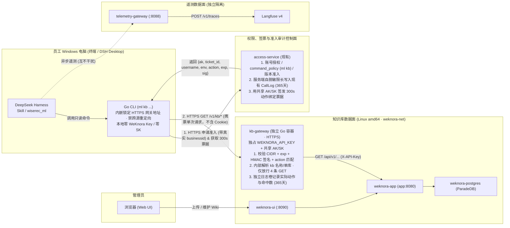

# WeKnora Wiki 知识库集成与独立只读网关设计方案

## 1. 背景与目标

### 1.1 业务背景

当前已在 Linux `amd64` 宿主机通过 `docker run` 部署 **WeKnora `v0.9.0`**（参见 [WeKnora Docker部署指南](../deployment/WeKnora%20Docker部署指南.md)）。结合内网环境与既有系统现状，形成以下核心前提：

1. **采用 Wiki 知识库模式**：当前内网暂无可用的 Embedding 模型，知识库新建时启用 **Wiki 知识库**索引策略（对应 WeKnora `v0.9.0` 的 `indexing_strategy.wiki_enabled`），将原始文档蒸馏为结构化、带溯源（`source_refs`）与词条关联的 Markdown 页面。
2. **管理员与普通用户职责分离**：管理员通过 WeKnora Web 控制台上传和维护文档，通过与普通员工相同的 ml.exe 和 DSH 验证灰度库的只读效果；普通员工及 DeepSeek Harness（DSH）仅需要**只读查阅共享知识库**的能力。
3. **三权分立架构诉求**：
   - **权限、签票与准入审计复用现有 `access-service`**：复用已有的用户授权、环境禁用策略、版本准入以及 MySQL `CallLog`（**零新增数据库表、零迁移**）；由 `access-service` 签发与具体操作绑定的 **300 秒短期 `HMAC-SHA256` 票据**；
   - **知识库转发使用独立 `kb-gateway`**：与 `telemetry-gateway`（Langfuse 异步遥测写入）物理拆分，实现流量隔离、故障隔离、凭据隔离与独立部署演进。

### 1.2 设计目标

1. **三权分立、职责纯粹**：
   - `access-service`（控制面）：负责账号授权、环境级命令策略（`ml kb`）、版本准入、服务端脱敏写入 `CallLog` 与 **300 秒动作绑定 `HMAC-SHA256` 票据签发**；
   - `kb-gateway`（知识库数据面）：独立 Go 只读网关，独占 `WEKNORA_API_KEY`，强制验签并核对票据动作后通过 `weknora-net` 转发 WeKnora `v0.9.0` Wiki 只读接口，并在独立日志卷记录命中数与耗时；
   - `telemetry-gateway`（遥测数据面）：保持纯粹，专心服务 Langfuse v4 上报，与知识库完全解耦。
2. **密钥与可信入口双重锁定**：
   - WeKnora `X-API-Key` 仅存放在宿主机 `/opt/wiserec-kb-gateway/kb-gateway.env`（`chmod 600`）；HMAC 签名密钥 `SK` 仅存放在 `access-service` 与 `kb-gateway` 两端服务端环境文件中，绝不写入 Git、MSI 或员工电脑；
   - `knowledge_base.url` 与现有 `access_control.url` 一样在打包期直接编译进 `ml.exe`（`config.embedded.json`），运行期禁止任何本机文件覆写网关地址且禁止跨源重定向，防止 300 秒票据外泄。
3. **源码级对齐 WeKnora `v0.9.0` Wiki 契约**：完整支持含 `/` 的 `slug`（如 `concept/rag`、`summary/<UUID>`）、按 `indexing_strategy.wiki_enabled` 与显式库白名单取交集筛选、四接口统一只返回已发布页、字面关键词搜索转义，以及 **64KB 有界预览**。
4. **作为可开关附加特性默认携带、显隐与 Skill 打包联动**：
   - `ml kb` 代码默认合入 `cli-go` 二进制（不拆分支），`cli-go/config.json` 默认开启 `knowledge_base.enable: true` 并锁定 HTTPS 网关地址；
   - `build-release.ps1` 将同一个 `-ConfigPath` 同步传给二进制编译与 Skill 装配：`enable: true` 时命令行、命令树、补全与安装包内 Skill 均可见可用；`enable: false`（或未配置）时全部隐藏且安装包内 Skill 零 `kb` 痕迹。
5. **零新增数据库迁移**：直接复用 `access-service` 现有的 MySQL 表结构与 `CallLog`，仅在应用层扩展服务端脱敏与短期票据签发。

### 1.3 范围、非目标与已确认安全边界

- **本阶段仅输出设计方案，不进行代码开发**；不触碰已废弃的 `cli-python/` 目录。
- **仅提供只读查询能力**：`kb-gateway` 与 `ml kb` 严禁暴露上传、修改、删除文档或管理知识库等写接口。
- **不封装 `ml kb chat`**：不通过 WeKnora 二次调用大模型生成答案，由 DSH 自身结合 `ml` 实时结果与 Wiki 原文进行综合推理。
- **已确认的首期认证边界与二期优化（经需求方明确确认）**：
  - 首期面向**内网非涉密共享 Wiki**，为控制首期复杂度，**服务端暂不验证 WiseRec 平台 `Cookie`**——沿用与现有 `cli-go` `/api/v1/access/check` 一致的本地 `credentials.json` 账号声明模型，并由 `access-service` 签发 **300 秒动作绑定 `HMAC-SHA256` 票据**给 `kb-gateway` 验签。票据证明权限服务已批准该**签票账号（客户端声明）**执行指定动作，可拦截无票据、过期票据或动作不符的直调请求，但无法证明调用方当时持有有效平台登录会话（不防绕过 CLI 伪造用户名向 `access-service` 骗票）；
  - **后续优化项**：当未来接入涉密文档或需要强防冒名、按人/按 `kb_id` 分库隔离时，二期在签票前（或前置可信入口）补齐服务端平台会话 Cookie 核验（带短缓存）以及细粒度「用户 ↔ `kb_id`」授权表。

---

## 2. 总体架构与三权分立边界

### 2.1 端到端架构与调用流程



### 2.2 三权分立职责边界

| 平面 / 组件 | 核心职责 | 凭据与存储 | 明确禁止事项 |
| --- | --- | --- | --- |
| **`access-service`（控制面）** | 校验用户与环境授权、执行 `command_policy`（`ml kb`）与版本准入、服务端脱敏限长写入现有 `CallLog`、用共享 `AK/SK` 签发 **300 秒动作绑定 `HMAC-SHA256` 票据** | 复用现有 MySQL；`service.env` 新增 `KB_TICKET_AK` / `KB_TICKET_SK` | 不代理转发 WeKnora 数据请求、不持有 `WEKNORA_API_KEY`、不向客户端暴露 `SK` |
| **`kb-gateway`（知识库数据面）** | 独立 Go 容器，强制验证 300 秒 `HMAC-SHA256` 票据与 `action` 路由绑定，服务端内部完成 `kb` 名称/单库解析，转发 4 条只读 `GET /v1/kb/*` 路由，向独立宿主机日志卷写入命中数与耗时 | 独占 `WEKNORA_API_KEY` 与共享 `AK/SK`（宿主机 `chmod 600`），独立日志卷（`chmod 750`） | 不持有 Langfuse 密钥、不放行无票/过期/动作不符请求、不放行任何写方法 |
| **`telemetry-gateway`（遥测数据面）** | 保持纯粹，专注接收 DSH 插件 OTLP Traces 并转发至 Langfuse v4 | 独占 Langfuse `pk/sk` | 不混入知识库同步读流量，避免相互抢占连接池与重启互相影响 |

---

## 3. 权限准入、动作绑定票据与 365 天审计设计

### 3.1 300 秒动作绑定 `HMAC-SHA256` 票据规范

`access-service` 与 `kb-gateway` 预先在各自服务端环境变量配置相同的 `AK` 与 `SK`（支持多组 `AK -> SK` 映射以便无感轮换，`SK` 长度 `>= 32` 字节随机串，绝不下发给客户端）：

1. **签发内容与动作绑定**：
   - 仅当 `KB_TICKET_AK` 与 `KB_TICKET_SK` 已配置且本次通过准入的命令为 4 条 `ml kb` 子命令之一时，`access-service` 在准入响应中返回短期票据，并**严格映射并签入获准动作 `action`**：

   | `access-service` 收到的 `command` | 签入票据的 `action` | `kb-gateway` 唯一放行路由 |
   | --- | --- | --- |
   | `ml kb list` | `kb_list` | `GET /v1/kb/list` |
   | `ml kb page list` | `kb_page_list` | `GET /v1/kb/pages` |
   | `ml kb search` | `kb_search` | `GET /v1/kb/search` |
   | `ml kb page show` | `kb_page_show` | `GET /v1/kb/page` |

   - 票据字段：
     - `ak`：密钥标识（仅限 `[A-Za-z0-9_-]{1,64}`）；
     - `ticket_id`：**由 `access-service` 服务端生成的全局唯一票据 ID**（UUIDv4，不复用客户端请求头 `x-request-id`，因后者可能为空或重复；同时写入 `CallLog` 与 `kb-gateway` 日志作为主关联键）；
     - `username`：签票账号（客户端声明）；
     - `environment`：当前环境名；
     - `action`：本次唯一获准动作（上表 4 选 1）；
     - `exp`：Unix 秒级过期时间戳，固定为 `now + 300`（**300 秒有效**）；
     - `sig`：规范编码后计算 `hex(HMAC-SHA256(sk, canonical_payload))`。规范原文采用逐字段 RFC 3986 percent-encoding 后以 `\n` 连接（`v1\n{ak}\n{ticket_id}\n{enc(username)}\n{enc(environment)}\n{action}\n{exp}`），彻底避免字段内容包含分隔符导致的拼接歧义。
   - **有效期内的复用语义与禁令延迟说明**：首版不引入一次性消费存储（如 Redis）；在 300 秒有效期内，同一张票据对绑定的同一 `action` 可重复调用，因此审计关系明确为 **“一次 `CallLog` 准入对应 `0..N` 次 `kb-gateway` 同动作数据请求”**，且后台新设禁令对已签发的有效票据在票据到期及验签宽限结束后生效。

2. **为何将 `--kb` 解析收敛在网关内部（一次命令 = 一次请求 = 一个动作）**：
   - 若 CLI 执行 `ml kb search "xxx" --kb 运维库` 或省略 `--kb` 时先在客户端私自调 `GET /v1/kb/list` 换取 `kb_id`，会与 `action=kb_search` 绑定冲突，并在管理员单独禁用 `ml kb list` 时误伤其他子命令。
   - 因此，`/v1/kb/pages`、`/v1/kb/search`、`/v1/kb/page` 统一通过查询参数 `kb` 接收目标知识库（支持传 ID、名称或留空），由 `kb-gateway` 在服务端内部按白名单和 `wiki_enabled` 规则解析出目标 `kb_id`（留空且仅 1 个可见库时自动选用；存在多个时返回 `400` 并列出候选名称），确保**单次 CLI 命令仅发 1 次网关请求、1 张票据严格对应 1 个 `action`**。

3. **`kb-gateway` 验签规则**：
   - `ml` 通过请求头携带票据（`X-KB-AK`、`X-KB-Ticket-ID`、`X-KB-User`、`X-KB-Env`、`X-KB-Action`、`X-KB-Exp`、`X-KB-Signature`，以及可选的 `X-Request-ID`），**绝不携带平台 `Cookie` 或 `csrftoken`**；
   - `kb-gateway` 按顺序严格校验：
     1. 校验 `X-KB-AK` 存在、`X-KB-Ticket-ID` 非空且合法、`X-KB-Exp` 为合法整数且满足精确到期宽限公式 **`now - 15 <= exp && exp <= now + 300 + 15`**（允许 `±15` 秒时钟偏移），失败返回 `401 Unauthorized`；
     2. 按与 Python 签发端完全一致的规范编码计算 `HMAC-SHA256` 并常量时间比对 `X-KB-Signature`（测试阶段使用同一组固定测试向量验证 Python 签发与 Go 验签字节一致），失败返回 `401 Unauthorized`；
     3. 核对 `X-KB-Action` 与当前命中路由所需的 `action` 完全一致，**不匹配直接返回 `403 Forbidden`**，确保在 `access-service` 单独禁用任意子命令（如 `ml kb page show`）在数据入口严格生效。

### 3.2 登录、业务前提、命令策略格式与 DSH 会话隔离

1. **前置条件（沿用既有规则，零例外冲突）**：
   - `ml kb` **沿用 `cli-go/internal/platform/session.go` 现有准入前提**：用户须在当前终端或 DSH 会话中**已绑定环境、已登录且已选中业务**；
   - 调用 `access-service` 时严格携带当前环境 `business.json` / 当前会话中真实的 `selected.businessId`（**严禁硬编码虚构值**，100% 遵守 `AGENTS.md` 第 1 条，且无缝复用 `access-service` 的 `CallLog` 与业务级版本策略）；
   - 用户在任一已授权受支持环境完成登录并选定业务后，均可访问同一份正式共享 Wiki 清单；该可用性仍受当前环境的账号授权、命令禁令与版本准入约束（须在用户手册中明确说明）。
2. **命令策略格式严格对齐源码**：
   - 依据 `access-service/app/command_policy.py`（`COMMAND_PATTERN = r'ml(?: [a-z][a-z0-9_-]*)+'`）与 `cli-go/internal/platform/mep.go`（Go 内部传 `"kb search"`，发送 HTTP 时自动拼接 `"ml " + command`）：
     - **CLI 内部命令路径**：`kb list`、`kb page list`、`kb search`、`kb page show`；
     - **发往 `access-service` 的 HTTP `command` 字段**：`ml kb list`、`ml kb page list`、`ml kb search`、`ml kb page show`；
     - **权限系统后台禁用规则**：分组禁令写 `ml kb`，单命令禁令写 `ml kb page show` 等，避免触发 `COMMAND_REQUIRED`。
3. **DSH 会话隔离红线**：
   - 在 DeepSeek Harness 托管环境（`DSH_SHELL=1`）下，`ml kb` 严格按 `DSH_SESSION_ID` 隔离，**绝不借用其他会话或全局默认环境的登录态与业务选择**。

### 3.3 365 天审计留存与服务端自脱敏机制

通过 `access-service` 服务端生成的唯一 **`ticket_id`**（辅以可选客户端 `request_id`）将控制面与数据面审计记录精确串联（**一次准入对应 `0..N` 次数据请求**），各自承担清晰职责并落实 365 天留存：

1. **`access-service` `CallLog`（记录准入结果与脱敏命令，MySQL 留存 365 天）**：
   - **`access-service` 服务端自行脱敏、限长**：在写入 MySQL `CallLog` 前，由 `access-service` 自身对 `full_command` 执行凭据正则脱敏（抹除 `Cookie`/`csrftoken`/`Authorization`/`token`/`password`/密钥等）与长度截断（如 `<= 256` 字符），不依赖客户端自觉；
   - 记录字段：`actor`（签票账号，客户端声明）、`created_at`（沿用 UTC 存储，北京时间展示）、`environment`、真实 `business_id`、`command`、脱敏 `full_command`、服务端 `ticket_id`（成功签票时写入现有 `version_decision` JSON 的 `kb_ticket_id`，保留客户端 request_id，事务提交后返回票据）、准入结果；
   - 留存与权限：存储于现有 MySQL `CallLog`（零新增表），仅权限系统管理员后台可查，由运维按 `created_at` 定期归档/清理超出 365 天的历史记录。
2. **`kb-gateway` 独立审计日志卷（记录实际动作、命中数与耗时，留存 365 天）**：
   - **不依赖 Docker `10m × 3` 控制台滚动日志**（高负载下会被快速覆盖），改为挂载宿主机持久化目录 `/opt/wiserec-kb-gateway/logs`；**必须按 `distroless/static:nonroot` 实际运行 UID/GID（`65532:65532`）设置目录属主**（如 `chown 65532:<运维组>` + `chmod 750`），避免 root 建目录导致非 root 容器无写权限；
   - 按北京时间自然日滚动输出结构化 JSONL（`kb-audit-YYYY-MM-DD.jsonl`，文件权限 `640`），每条包含：`timestamp`（北京时间 `YYYY-MM-DD HH:mm:ss`）、`ticket_id`（主关联键）、`request_id`、`actor`（签票账号，客户端声明）、`env`、`action`、`kb_id`、脱敏后的 `query`/`slug`、`hit_count`、`candidate_window_exhausted`（仅搜索）、`status`、`duration_ms`、`client_ip`；
   - 到期清理：在宿主机配置每日 `cron`（或 `logrotate`）自动压缩历史日日志并清理超过 **365 天**的归档文件。

---

## 4. 服务端设计：独立 Go 知识库网关（`kb-gateway/`）

### 4.1 目录与模块拆分（严格遵守 `< 500 LoC`）

```text
kb-gateway/
├── go.mod
├── Dockerfile                        # golang:1.25-alpine -> distroless/static:nonroot (linux/amd64)
├── kb-gateway.env.example            # 无真实凭据的配置模板
├── README.md                         # 独立构建、HTTPS 接入与 365 天日志运维说明
├── cmd/
│   └── kb-gateway/
│       ├── main.go                   # 加载配置、装配 HTTP Server、SIGTERM 优雅退出
│       └── version.go                # 由 scripts/sync_versions.py 同步的版本号
└── internal/
    ├── config/
    │   ├── config.go                 # 环境变量解析、AK/SK 密钥表、CIDR、KB 白名单校验（~150 LoC）
    │   └── config_test.go
    ├── auth/
    │   ├── ticket.go                 # 300 秒 HMAC-SHA256 票据校验、时间窗与 action 绑定检查（~110 LoC）
    │   └── ticket_test.go
    ├── weknora/
    │   ├── client.go                 # 对齐 WeKnora v0.9.0 的 4 接口、kb 解析、slug 分段编码、字面转义、草稿超采过滤与 64KB 预览（~290 LoC）
    │   └── client_test.go
    ├── audit/
    │   ├── logger.go                 # 按日轮转 JSONL 审计日志写入与查询词脱敏（~130 LoC）
    │   └── logger_test.go
    └── server/
        ├── handler.go                # GET /health 与 4 条 GET /v1/kb/* 路由、限流与错误区分（~220 LoC）
        ├── limiter.go                # 单 IP 令牌桶限流（~60 LoC）
        └── handler_test.go
```

### 4.2 环境变量规范（`kb-gateway.env.example`）

```dotenv
# 监听地址（员工侧统一经前置 HTTPS SLB/Nginx 接入）
KB_GATEWAY_LISTEN_ADDR=:8087

# 上游 WeKnora v0.9.0 后端地址（加入 weknora-net 容器内网直连 app:8080）
# 部署前提：须在 WeKnora 后台签发仅含 retrieve 权限、限定共享库范围的最小权限 Scoped API Key
WEKNORA_BASE_URL=http://weknora-app:8080
WEKNORA_API_KEY=

# 允许对外暴露的正式共享知识库 ID 白名单（生产必须显式填写具体 kb_id，逗号分隔，严禁直接照抄通配符）
WEKNORA_ALLOWED_KB_IDS=kb_id_1,kb_id_2

# 可选：仅对内部调试人员可见的灰度知识库 ID 白名单与调试账号名单（留空则关闭灰度）
# 注意：WeKnora 最小权限 Scoped API Key 需同步覆盖灰度库 ID；调试完成后将库 ID 移入 WEKNORA_ALLOWED_KB_IDS ，用更新后的 env 文件重建网关，经普通账号验收后完成开放
WEKNORA_PREVIEW_KB_IDS=
# 格式示例 test:alice,prod:bob；环境和账号均区分大小写
KB_PREVIEW_USERS=

# 与 access-service 共享的短期票据签名密钥（支持多组 ak1:sk1,ak2:sk2 平滑轮换）
KB_TICKET_KEYS=

# 允许访问的内网网段（经反代转发时填反代网段）
KB_GATEWAY_ALLOWED_CIDRS=127.0.0.0/8,::1/128
# 仅填写会覆写 X-Real-IP 的可信反代地址段，留空时按连接对端 IP 限流和审计
KB_GATEWAY_TRUSTED_PROXY_CIDRS=

# 365 天独立 JSONL 审计日志目录（容器内挂载点）
KB_GATEWAY_AUDIT_DIR=/var/log/kb-gateway

# 安全、响应上限与限流参数
KB_GATEWAY_TIMEOUT_SECONDS=10
KB_GATEWAY_MAX_UPSTREAM_BYTES=8388608
KB_GATEWAY_MAX_PAGE_CONTENT_BYTES=65536
KB_GATEWAY_RATE_LIMIT_RPS=20
KB_GATEWAY_RATE_LIMIT_BURST=40
```

### 4.3 对齐 WeKnora `v0.9.0` 源码的四接口只读契约

以下契约依据 WeKnora `v0.9.0` 源码（`internal/types/knowledgebase.go`、`internal/router/routes_knowledge.go`、`internal/handler/wiki_page.go`、`internal/application/repository/wiki_page.go`）定稿，**四接口执行同一可见性规则**：
- **库级可见性**：同时满足 `indexing_strategy.wiki_enabled == true` **且**命中当前请求的允许库集合——普通请求仅允许 `WEKNORA_ALLOWED_KB_IDS`；当已验签的 `environment` 与 `username` 组合命中 `KB_PREVIEW_USERS` 时，允许集合扩展为 `WEKNORA_ALLOWED_KB_IDS ∪ WEKNORA_PREVIEW_KB_IDS`（未命中者访问灰度库统一返回 `404 KB_NOT_FOUND`，绝不泄露库存在性）；
- **页级可见性**：统一只对外返回**已发布页（`published`）**，屏蔽草稿、未发布与已归档页；
- **错误与零命中严格区分**：真实无匹配返回 `200 OK` 与空 `items: []`；若上游响应超过 `KB_GATEWAY_MAX_UPSTREAM_BYTES`（`8MB`）上限，明确返回 `502 Bad Gateway` 及错误码 `UPSTREAM_RESPONSE_TOO_LARGE`（提示调小 `--page-size` 或缩小查询范围），绝不伪装成零命中。

| 网关接口（仅 `GET`） | 所需票据 `action` | 上游 WeKnora `v0.9.0` 接口 | 关键适配与过滤策略 | 裁剪后返回核心字段 |
| --- | --- | --- | --- | --- |
| `GET /v1/kb/list` | `kb_list` | `GET /api/v1/knowledge-bases` | 按 `indexing_strategy.wiki_enabled == true` 与当前请求允许库集合（普通账号使用 `WEKNORA_ALLOWED_KB_IDS`；调试账号叠加 `WEKNORA_PREVIEW_KB_IDS`）取交集 | `items[]`: `id`、`name`、`description`、`updated_at`（北京时间）；首版不承诺 `page_count` |
| `GET /v1/kb/pages?kb=...&page=1&page_size=20` | `kb_page_list` | `GET /api/v1/knowledgebase/{kb_id}/wiki/pages?status=published&...` | 网关内部解析 `kb`（ID/名称/留空单库自动选）并校可见性；**将 `status=published` 透传给上游**使 `total` 与可见数据一致；`page_size` 默认 `20`、上限 `50`；裁剪上游 `content` | `kb_id`、`kb_name`、`page`、`page_size`、`total`、`items[]`: `slug`、`title`、`summary`、`updated_at` |
| `GET /v1/kb/search?kb=...&q=...&limit=5` | `kb_search` | `GET /api/v1/knowledgebase/{kb_id}/wiki/search` | 网关内部解析 `kb` 并校可见性；`q` 非空且 `<= 512` 字符，**对 PostgreSQL 正则元字符按字面转义**；因上游搜索仅排除归档页且草稿可能排在已发布页之前，网关按 `min(limit * 3, 50)` **有界超采候选**，过滤非 `published` 页后截断返回**最多 `limit` 条**（默认 `5`、上限 `20`）；若上游返回的候选数达到超采上限且过滤后不足 `limit` 条（含为 0），将 `candidate_window_exhausted` 置为 `true`（区分「已确认无匹配」与「候选窗口已满，本次未找到已发布页」）；沿用上游排序并裁剪 `content` | `kb_id`、`kb_name`、`query`、`limit`、`candidate_window_exhausted`（布尔，正式契约字段，供 CLI/DSH 与零命中统计识别）、`items[]`: `slug`、`title`、`summary`、`updated_at`（不虚构 `score`/`snippet`） |
| `GET /v1/kb/page?kb=...&slug=...` | `kb_page_show` | `GET /api/v1/knowledgebase/{kb_id}/wiki/pages/*slug` | 网关内部解析 `kb`；**查询参数接收完整 `slug`**，支持 `concept/rag`、`summary/<UUID>` 等含 `/` 的合法 `slug`，按 `/` 逐段校验（拒绝空段、`.`、`..`、反斜杠、控制字符）并逐段 `url.PathEscape`；校验页面为 `published`（草稿返回 `404`）；正文按 **64KB UTF-8 安全边界有界预览**截断 | `kb_id`、`kb_name`、`slug`、`title`、`content`（≤ 64KB）、`content_bytes`、`truncated`、`source_refs[]`、`updated_at` |

### 4.4 Linux `amd64` 独立部署与 HTTPS 接入（兼容 Docker `18.09.0`）

- **员工侧强制 HTTPS**：启用 KB 时，取票的 `access_control.url` 和携票访问的 `knowledge_base.url` 均要求 HTTPS 并校验证书；申请票据前检查配置。反代按员工来源限流，覆盖写入客户端 IP；网关仅对允许的反代来源采信该地址。员工电脑访问 `kb-gateway` 统一经前置 HTTPS SLB / Nginx 卸载 TLS 后转发到网关宿主机内网地址的 8087 端口，网络侧仅放行反代来源。
- **容器启动与 365 天日志卷**（注意将日志目录属主设给 `distroless/static:nonroot` 实际运行 UID `65532`，确保非 root 容器可创建并追加写入当天 JSONL）：

```bash
mkdir -p /opt/wiserec-kb-gateway/logs
cp kb-gateway.env.example /opt/wiserec-kb-gateway/kb-gateway.env
chmod 600 /opt/wiserec-kb-gateway/kb-gateway.env

# 关键：将日志目录所有者设为容器运行 UID 65532（属组可设为运维可读组）
chown 65532:65532 /opt/wiserec-kb-gateway/logs
chmod 750 /opt/wiserec-kb-gateway/logs

docker run -d \
  --name wiserec-kb-gateway \
  --network weknora-net \
  --restart unless-stopped \
  --read-only \
  --cap-drop ALL \
  --security-opt no-new-privileges:true \
  --security-opt seccomp=unconfined \
  --env-file /opt/wiserec-kb-gateway/kb-gateway.env \
  -v /opt/wiserec-kb-gateway/logs:/var/log/kb-gateway \
  -p 8087:8087 \
  --log-driver json-file \
  --log-opt max-size=10m \
  --log-opt max-file=3 \
  wiserec-kb-gateway:0.1.0
```

### 4.5 非涉密知识库灰度调试与开放

管理员与普通员工共用同一份启用知识库的 `ml.exe`、DSH 插件、HTTPS 入口和网关实例。Web 控制台维护内容，CLI 与 DSH 验证员工实际使用的目录、搜索、预览和引用链路。首版用于防止普通员工和 Agent 误见待校对资料。票据中的账号来自客户端声明，涉密资料或要求验证管理员本人身份的场景须使用可信身份认证和独立受控入口。WeKnora Web/API 的共享权限由管理员单独核对。

| 服务端配置 | 含义 |
| --- | --- |
| `WEKNORA_ALLOWED_KB_IDS` | 已开放的正式库 ID，可为空。空名单时普通用户列表返回 `200` 和空数组。 |
| `WEKNORA_PREVIEW_KB_IDS` | 待调试的库 ID，可为空。两份库名单只接受明确 ID；出现通配符或交集时拒绝加载配置。 |
| `KB_PREVIEW_USERS` | 逗号分隔的 `环境:账号` 对，与已验签票据的两个字段逐项精确匹配。格式错误时拒绝加载。此名单或灰度库名单为空时关闭灰度访问。 |

**四个接口共享同一套可见性规则。** 网关先验签并核对动作，再计算本次请求可见的库。普通账号使用正式库集合；调试账号使用正式与灰度库的并集。两者均与 Scoped Key 授权范围及启用 Wiki 的库取交集。配置集在进程中只读，严禁请求临时修改共享集合。库列表、按名称或 ID 查找、默认库、单库自动选择、重名判断和错误候选都在过滤后执行。未知库和当前请求不可见的库统一返回 `404 KB_NOT_FOUND`；可见范围内重名时提示使用 ID。所有人均只能读取 `published` 页面。

**操作流程**

1. **准备内容。** 在 Web 中建库、导入非涉密资料，将待测页面设为 `published`。核对 Web 共享范围，并将库 ID 加入网关只读 Scoped Key 的授权范围。
2. **开启调试。** 备份当前网关配置，在同一份 env 文件中填写灰度库 ID 和调试账号，检查名单无交集。按 §4.4 的启动参数使用更新后的 `--env-file` **重建容器**，沿用镜像、网络、端口、日志卷和 HTTPS 入口。普通容器重启沿用创建时的环境变量。
3. **验证。** 管理员执行 `ml kb search "<关键词>" --kb <灰度库ID>`，复制结果中的 slug 执行 `ml kb page show <slug> --kb <灰度库ID>`；随后在同一环境的 DSH 会话中用真实业务问题核对引用。普通账号同时验证列表、名称、ID 和默认库均不会返回该灰度库。
4. **开放或撤回。** 调试通过后，在一次配置变更中将该 ID 从灰度名单移到正式名单，重建网关。用普通账号原有的 CLI 和 DSH 成功查到并读取页面，即完成开放。需要撤回时反向移动并重建，用普通账号确认直查已返回 404。配置或启动失败时恢复上一份配置并用原参数重建。


---

## 5. Go CLI 客户端设计（`cli-go/`）

### 5.1 网关地址锁定在内嵌配置（与 `access_control.url` 同一模型）

为防止本机配置将 300 秒有效票据重定向发送至不可信服务器，`knowledge_base.url` 采用与现有 `access_control.url` 完全一致的**编译期锁定机制**：

1. **打包期嵌入 `ml.exe`（`cli-go/config.json` → `config.embedded.json`）**：
   ```json
   {
     "knowledge_base": {
       "enable": true,
       "url": "https://kb-gateway.internal.example.com",
       "default_kb": "",
       "timeout_seconds": 15,
       "verify_ssl": true
     }
   }
   ```
   - **强制 HTTPS 与禁跨源重定向**：当 `enable: true` 时，`url` 必须为合法 HTTPS 地址（不含凭据、查询或片段），`verify_ssl` 默认 `true`；CLI 访问 `kb-gateway` 的 HTTP 客户端显式拒绝任何跨源 `3xx` 重定向（`CheckRedirect` 返回错误），彻底杜绝票据外泄；
   - **不可通过本机文件覆写网关 `url`**：运行期绝不接受任何本机文件将携票请求指向未打包的任意外部主机（开发调试须使用独立测试 `-ConfigPath` 构建与独立测试 `AK/SK`）；若需单机临时禁用或指定默认库，可选仅允许 `%APPDATA%\ml-go-preview\kb.json` 覆写 `enable: false` 与 `default_kb`（忽略其中的 `url` 字段）。

### 5.2 动态显隐策略（`kbCmd.Hidden = !cfg.Knowledge.Active()`）

- `cli-go` 构造根命令时读取有效配置，动态设置 `kb` 命令组的 `Hidden` 属性：
  - **`enable: true` 且 `url` 有效**：`ml --help`、`ml tree`、`ml tree --all` 及 Shell 补全**正常显示 `ml kb`**，并可完整执行；
  - **`enable: false` 或 `url` 为空**：复用 `cli-go/internal/command/tree.go`（`child.Hidden` 自动过滤）与 Cobra 补全机制，**`ml --help`、`ml tree`、`ml tree --all` 及补全均完全隐藏 `ml kb`**；手动执行也在本地直接拦截退出，绝不发任何请求。

### 5.3 命令树与 4 条只读子命令

严格遵守 `AGENTS.md` 规范：`ml tree` 说明结尾无任何标点、首列 ID 宽 `36` 不截断、时间统一北京时间 `YYYY-MM-DD HH:mm:ss`：

```text
ml
└── kb                                          查询 WeKnora Wiki 知识库
    ├── list                                    列出可用的 Wiki 知识库
    ├── search                                  检索 Wiki 知识库页面
    └── page                                    浏览和读取 Wiki 知识库页面
        ├── list                                列出指定 Wiki 知识库的页面目录
        └── show                                查看指定 Wiki 页面的有界预览内容
```

1. **`ml kb list [-o table|json]`**：列出可用共享 Wiki 知识库；表格首列 `知识库 ID` 固定宽 `36`，其余列为 `名称`、`更新时间`（北京时间）、`说明`。
2. **`ml kb page list [--kb NAME_OR_ID] [--page N] [--page-size N] [-o table|json]`**：列出指定 Wiki 知识库的已发布页面目录（`slug`、标题、摘要、更新时间）；`--kb` 原样透传给 `kb-gateway` 内部解析。
3. **`ml kb search <QUERY> [--kb NAME_OR_ID] [--limit N] [-o table|json]`**：按字面关键词检索 Wiki 页面（返回最多 `limit` 条已发布页，默认 `5`、上限 `20`），沿用上游排序展示 `Slug`、`标题`、`更新时间`与`摘要`（`summary`）；当返回 `candidate_window_exhausted == true` 且结果为空或不足 `limit` 条时，CLI 输出明确提示「候选窗口已满，未找到更多已发布页，请补充更精确的关键词」，不将其与“已确认无匹配”混为一谈。
4. **`ml kb page show <SLUG> [--kb NAME_OR_ID] [-o text|json]`**：按完整 `slug`（支持含 `/` 的路径，如 `concept/rag`、`summary/<UUID>`）读取 Wiki 页面 **64KB 有界预览**及 `source_refs` 来源引用；若 `truncated == true`，在正文末尾明确输出截断提示。

### 5.4 `cli-go` 模块拆分规划（`< 500 LoC`）

| 文件路径 | 职责 | 预估行数 |
| --- | --- | --- |
| `cli-go/internal/localstate/config.go` & `kb_config.go` | `KnowledgeBase` 配置结构、HTTPS 校验；仅允许内嵌配置提供 `url`（可选 `kb.json` 仅覆写 `enable: false` / `default_kb`） | ~100 LoC |
| `cli-go/internal/platform/mep.go` & `session.go` | 扩展现有准入链路，使同一次 `/api/v1/access/check` 调用在返回准入结果的同时解析并返回可选 `KBTicket`（现有业务命令忽略票据保持行为不变；对接未返回票据的旧版权限服务时报错并停止查询） | 增量 ~60 LoC |
| `cli-go/internal/kb/client.go` | 调用 `kb-gateway` 4 条 `GET /v1/kb/*`（查询参数传 `kb` / `slug`）、票据头注入、禁止跨源重定向、区分零命中 / 候选窗口已满 / 超限错误 | ~210 LoC |
| `cli-go/internal/kb/client_test.go` | 含 `/` 的 `slug` 透传、跨源重定向拒绝、动作头传递与三类搜索结果区分单测 | 测试不计入 |
| `cli-go/internal/command/kb.go` | 注册 4 条命令、动态 `Hidden`、单次准入拿 300 秒票据（`ml kb ...`）、表格/JSON/64KB 预览与窗口已满提示渲染 | ~240 LoC |
| `cli-go/internal/command/kb_test.go` | 动态显隐、`ml tree` 无尾标点、首列 36 宽、单次准入只签票一次、旧权限服务无票据报错、64KB 截断提示与不传 Cookie 测试 | 测试不计入 |

---

## 6. Skill 模板、打包 `-ConfigPath` 一致性与文档规范

### 6.1 受维护速查模板与打包 `-ConfigPath` 统一（对齐 `AGENTS.md`）

1. **速查模板统一维护**：
   - 在受维护模板 `scripts/skill_index/commands.md.in` 中定义带标记的可选段（例如 `<!-- KB_START --> ... <!-- KB_END -->`）维护 `ml kb` 4 条只读命令速查行，运行 `python scripts/sync_skill_index.py` 与 `--check` 时校验模板合法性；
   - 知识库详细查阅指南维护于 `skill/addons/kb/references/kb.md` 与 `skill/addons/kb/skill_section.md`（写明「`page list` / `search` 定位 `slug` → `page show` 读有界预览 → 关联词条多跳」及「查日志报错联动查 Wiki」）。
2. **`build-release.ps1` 与 `stage.py` 读取同一个 `-ConfigPath`**：
   - 改造 `cli-go/scripts/build-release.ps1`：将实际传入的 `-ConfigPath`（未传时解析为与 `build-windows.ps1` 一致的默认配置文件路径）**同时传递给 `cli-go/scripts/installer/stage.py` 和 `build-windows.ps1`**，确保二进制内嵌的 `knowledge_base.enable` 与 Skill 装配开关 100% 一致：
     - `knowledge_base.enable == true`：`stage_skill_resources.py` 保留 `commands.md` 中的 KB 可选段，拷入 `references/kb.md`，并在打包产物 `SKILL.md` 装配 KB 入口段，统一计算 `source_sha256` 与 `manifest.json`；
     - `knowledge_base.enable == false`（或未配置）：`stage_skill_resources.py` 剔除 `commands.md` 中的 KB 可选段且不拷入 `references/kb.md`，最终 MSI / 便携 ZIP 产物中**零 `kb` 文件与文案**。

### 6.2 `AGENTS.md` 强制同步清单（实施阶段必做）

- **用户手册同步**：同步更新 `docs/guides/WiseRec CLI 使用手册.md` 的命令树与 `kb` 章节（严格遵守“命令格式 / 参数与选项 / 说明 / 示例”四小节规范，注明“需已绑定环境、已登录且已选业务；任一受支持环境可用仍受该环境的账号授权、命令禁令与版本准入约束；受打包配置开关控制”，**绝不写入版本号或发布信息**）。
- **版本递增、交付清单与上线顺序**：
  - 在根目录 `versions.toml` 的 `[components]` 中：
    - 新增独立组件 `kb_gateway = "0.1.0"`（同步至 `kb-gateway/cmd/kb-gateway/version.go`）；
    - 因 `access-service` 新增签票与服务端自脱敏能力，同步递增 `components.access`（并交付新 `linux/amd64` 镜像及 `service.env` 新增 `KB_TICKET_AK`/`KB_TICKET_SK` 配置说明）；
    - 合入 `ml kb` 时按规范将 `components.cli_go` 补丁号加 `1`；
  - 运行 `python scripts/sync_versions.py` 与 `python scripts/sync_versions.py --check`，同步更新版本测试、`README.md` 及目标版本的 `docs/releases/RELEASE_NOTES_<版本>.md`；
  - **严格上线顺序**：① 在 WeKnora 后台签发仅含 `retrieve` 权限、限定共享库的 Scoped API Key → ② **先升级 `access-service` 镜像并配置 `KB_TICKET_AK`/`KB_TICKET_SK`** → ③ 再部署 `kb-gateway`（显式配置 `WEKNORA_ALLOWED_KB_IDS` 与 `65532` 属主日志卷）→ ④ 最后发布并启用 `knowledge_base.enable: true` 的 CLI 包。

---

## 7. 测试与首版核心验收标准

### 7.1 自动化测试

1. **`kb-gateway` 单元测试**（`(cd kb-gateway && go test ./...)`）：
   - 仅放行 `GET /health` 与 4 条 `GET /v1/kb/*`，其他路径及 `POST`/`PUT`/`DELETE` 一律拒绝；
   - **动作绑定票据与跨语言测试向量**：无票据、伪造签名、`exp` 越界（不满足 `now - 15 <= exp <= now + 315`）、错误 `AK`、缺失 `ticket_id` 返回 `401`；**有效票据与请求动作不符（如拿 `kb_list` 票据请求 `/v1/kb/page`）返回 `403`**；使用与 `access-service`（Python）**同一组固定测试向量（Golden Vector）**验证签名计算 100% 一致；
   - **WeKnora `v0.9.0` 契约测试**：
     - 含 `/` 的合法 `slug`（`concept/rag`、`summary/<UUID>`）通过 `?slug=...` 逐段编码正常读页；`../secret`、`a//b`、`a\b`、控制字符返回 `400`；
     - 按 `indexing_strategy.wiki_enabled == true` 与本次请求允许库集合取交集筛库；`kb` 名称/ID/留空单库自动匹配准确；
     - **管理员灰度库白名单**：配置 `WEKNORA_PREVIEW_KB_IDS` 与 `KB_PREVIEW_USERS` 后，普通用户不可见灰度库（`list` 不返回、直查返回 `404 KB_NOT_FOUND`）且单正式库免 `--kb` 行为不受影响；环境与账号组合命中 `KB_PREVIEW_USERS` 的调试人员可正常列出并查询灰度库；
     - 目录透传 `status=published` 使 `total` 与结果一致；**草稿排在已发布结果前**时，覆盖两类用例：① 窗口内仍有已发布页可正常返回；② **草稿占满整个超采窗口**时返回 `items: []` 且 `candidate_window_exhausted: true`（与已确认无匹配的 `false` 严格区分）；
     - 搜索词含正则标点（`[ERROR] (timeout).*$`）按字面转义；
     - 单页超 64KB 在 UTF-8 字符边界安全截断并返回 `truncated: true`；**上游响应超 8MB** 时返回 `502` + `UPSTREAM_RESPONSE_TOO_LARGE`，不伪装为零命中；
   - 按日 JSONL 审计日志写入、脱敏、`ticket_id` 记录与北京时间格式校验。
2. **`access-service` 单元测试**（`PYTHONPATH=access-service python -m pytest access-service/tests -q`）：
   - 校验 `ml kb` 分组禁令与 `ml kb page show` 单命令禁令匹配正常，不出现 `COMMAND_REQUIRED`；
   - 校验准入通过后签发 300 秒动作绑定 `HMAC-SHA256` 票据（含服务端唯一 `ticket_id`，与 Go 端共用测试向量验证一致）且不泄露 `SK`；
   - 校验 **`access-service` 服务端自身对 `full_command` 脱敏与限长**后再写入 `CallLog`；拒绝时不签票。
3. **`cli-go` 与打包脚本测试**（`(cd cli-go && go test ./...)` + `python -m pytest tests -q`）：
   - `enable=true` 时 `ml --help` / `ml tree` 展示 `kb` 且说明结尾无标点；`enable=false` 时完全隐藏且本地拦截；
   - **单次准入与旧版权限服务兼容测试**：验证每条 `ml kb` 命令只向 `/api/v1/access/check` 请求一次、只签票一次、只写一条 `CallLog`；当权限服务未返回票据（旧版服务或未配签票密钥）时明确报错并停止查询 `kb-gateway`；
   - 校验携票请求只发往内嵌锁定 HTTPS 网关、`kb.json` 无法覆写 `url`、跨源重定向被拒绝、绝不携带平台 `Cookie`/`csrftoken`；
   - 校验 `build-release.ps1` / `stage_skill_resources.py` 依据同一个 `-ConfigPath` 在 `enable=true/false` 下装配或剔除 KB Skill。

### 7.2 首版核心端到端验收标准

在真实部署环境（Linux `amd64` `access-service` + `kb-gateway` + WeKnora `v0.9.0` + Windows DSH Desktop）完成以下必过验收：

1. **任一受支持环境登录后可读共享页面**：在任意已授权受支持环境完成登录并选定业务后，执行 `ml kb list`、`ml kb page list`、`ml kb search` 与 `ml kb page show` 均可读取同一份共享 Wiki 页面；每条命令只写一条 `CallLog` 准入记录；DSH 会话隔离下不借用其他会话登录态。
2. **数据入口严格拒绝无效或越权票据**：无票据、伪造签名、超出验签宽限（网关时间大于 exp + 15 秒）的票据请求 `kb-gateway` 返回 `401`；**拿 `ml kb list` 签发的有效票据请求 `page show` 或 `search` 返回 `403`**；对接旧版未签票 `access-service` 时 CLI 立即停止查询。
3. **搜索结果复制含 `/` 的 `slug` 可直接读页**：对真实导入的含 `/` 词条（如 `concept/rag`、`summary/<UUID>`），从 `ml kb search` 或 `ml kb page list` 输出中**原样复制 `slug`** 执行 `ml kb page show <SLUG>` 直接成功打开。
4. **草稿占满窗口、多篇长页与 8MB / 64KB 边界验收**：
   - 验证「草稿排在已发布结果前」时既能返回窗口内的已发布页，也能在「草稿占满整个候选窗口」时明确返回 `candidate_window_exhausted: true` 并由 CLI 提示缩小关键词；
   - 验证多篇长页目录/搜索正常裁剪，刻意构造上游超 8MB 时返回 `UPSTREAM_RESPONSE_TOO_LARGE`（区分真实零命中），超 64KB 单页返回 `truncated: true` 与截断提示。
5. **非 root 审计日志真实落盘、365 天关联与双形态打包验收**：
   - 以 `nonroot`（`65532:65532`）身份启动 `kb-gateway` 容器并实际执行查询，**验证宿主机 `/opt/wiserec-kb-gateway/logs/` 成功创建并追加当天 `kb-audit-YYYY-MM-DD.jsonl`**；以服务端生成的 `ticket_id` 串联 `access-service` `CallLog` 与网关日志（支持一次准入关联 `0..N` 次网关请求）；
   - 分别用 `enable=true` 与 `enable=false` 的 `-ConfigPath` 打包，核对 `ml --help`、`ml tree --all` 与安装包内 Skill 显隐完全一致。

6. **灰度上线与撤回**：同一份 CLI 和 DSH 下并发使用普通账号与调试账号，验证四个接口、同名跨环境账号、草稿页、名称/ID/默认库以及错误候选；覆盖仅有灰度库、两名单重叠拒绝加载。将库转正式并重建后用普通账号查到且读到，再撤回并确认 404。

---

## 8. 分阶段实施计划与风险控制

### 8.1 分阶段实施

| 阶段 | 主要内容 | 交付物 |
| --- | --- | --- |
| **阶段 1：WeKnora `v0.9.0` 实机接口核对** | 在宿主机用 `curl` 实测 WeKnora `v0.9.0` 4 个接口（重点核对 `wiki_enabled`、含 `/` 的 `slug`、`status=published`、**草稿占满候选窗口时的搜索返回**、PG 正则标点、多篇长页响应体积） | 实机响应样本核对记录 |
| **阶段 2：`access-service` 签票、自脱敏与发版** | 在 `access-service` 增加 `KB_TICKET_AK`/`KB_TICKET_SK`、300 秒动作绑定 `HMAC-SHA256` 票据签发（含服务端 `ticket_id` 与跨语言测试向量）及服务端 `full_command` 脱敏限长（零 MySQL 迁移）；递增 `components.access` 并交付新镜像（**先于网关与 CLI 上线**） | `access-service` 增量代码、测试与新 `linux/amd64` 镜像 |
| **阶段 3：独立 `kb-gateway/` 实现与 HTTPS 部署** | 在 WeKnora 签发最小权限 Scoped Key 后，实现 `kb-gateway/`（验签+动作校验、服务端 `kb` 解析与管理员灰度库白名单、`?slug=` 逐段编码、字面转义、有界超采+`candidate_window_exhausted`、64KB 预览、365 天 `65532` 属主日志卷）及 `< 20MB` `linux/amd64` 镜像并完成实机日志落盘验收 | `kb-gateway/` 源码、单测与 Docker 镜像 |
| **阶段 4：`cli-go`、`build-release.ps1` 与文档/Skill 同步** | 改造 `cli-go/internal/platform` 准入返回票据，实现 `ml kb`、动态显隐、内嵌锁定 HTTPS 网关与禁跨源重定向、`commands.md.in` 可选段、`-ConfigPath` 透传、手册与版本号同步，完成 6 项端到端验收 | `cli-go/`、打包脚本、手册、Skill 与验收记录 |

### 8.2 风险与缓解措施

| 风险点 | 影响 | 缓解措施 |
| --- | --- | --- |
| 首期服务端不验平台 `Cookie`，签票账号为客户端声明 | 内网中绕过 CLI 伪造已授权同事用户名可向 `access-service` 获取票据 | 首期仅开放内网非涉密共享 Wiki，叠加 CIDR 白名单、300 秒动作绑定票据与 365 天双端审计；**二期优化**：签票前补齐服务端平台会话 Cookie 校验（短缓存）与按 `kb_id` 分库授权 |
| 搜索词来自报错堆栈，可能混入内部业务数据或凭据 | 365 天留存审计日志产生敏感信息暴露风险 | `access-service` 落库前与 `kb-gateway` 写日志前双端服务端脱敏限长；严格限制 `CallLog` 与独立日志卷仅管理员可查，并配置 365 天自动清理 |
| 上游目录或搜索响应携带全文导致超 8MB 上限 | 合法多篇长页查询报错 | 阶段 1 实机核对响应体大小，控制默认 `page_size=20` 与超采上限 `50`，明确返回 `UPSTREAM_RESPONSE_TOO_LARGE` 区分真实零命中；必要时在网关改用流式 JSON 逐条丢弃 `content` |
| WeKnora 升级后 Wiki API 路径或响应字段调整 | 网关解包异常 | 上游适配全部收敛在 `kb-gateway/internal/weknora/client.go` 一处，升级时只需更新 `kb-gateway` 容器，全员 `ml.exe` 无需重装 |
| `access-service` 与 `kb-gateway` 宿主机时钟偏差过大 | 300 秒短期票据误判过期 | 两端宿主机开启 NTP 同步，且网关验签允许 `±15` 秒时钟偏移窗口 |
| 宿主机 Docker `18.09.0` 运行新版容器报错 | `kb-gateway` 容器启动失败 | `kb-gateway` 采用 `CGO_ENABLED=0` 静态 Go 二进制并在部署命令明确保留 `--security-opt seccomp=unconfined` |
