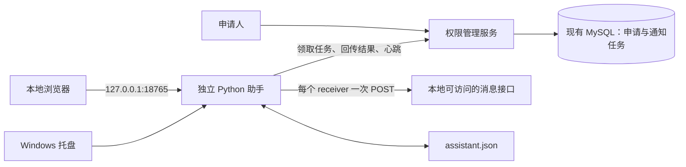

# 权限申请通知与独立本地助手设计

文档日期：2026-10-22（北京时间）

文档状态：开发设计基线，已形成开发实现；实际验证与差异见 [开发与验收说明](权限通知开发与验收说明.md)

适用范围：现有权限管理服务与独立 Windows Python 助手

## 1. 目标与最终决策

权限管理服务所在服务器无法访问消息接口，用户本地电脑可以访问。需要在有人提交权限申请后，由本地助手调用消息接口，通知指定接收对象，方便用户及时进入权限系统审批。

本文汇总对话中已确认的需求，并补全开发所需的协议、状态和验收规则。接口路径、字段及默认参数属于拟定设计；第三方接口尚未说明的能力不得视为已经具备。

| 编号 | 最终决策 |
| --- | --- |
| R01 | 使用“统一通知任务接口 + 独立 Python 本地助手”，助手主动轮询权限系统 |
| R02 | 第一版仅一个通知所有者、一台 Windows 电脑、一个有效助手凭据 |
| R03 | 支持多个接收对象；每个对象独立调用一次消息接口 |
| R04 | 消息 URL、auth、接收 UID 列表可配置；sender 为可选字段 |
| R05 | 本地配置与任务恢复状态存入一个 JSON 文本文件，不使用 SQLite 等本地数据库 |
| R06 | 通过 http://127.0.0.1:18765 查看状态、修改配置，保存后按安全边界热更新 |
| R07 | Windows 托盘作为日常入口，本地网页负责配置和详情，另有一个启动快捷方式 |
| R08 | 权限系统提供“个人通知”页面，管理助手 Token、在线状态和任务摘要 |
| R09 | 通知助手、配置、依赖、文档和相关功能不得进入 CLI 分发包，不增加 ml 通知命令 |
| R10 | 通知不执行审批；消息链接跳转到现有管理员审批详情，仍需登录并正常授权 |

本文替代早期讨论中的本地 SQLite、系统凭据管理器存储、单接收对象和纯命令行入口方案。当前明确采用 JSON 文件保存凭据与状态、多接收对象、托盘与本地网页组合。

### 1.1 第一版不包含

- 多人订阅、多客户端负载分担、多渠道消息路由。
- 自动审批、定时催办、申请结果通知、复杂可视化模板编辑。
- 浏览器插件、n8n、Node-RED、服务端直连消息接口。
- 公网访问本地助手、远程管理本机配置。
- 自动注册成 Windows 系统服务；采用当前用户登录后运行的方式。
- 把本地助手附加到 CLI 的安装、升级、保活或业务认证流程。

## 2. 已核对的项目基础

以下是当前仓库代码事实，不等同于已核实生产部署版本。

| 项目事实 | 设计影响 | 代码位置 |
| --- | --- | --- |
| 权限服务使用 FastAPI、SQLAlchemy、MySQL、Jinja2 | 复用服务端技术栈和现有管理页面 | `access-service/requirements.txt` |
| 申请创建有独立事务提交位置，重复待审批申请由唯一约束限制 | 在申请事务中同步创建通知任务 | `access-service/app/applications.py` |
| 待审批列表返回 HTML | 不能直接作为机器领取通知任务的接口 | `access-service/app/applications.py` |
| 管理员使用 Cookie 会话，默认 8 小时 | 助手使用独立凭据，不依赖网页登录续期 | `access-service/app/admin_auth.py`、`settings.py` |
| 当前数据库结构版本为 11 | 新表必须走显式迁移，实际目标结构版本以开发时基线为准 | `access-service/app/migrations.py` |
| CLI 包自动复制根 config.json 及 skill 资源 | 通知信息不得放入这些位置 | `setup.py`、`MANIFEST.in` |
| 正式发布流程要求 CLI 与权限服务版本一致 | 保留发布规则，靠产物隔离保证 CLI 不包含通知功能 | `.github/workflows/release.yml` |
| CLI 已有后台保活，但与终端会话绑定 | 助手必须独立运行，不复用其生命周期 | `src/wiserec_cli/ping.py` |

## 3. 架构与分发边界



权限服务器不连接用户电脑。本机仅为配置网页监听回环地址，通知网络连接由助手主动发起。

| 组件或信息 | 存放和分发位置 |
| --- | --- |
| 通知任务、Token 校验、管理页面 | 当前仓库的 `access-service`，进入权限服务镜像 |
| 助手源码、网页资源、托盘、安装脚本 | 独立子项目 `permission-notifier/`，独立依赖与安装入口 |
| 助手安装包、使用说明 | 同一 Release 的独立助手附件，不进入 CLI 安装包 |
| 消息 URL、auth、真实接收 UID | 用户电脑上的 JSON 文件，不上传权限系统 |
| 助手 Token 原文 | 一次性显示后保存在本地 JSON；服务端仅存摘要 |
| 任务、逐对象匿名状态和审计 | 权限服务 MySQL；不存实际消息接口地址及凭据 |
| 本设计文档 | 开发资料；后续打包检查确保不进入 CLI 包 |

独立助手不 import `wiserec_cli`，不读取 CLI 的 config.json、business.json、登录缓存或安装目录。服务端通知源码仍对有仓库访问权限的人可见；包隔离不代表仓库内容保密。

## 4. 消息接口契约

用户提供的请求行为：

```text
POST <本机配置的 message.url>
Content-Type: application/json
```

```json
{
  "content": "权限申请通知内容",
  "receiver": "单个接收对象UID",
  "auth": "接口认证信息"
}
```

`sender` 非空时才加入 JSON。示例地址为 `http://test.cn`，是可配置值，不作为硬编码默认发送目标。

### 4.1 字段规则

| 字段 | 来源和约束 |
| --- | --- |
| URL | 本地配置，支持 HTTP/HTTPS，不接受服务端任务覆盖 |
| auth | 本地配置，放在 JSON 请求体，不是 HTTP Bearer 请求头 |
| receiver | 接收列表中的一个 UID；用户代码中的 receiver_uid 变量映射到此字段 |
| content | 本地固定模板生成的文本；同一任务各对象使用同一内容快照 |
| sender | 本地可选配置，空值时省略 |

UID 按字符串处理，保留前导零，去除首尾空格，不允许空值或重复值。备注仅供本地显示。能否向群发送由接口本身决定，不能从 UID 格式推测。

### 4.2 响应与重试边界

当前仅有请求示例，没有成功/失败响应、幂等规则、发送结果查询、限流和消息长度限制。实现前需确认，不能假定缺少的能力不存在，也不能假定业务成功字段为 `code == 0`。

- 示例中的 `res.ok` 只检查 HTTP 层状态，不能证明业务成功或实际送达。
- HTTP 2xx 只有在契约明确其含义后才能归类；界面区分“接口已接受”和“已送达”，后者需接口提供证据。
- 默认禁止自动跟随重定向，防止把含 auth 的请求体发送到非预期地址。
- 超时、响应丢失、响应无法解析、部分 5xx 均可能发生在远端已接受消息之后；不能统一按“未发送”自动重试。
- 如确认支持幂等，使用每个任务、每个接收对象独立且稳定的幂等键，并确认有效期覆盖重试周期。不得未经确认增加第三方请求字段。
- 如无幂等或查询能力，发送结果不确定时默认等待人工核对，不自动重复发送。

### 4.3 消息模板

```text
【权限申请待审批】

申请人：张三
账号：zhangsan
申请时间：2026-10-22 10:30:00
申请编号：12345

审批地址：https://权限系统地址/cli-permission/admin/applications/12345
```

模板由助手提供，第一版不支持执行用户脚本或任意模板代码。审批链接由已配置的权限系统地址和受限审批路径组合，不使用申请人的私密查询 Token。日期存储和传输使用 UTC，消息和界面显示北京时间 `YYYY-MM-DD HH:mm:ss`。

## 5. 申请与通知任务生成

通知功能默认关闭，配置所有者后主动开启。开启后，在原有申请入库事务内增加通知任务：

1. 沿用申请内容、CSRF、频率和重复申请校验。
2. 保存申请并获得申请 ID。
3. 保存 `application_submitted` 通知任务。
4. 同一事务提交，成功后返回原有申请成功页面。

唯一事件键建议为 `application_submitted:<application_id>`，数据库唯一约束防止重复任务。被判定为重复申请的提交不产生新任务。

消息发送失败不影响已经提交的申请；申请或通知任务数据库写入失败时整体回滚，不静默丢掉通知记录。关闭通知功能时沿用现有申请流程，不生成任务。

首次开启不自动发送所有历史申请。所有者可在服务端主动执行“为现有待审批申请补建通知”，使用相同唯一事件键避免重复。暂停领取与关闭事件生成是不同操作，页面必须解释清楚。

任务首次领取，以及后续发起仍未发送的提醒前，检查申请是否仍待审批。已审批或不存在的申请，其尚未发送项可标为跳过；已发生或结果不确定的发送记录不得覆盖为“未发送”。检查与外部发送无法组成原子事务，允许极短时间窗口内收到已经处理过的提醒。

## 6. 服务端数据模型

第一版建议两张新表；逐对象状态使用任务中的受限结构化字段保存，暂不引入第三张投递明细表。实际迁移需验证 MySQL 和测试数据库的序列化兼容性。

### 6.1 notification_clients

第一版只允许一个有效客户端，通过固定配置键或数据库唯一约束限制，不能仅依赖前端隐藏新增按钮。

| 字段组 | 字段建议 |
| --- | --- |
| 归属 | id、owner_admin_id、enabled |
| 凭据 | token_hash、credential_generation、issued_at、bind_deadline、expires_at、revoked_at |
| 绑定 | installation_id、bound_at |
| 运行 | last_seen_at、agent_version、protocol_version、health_code、error_summary |

所有者必须是现有有效管理员，由服务端部署配置指定，初始化时校验并绑定稳定管理员 ID。普通管理账号不能自行成为通知所有者。

### 6.2 notification_tasks

| 字段组 | 字段建议 |
| --- | --- |
| 身份 | id（UUID）、event_key（唯一）、event_type、application_id |
| 状态 | status、next_attempt_at、created_at、updated_at、completed_at |
| 领取 | client_id、lease_generation、lease_token_hash、lease_expires_at |
| 快照 | snapshot_id、匿名 delivery_id 集合、每项状态与尝试编号 |
| 结果 | accepted_count、failed_count、uncertain_count、skipped_count、message_id、last_error_code、脱敏摘要 |
| 协议 | last_report_seq、最近报告标识/摘要，用于去重和防止旧结果覆盖 |

逐对象记录仅包含每条任务生成的随机 delivery_id、状态及必要结果，不上传真实 UID、备注、消息 auth 或正文。随机 ID 不从 UID 简单哈希得到，避免可枚举信息泄露。

任务领取按状态和 next_attempt_at 建索引；查询页按状态、创建时间分页。实际结构版本须基于开发时最新迁移版本递增，不把本文的版本 11 当作永远固定的基线。

## 7. Token 分配与访问控制

### 7.1 人工分配流程

1. 部署配置指定通知所有者，功能默认关闭。
2. 所有者登录权限系统，进入“个人通知”。
3. 点击“生成助手 Token”，服务端用安全随机源生成至少 32 字节随机值。
4. 原文仅在生成成功的响应中显示一次，可复制，不提供后续找回。
5. 用户在本地网页录入 Token，助手调用绑定接口登记安装实例。
6. 绑定成功后，符合运行条件的助手开始领取任务。

不需要 JWT；使用不可预测的随机 Bearer Token，服务端保存 SHA-256 等摘要并进行安全比较。原文不写入审计、访问日志或错误信息。

### 7.2 默认生命周期（实现建议，可调整）

| 项目 | 默认建议 |
| --- | --- |
| 未绑定有效期 | 生成后 30 分钟 |
| 绑定后有效期 | 从首次成功绑定起 90 天；重复绑定不能续期 |
| 到期提示 | 到期前 7 天在服务端页面、本地网页和托盘提示 |
| 有效凭据数量 | 一份 |
| 重置 | 新 Token 生成时旧 Token 立即失效 |
| 撤销 | 后续请求立即拒绝；待发送任务保留 |
| 管理员停用 | 每次机器请求检查管理员状态，同时停止访问 |

绑定安装实例是防误配置和重复运行措施，不是硬件认证。如果 Token 和实例 ID 一同泄漏，仍可能被冒用。换机需重置绑定并显式核对旧机未完成任务；不自动把旧任务当作从未发送。

### 7.3 两类认证隔离

| 接口类别 | 认证方式 | 权限 |
| --- | --- | --- |
| 服务端个人通知管理页面及管理操作 | 现有管理员会话、CSRF、通知所有者校验 | 生成/撤销 Token，查看摘要，人工处理任务 |
| 助手机器接口 | HTTPS + Bearer Token + 安装实例校验 | 绑定、领取、续租、报告、心跳；无审批和管理权限 |
| 第三方消息接口 | JSON 中的 auth | 仅按实际接口契约发送消息 |

Token 不出现在 URL 或进程命令行。助手不复用管理员密码、网页登录 Cookie、CLI 网关 Token 或业务认证。权限系统使用可验证的 HTTPS；本地回环网页与用户提供的 HTTP 消息地址分别处理，不混淆其传输边界。

## 8. 统一机器接口草案

基础路径：`/cli-permission/api/v1/notifications`。接口返回 JSON，携带明确错误码，不返回 HTML 登录页。请求包括协议版本及安装实例；任务操作还需处理凭证及领取代次。

| 方法与路径 | 用途 |
| --- | --- |
| POST /bind | 原子绑定实例；同一实例重复绑定幂等 |
| POST /claim | 领取一条可处理任务，或恢复同一实例尚未确认的领取 |
| POST /{task_id}/prepare | 注册不可变的匿名接收快照；必须成功后才允许开始发送 |
| POST /{task_id}/renew | 续租并返回最新申请状态及可处理项 |
| POST /{task_id}/result | 增量上报逐对象阶段/结果，服务端汇总任务状态 |
| POST /{task_id}/resume | 重启/过期后核对已知结果，取得新的处理权或进入人工处理 |
| POST /heartbeat | 上报助手、工作线程、消息通道状态；不替代任务续租 |

prepare、renew、resume 用于多接收对象及崩溃恢复，是对早期 claim/result/heartbeat 草案的补全。客户端从不在持有数据库事务或行锁期间调用消息接口。

### 8.1 领取与快照

claim 使用短事务和行锁或等价的原子条件更新，保证同一时刻只有一个有效领取者。MySQL 并发行为需实测，不能只依赖 SQLite 测试。

领取成功响应示意：

```json
{
  "protocol_version": 1,
  "task": {
    "id": "00000000-0000-4000-8000-000000000001",
    "event": "application_submitted",
    "application_id": 12345,
    "applicant_name": "示例姓名",
    "applicant_account": "示例账号",
    "created_at": "2026-10-22T02:30:00Z",
    "review_path": "/cli-permission/admin/applications/12345",
    "lease_generation": 1,
    "lease_token": "临时处理凭证占位符",
    "lease_expires_at": "2026-10-22T02:32:00Z"
  }
}
```

无任务返回 `task: null`，并可返回建议下次轮询间隔。claim 响应丢失时，同一安装实例重试需先找回其未准备的领取，不能无界领取更多任务；处理凭证可在失效旧代次后重新签发，不要求数据库保存原文。

助手将当前启用对象、URL、sender、消息内容和配置修订号保存为本地快照，为每个对象生成 delivery_id。prepare 仅提交 snapshot_id 和 delivery_id 集合。相同快照重复提交成功，不同快照覆盖已有任务返回冲突，禁止新增收件人时悄悄扩展旧任务。

### 8.2 逐对象报告

每份报告包含 report_id、递增 report_seq、lease_generation、lease_token，以及本次更新的 delivery_id、attempt_id、阶段/结果、可选消息 ID、脱敏错误。服务端根据已登记集合校验并计算统计值，不直接信任客户端传入的汇总数量。

```json
{
  "report_id": "report-example-002",
  "report_seq": 2,
  "lease_generation": 1,
  "lease_token": "临时处理凭证占位符",
  "updates": [
    {
      "delivery_id": "delivery-example-a",
      "attempt_id": "attempt-example-a-1",
      "state": "accepted",
      "message_id": null,
      "error_code": null
    }
  ]
}
```

`accepted` 表示符合已确认消息契约的“接口接受成功”，不是已读。报告严格按本地顺序补报；同 report_id 同内容幂等成功，同 ID 不同内容或跳号返回冲突。旧报告不覆盖新状态，旧租约不能修改新租约状态。

凭据重置/租约过期后，对旧发送结果通过 resume 核对并以新处理权补报；已受理的重复报告仍可在当前有效身份下查询确认。不能因旧 lease 被拒绝而再次发送消息。

### 8.3 错误语义

| 状态 | 示例错误码 | 客户端处理 |
| --- | --- | --- |
| 400/422 | INVALID_REQUEST、UNSUPPORTED_PROTOCOL | 提示配置/兼容性问题，不盲目重试 |
| 401 | TOKEN_INVALID、TOKEN_EXPIRED | 暂停新工作，等待替换凭据 |
| 403 | CLIENT_DISABLED、OWNER_DISABLED | 暂停，保留本地结果 |
| 409 | INSTANCE_MISMATCH、LEASE_CONFLICT、SNAPSHOT_CONFLICT、REPORT_CONFLICT | 进入核对/恢复流程，不重发已知成功项 |
| 429 | RATE_LIMITED | 遵循服务端重试时间 |
| 5xx/连接失败 | SERVICE_UNAVAILABLE | 退避重连；报告可幂等重试，外部消息不可据此重发 |

## 9. 逐对象投递与任务状态

### 9.1 接收对象状态

| 状态 | 含义与后续处理 |
| --- | --- |
| pending | 尚未开始消息请求 |
| sending | 已登记准备发送，可能已经向远端发送 |
| accepted | 接口明确接受，自动重试不得再次发送 |
| retry_wait | 有证据确认未成功，可等待下一次尝试 |
| failed | 永久失败或达到重试上限，等待显式操作 |
| uncertain | 可能发送成功但缺少确认，默认不自动重发 |
| skipped | 因申请已处理或用户明确取消而跳过 |

已接受项不可被迟到失败报告降级。人工确认/重新发送须带当前任务修订号，并记录操作者与原因。重新发送仅针对选定项；已接受项不提供普通“全部重试”。

### 9.2 任务汇总状态

| 状态 | 判定 |
| --- | --- |
| pending | 尚未领取 |
| processing | 有有效租约并正在准备/发送 |
| retry_wait | 存在可自动重试项，无当前发送 |
| sent | 所有登记对象均 accepted |
| skipped | 全部对象均 skipped，或尚未建快照时申请已处理 |
| partial | 至少一项 accepted，其他项终结为 failed/uncertain/skipped，且无自动处理项 |
| failed | 没有成功项、没有不确定项，存在失败且没有自动处理项 |
| uncertain | 没有成功项，存在结果不确定项，且没有自动处理项 |

任务摘要始终同时显示各状态数量。例如“成功 2、失败 1”不能显示成“已发送”。未到时间的 retry_wait 项不占用工作线程，结果不确定的任务不阻塞后续新申请。

### 9.3 一次发送的持久化顺序

1. 成功领取任务，原子保存本地任务和对象快照。
2. prepare 在服务端登记匿名目标集合并确认成功。
3. 检查运行开关、有效租约和申请状态。
4. 为一个对象生成 attempt_id，本地保存 sending 意图。
5. 向服务端上报 sending 并收到确认；该报告重试不会触发消息请求。
6. 调用一次消息接口，默认禁用 HTTP 库针对 POST 的透明重试。
7. 立即把结果及待回传报告持久化到 JSON。
8. 幂等补报结果，收到确认后清理对应 outbox 项。
9. 串行处理其他对象；对已成功对象不再调用接口。

第 5 步增加一个小的检查点，用于文件丢失或换机时让服务端知道哪些项可能已经发送。服务端不可达或本地无法持久化时停止发起新的消息请求。服务端仍只接收匿名投递标识及状态，不接收 UID。

### 9.4 租约与恢复

- 默认租约 120 秒，处理期间约每 30 秒续租；服务端时间为权威，客户端使用单调时钟安排周期。
- 心跳不自动延长任务租约。长时间发送、多个对象或等待结果补报均需独立续租。
- 无法确认租约有效时不发起新请求；已发出的请求保存其真实结果，不能撤回远端已接收的消息。
- 租约到期不是“发送失败”的证据。无幂等保证时，sending 项进入 uncertain，不能自动整单重新投递。
- 本机重启先补报明确结果，再经 resume 核对服务端状态；快照一致、未开始发送且已取得新租约的项可继续。
- 文件丢失、损坏、实例变更或快照无法核对时，需要人工恢复；服务端保留已知成功和可能发送的状态，不能重置后直接全发。
- 服务端的租约代次防止旧进程覆盖记录；第三方接口不理解租约，无法绝对阻止旧进程的在途发送，因此换机/接管不自动重发不确定项。

### 9.5 重试建议

对明确未发送成功且可重试的情况，建议等待 30、60、120、300 秒，后续最高 600 秒并加入少量抖动，最多 8 次发送尝试。持久化 next_attempt_at，不在工作线程中长时间 sleep 阻塞其他任务。

网络错误需判断发生阶段：连接尚未建立等可证明未提交的失败可以重试；写入后超时、读响应失败等为 uncertain，除非已确认幂等/查询能力。第三方 429、5xx 的处理以实际契约为准。

公共 auth 失效时暂停所有新发送，不消耗所有任务的重试次数；接收 UID 无效只影响该对象。Token 更新后可恢复明确未发送成功的项，不能把 uncertain 自动转为 pending。

## 10. 本地文件与运行模块

### 10.1 单个主数据文件

建议位置：`%LOCALAPPDATA%\PermissionNotifier\assistant.json`。程序安装目录与数据目录分开。用户明确选择文本存储，因此 Token 与 auth 可以明文存在此文件，不使用本地数据库或系统凭据库作为必需组件。

示例为初始文件；真实地址与凭据在本地网页录入，不随安装包预填：

```json
{
  "file_version": 1,
  "config_revision": 1,
  "config": {
    "permission_service_url": "",
    "assistant_token": "",
    "poll_interval_seconds": 10,
    "message_timeout_seconds": 20,
    "message": {
      "url": "",
      "auth": "",
      "sender": "",
      "receivers": [
        {"uid": "UID_A", "label": "我自己", "enabled": true},
        {"uid": "UID_B", "label": "审批群", "enabled": true}
      ]
    }
  },
  "state": {
    "installation_id": "由助手首次运行生成的随机UUID",
    "paused": true,
    "active_config_revision": null,
    "config_apply": {
      "pending_fields": [],
      "effective_overrides": {}
    },
    "last_success_at": null,
    "last_error": null,
    "tasks": {},
    "pending_reports": []
  }
}
```

`tasks` 替代早期仅一个 inflight_task 的示意，允许保存多个等待重试/人工核对的任务，但同一时刻只有一个消息请求。每条记录至少包含原服务地址、任务 ID、快照、对象 UID 与 delivery_id 映射、内容、URL/sender 快照、租约、尝试结果及报告序号。auth 从当前已生效凭据读取，不为每个任务复制历史 auth。

`pending_reports` 是有序回传缓冲，含原服务标识，不能因修改服务地址而被发送到另一个系统。已确认的终态记录按保留策略清理；未确认结果或不确定任务不得因文件大小自动丢弃。

`config` 保存用户已提交的目标配置。`config_apply` 记录尚未生效的字段，以及完成当前工作必需的旧有效值；不能只保存修订号而丢掉旧值。服务地址切换时，旧地址及旧 Token 临时保留在 effective_overrides，新地址及新 Token 位于 config；工作线程仍仅连接旧系统，完成切换后原子清除旧值。只允许一个待应用版本，不保存历史凭据链；再次编辑时对既有待切换状态进行校验。普通同地址 Token 替换在当前请求结束后立即更新，不保留旧 Token。

可有独立轮转文本日志和写入过程中短暂存在的同目录临时文件，但配置与恢复状态只有这一个主文件。日志不是恢复依据，不记录完整凭据和请求体。

### 10.2 写入一致性

- 单进程内所有网页保存、工作线程状态变更通过同一存储模块和互斥锁串行提交。
- 网页只提交 config，不能覆盖整个文件或客户端提交 state；使用 config_revision 做乐观并发控制，旧表单保存返回冲突。
- 先校验并构造完整新状态，再写同目录临时文件，flush/fsync 后原子替换；Windows 文件被占用、磁盘满或权限错误必须明确报错。
- 配置写入失败保留原配置；发送状态写入失败则停止新发送，并在网页/托盘提示。不得继续发送后只依赖内存保存结果。
- 文件损坏不自动初始化或清空。进入恢复模式，允许查看错误、导出脱敏诊断并由用户提供备份。
- 单实例采用当前用户范围的操作系统互斥量，不能只检查某个 lock 文件是否存在。
- 首次缺少文件可创建空配置并保持暂停；已完成安装后意外丢失文件需结合服务端绑定状态核对，不能无提示创建新实例接管旧任务。
- 文件权限限制为当前用户及必要系统身份；程序升级保留文件。用户手动编辑须先退出助手。

### 10.3 独立助手模块建议

| 模块 | 职责 |
| --- | --- |
| config_store | 文件校验、修订号、原子保存、恢复 |
| service_client | Token 绑定、任务协议、续租、心跳 |
| message_sender | 用户消息接口适配、成功判定、错误分类 |
| worker | 调度、逐对象处理、暂停、恢复、退出 |
| local_web | 状态与配置 API、页面、CSRF/Origin 校验 |
| tray | 图标、菜单、主线程事件循环 |
| lifecycle | 单实例、启动、停止、用户登录启动 |

推荐 Python 3.12、FastAPI、Uvicorn、HTTP 客户端、Jinja2/原生 HTML/CSS/JavaScript。托盘可选 pystray/Pillow，具体版本经 Windows 验证后锁定。无 Node.js 构建要求。托盘主事件循环与 Web/工作线程通信，不从多个线程直接修改 UI 或文件；模块按职责拆分，避免单文件膨胀。

## 11. 本地网页交互

地址固定默认为 `http://127.0.0.1:18765`，仅监听 IPv4 回环地址；不自动退回 0.0.0.0，也不静默换成未知端口。端口占用时给出可诊断错误。

### 11.1 页面区域

| 区域 | 内容 |
| --- | --- |
| 状态概览 | 运行/暂停/退出中，配置是否生效，工作线程最近心跳，最近轮询 |
| 权限系统 | 地址、Token 是否已配置、绑定/到期信息、最近连接错误 |
| 消息配置 | URL、auth 替换、可选 sender、超时 |
| 接收对象 | UID、备注、启用开关、添加/删除；校验重复和空值 |
| 发送明细 | 按任务及对象显示成功、等待重试、失败、不确定、跳过 |
| 操作 | 保存并应用、检查连接、发送测试消息、暂停/恢复、退出 |

状态可每 3～5 秒轮询刷新。网页能打开只说明 Web 服务在运行，工作线程心跳必须单独监测；消息通道状态标注最近检查时间，不因进程存活而一直显示正常。

### 11.2 本地 API 草案

| 方法与路径 | 用途 |
| --- | --- |
| GET /api/status | 运行、工作线程、连接和任务状态 |
| GET /api/config | 返回非敏感配置和敏感项已配置标记，不返回 Token/auth 原文 |
| PUT /api/config | 携带 config_revision 保存配置；敏感值显式 retain/replace/clear |
| POST /api/check | 检查所选配置的可用性；不发送真实通知、不隐式领取任务 |
| POST /api/bind | 用户配置后的显式绑定动作；更新已绑定 Token 不强制重复建绑定 |
| POST /api/test-message | 向用户明确选择的对象实际发送测试消息 |
| POST /api/pause、/api/resume | 暂停/恢复 |
| POST /api/shutdown | 回复正在退出后异步停止进程 |
| GET /api/tasks | 本地逐对象状态和脱敏错误 |
| POST /api/tasks/{id}/resolve | 显式确认结果、重试指定项或取消未发送项，并同步审计 |

上述为本地助手自身接口，不是现有 CLI 命令，也不得转发为任意 URL 请求代理。

### 11.3 凭据展示和测试

Token/auth 显示为“已配置”及固定掩码，提供替换和清除操作。未修改时保留原值，空表单不能默默清除。错误与诊断输出脱敏；浏览器页面/API 均禁用缓存敏感响应。

检查连接与发送测试消息分开：只读检查不制造正式通知；第三方没有只读健康接口时，明确提示需发送测试消息才能验证。测试可使用未保存表单，但必须标明配置修订/未保存状态及目标列表。

测试消息带“测试”标识，每个目标单独展示结果，不改变正式任务状态。测试和正式发送共享串行发送调度，避免突破限流；测试不自动重试。未保存配置的测试不把秘密或配置写回主配置，退出后不承诺恢复测试任务。

### 11.4 本地网页访问防护

- 第一版不额外增加网页登录密码，仅允许本机访问。
- 严格校验 Host、Origin，使用 CSRF Token 保护所有配置和操作请求；拒绝异常或 null Origin 的变更请求。
- 不开放任意 CORS，不使用 GET 执行发送、保存、停止等副作用。
- 本地会话 Cookie 使用 HttpOnly、SameSite=Strict 等适合回环 HTTP 的设置；不误设导致 HTTP 下无法使用的 Secure Cookie。
- 防止 DNS rebinding，配置地址只允许 HTTP/HTTPS；固定接口能力，不提供任意文件读取或命令执行。
- 无密码本地页面不防御已控制本机或可读取当前用户文件的恶意程序。

## 12. 配置热更新规则

表单修改不生效；点击“保存并应用”后先校验、持久化，再在工作线程的安全边界切换。不强行中断正在执行的 HTTP 请求。

| 修改项 | 生效规则 |
| --- | --- |
| 轮询间隔 | 重新计算下一次轮询，不等待旧计时结束 |
| 消息 auth | 当前请求结束后，后续请求使用新凭据；明确认证失败的项可恢复，不确定项不自动重发 |
| 消息 URL、sender | 当前请求不变；未开始发送的任务使用新配置。已有发送快照的任务暂停未完成项，提示沿用原路由或显式迁移，避免一条消息跨接口重发 |
| 接收列表 | 新开始处理的任务使用新列表；已 prepare 的任务保持快照 |
| 助手 Token | 后续机器请求使用新 Token，保持实例 ID；失败时暂停并保留待回传记录 |
| 权限系统地址 | 停止新领取，完成/处置旧任务和待回传后切换；未解决时显示等待切换，不能把旧报告发到新地址 |
| 超时 | 影响后续请求，不改变正在执行请求的截止时间 |
| 暂停 | 立即停止领取与新消息请求，允许在途请求收尾及必要结果回传 |

URL/sender 的规则细化了早期“下一次请求使用新配置”的表述：已发生部分发送的任务必须优先维护快照和去重边界。修改凭据可以即时修复认证，不意味着允许重新路由旧消息。

保存后返回 `saved_revision`、`active_revision`、`apply_state`（applied/waiting_action/waiting_request）和具体原因。存在延后项时显示逐项状态，不用一个“已生效”掩盖部分未生效配置。后续保存必须保留仍待处理的切换意图，重启也能恢复该状态。

服务器地址无法完成切换时，提供“恢复旧配置”“导出未完成状态并显式放弃旧处理”等明确操作；放弃需留下本地记录，并在旧服务可达时写入服务端审计，不能把旧任务标为成功或宣称已同步旧服务。第一版不同时后台连接两个权限系统；只在待切换期间保存新旧两组必要连接信息，切换或取消后清理多余凭据，不积累历史 Token。

## 13. Windows 托盘与生命周期

### 13.1 日常入口

采用托盘 + 本地网页 + 一个启动快捷方式，不增加完整桌面配置窗口。

```text
打开管理页面
查看当前状态（打开网页状态区域）
暂停通知 / 恢复通知
打开日志目录
退出助手
```

| 图标 | 含义 |
| --- | --- |
| 绿色 | 工作线程正常、当前运行条件满足；附最近验证时间 |
| 黄色 | 暂停、短暂重试、等待配置应用或尚未完成连接验证 |
| 红色 | 认证失败、工作线程故障、文件写入失败、需人工核对的不确定结果等 |

颜色之外提供文字提示，优先显示需要用户处理的错误。托盘图标被 Windows 隐藏不代表进程退出，首次安装提示在系统托盘展开区查找。

### 13.2 启动

1. 取得当前用户单实例互斥量；已有实例时只打开其页面。
2. 加载并校验 JSON。首次运行建立空配置、保持暂停并打开页面。
3. 启动回环网页服务、托盘和工作调度，检查实际启动成功后才显示正常。
4. 先恢复和补报旧结果，再处理新的通知。
5. 自动登录启动时默认不弹浏览器；首次配置或主动点击启动快捷方式可打开页面。

采用当前用户登录后运行，不默认以 SYSTEM 或其他服务账号运行，以保留用户代理、VPN、证书和客户端环境。用户注销、电脑休眠或关机期间无法保证及时发送；锁屏且系统未休眠时通常可继续运行。

### 13.3 暂停与退出

暂停持久化到 JSON，重启仍暂停；暂停时网页和心跳可继续运行，状态明确标为暂停。关闭浏览器不影响助手。

退出流程：停止领取和新消息请求 → 等待在途请求到截止时间 → 保存结果与不确定项 → 尝试有界回传 → 停止 Web/工作线程/托盘 → 释放互斥量。网络不可用不能让退出无限等待，未回传数据留待下次恢复。

网页退出操作先返回“正在退出”，然后主动显示连接关闭。退出后网页无法访问、托盘图标消失。任务管理器强制结束仅作为卡死恢复方式，之后对 sending 项执行保守恢复。

用户可选择通过任务计划程序登录自动启动；异常退出可按有限次数重启，正常“退出助手”必须返回正常退出码，不能立即自动拉起。下次登录是否启动由自动启动设置决定。暂停状态与启动设置分别管理，关闭自动启动不等于退出当前进程。

任务计划程序动作只引用独立助手的固定绝对路径，不携带 Token/auth。升级前优雅停止，升级后恢复原配置和暂停状态；卸载移除计划任务/快捷方式，数据文件是否删除由用户明确选择。

## 14. 服务端“个人通知”页面

拟定地址：`/cli-permission/admin/notifications`。入口仅向通知所有者展示，所有后端管理请求也必须独立鉴权。

| 区域 | 功能 |
| --- | --- |
| 功能设置 | 开启/关闭通知事件生成，说明对已有任务的影响 |
| 助手凭据 | 生成、重置、撤销；原文一次性显示，显示有效期和绑定状态 |
| 在线状态 | 最近心跳、版本、工作状态、消息通道上报状态 |
| 任务记录 | 申请链接、创建时间、总体状态、各状态数量、脱敏错误 |
| 恢复操作 | 补建历史待审批通知、请求重试明确失败项、核对不确定项 |

重置凭据、撤销、历史补建和不确定项重发均有明确影响提示，使用 CSRF 和审计。管理端只更改任务意图，不直接调用消息接口；没有本地 UID 快照时，服务端不能自行重建真实目标并重发。

建议心跳 60 秒，超过 180 秒显示离线，区分“助手失联”和“消息通道异常”。服务端只能页面显示离线，不能通过已经离线的唯一通道保证向用户发送告警。

## 15. 默认参数建议

以下是建议初值，除已确认的本地访问地址外可在开发联调后调整，不应被理解为第三方接口承诺。

| 参数 | 默认建议 |
| --- | --- |
| 本地监听 | 127.0.0.1:18765 |
| 任务轮询 | 10 秒；无任务时轻微抖动 |
| 机器接口超时 | 10 秒，并区分连接/读取错误 |
| 消息接口超时 | 总预算约 20 秒，细分连接/读取超时 |
| 心跳 / 离线阈值 | 60 秒 / 180 秒 |
| 任务租约 / 续租 | 120 秒 / 30 秒 |
| 消息并发 | 1，包括主动测试 |
| 最大自动尝试 | 8 次，仅限明确可重试情形 |
| 本地终态明细 | 服务端确认后保留约 7 天；未确认项不得按时间清理 |
| 文本日志 | 轮转保存，建议总量不超过 25 MB，始终脱敏 |

轮询负载约每台电脑每日 8,640 次空闲请求，当前单人规模可接受；数据库查询须走索引。大量积压通过调度和短事务处理，不一次性把所有记录载入本地文件。

## 16. CLI 隔离与正式交付

### 16.1 必须遵守的隔离要求

- 不新增 `ml notify` 等 CLI 命令，不向 CLI 依赖增加 Web/托盘模块。
- 不把助手代码放入 `src/wiserec_cli`，不修改其后台保活来承载通知。
- 不把通知配置放入根 config.json，不把通知操作写进 CLI skill 或 CLI 用户手册。
- 助手使用独立子项目、包名、依赖、安装目录和构建产物；按本次发布要求与 CLI、权限系统同版号、同 Release 分附件交付。
- 权限服务仅包含通用任务能力，不包含用户真实消息 URL、auth、UID。
- 本设计文档和后续助手资料不得进入 CLI Wheel、源码分发包或 Windows ZIP。

### 16.2 产物检查

实施时扩展现有构建检查，递归核对 CLI Wheel、sdist、联网/离线 ZIP 及内嵌包：

1. 无通知助手、服务端通知模块、网页资源、托盘资源和助手安装脚本。
2. 无 assistant.json、发送快照、日志、Token、auth 或真实接收目标。
3. 无通知功能相关命令、依赖、skill 和使用说明；对固定模块路径/资源清单检查，不依赖粗略搜索 notify 单词。
4. 本文及后续通知设计/使用资料不被打入 CLI 包。
5. 助手产物由独立 job 构建，作为同一 Release 的单独附件；CLI ZIP 收集与检查只匹配 CLI 文件名。

实现与发布的验证记录见开发验收说明；包隔离以实际产物检查为准。

### 16.3 版本与数据库升级

现有正式流水线绑定 CLI 与权限服务版本，不因本需求擅自改成另一套服务发布流程。权限服务正式发布可能伴随 CLI 版本同步和重新构建，但 CLI 功能及内容必须满足上述隔离要求。本次助手版本同步为 1.0.7.7，机器接口协议版本仍显式协商。

新表迁移需走当前项目要求的备份、恢复演练、维护窗口、显式单进程迁移和验收流程。数据库增加通知表后，旧版服务是否可直接回滚必须比较实际 schema 校验与代码；不得假定“只是加表”就能直接回滚，也不得手改 schema_versions。

正式发布不等于自动部署生产。本文不授权连接生产库、运行迁移、发送真实测试消息或发布正式版本。

## 17. 开发阶段与交付物

| 阶段 | 主要工作 | 交付物 |
| --- | --- | --- |
| P0 接口确认 | 明确业务成功/失败、幂等/查询、限流、认证有效期和网络依赖 | 消息适配契约与脱敏样例 |
| P1 服务端 | 迁移、任务创建、Token、领取/恢复协议、所有者页面 | 服务端模块、迁移和协议测试 |
| P2 独立助手核心 | JSON 存储、多对象发送、状态恢复、热更新 | 独立私有项目与核心验证 |
| P3 Windows 交互 | 本地网页、托盘、单实例、登录启动、优雅退出 | 私有安装包、使用说明 |
| P4 联调与交付 | 故障注入、真实接口核验、MySQL 并发、CLI 包隔离 | 验收记录、独立部署和恢复说明 |

消息适配契约未确认前可以开发模拟器和其余组件，但不得把模拟结果写成真实消息发送验收通过。关键状态和协议以本文为基线，开发中修改须同步文档。

## 18. 验收清单

### 18.1 申请与权限

- [ ] 开启通知时提交申请与任务同事务，失败回滚；重复申请不重复建任务。
- [ ] 功能关闭时原有申请、审批、CLI 鉴权正常。
- [ ] 所有者能生成/撤销 Token，其他管理员直接访问管理接口也被拒绝。
- [ ] Token 不具备审批/授权能力，失效、到期、撤销和管理员停用立即阻止新机器请求。
- [ ] 首次绑定、重复绑定、其他实例绑定及换机恢复行为明确。

### 18.2 多对象与发送判定

- [ ] 配置 A/B/C 后实际每次仅向一个 receiver 发送，content 正确，空 sender 不提交。
- [ ] A 成功、B 明确失败、C 超时后，重试不重复发送 A；C 默认待核对。
- [ ] 多对象使用稳定快照；中途增删对象不改变已准备任务。
- [ ] 公共 auth 失效暂停整个发送通道；单个 UID 无效不阻止其他目标。
- [ ] 成功/失败按已确认接口契约解析，HTTP 成功不被误称为已读或已送达。
- [ ] POST 不被 HTTP 客户端透明重试，重定向不泄露消息凭据。

### 18.3 恢复与并发

- [ ] 消息成功但结果回传失败，重启后补报而非重新发送。
- [ ] 在登记 sending、请求已发出、收到响应、写文件及报告确认各位置强制退出，恢复状态保守且一致。
- [ ] 租约过期/续租失败、Token 重置、重复报告、旧报告晚到不覆盖新状态。
- [ ] 文件丢失/损坏/磁盘满时不清空状态继续发送，能够提示并恢复。
- [ ] 网页保存与工作线程更新同时发生不丢状态；两个页面旧修订保存被拒绝。
- [ ] 同时启动两次只有一个实例；等待重试/不确定任务不阻塞后续申请。
- [ ] MySQL 下任务领取、快照注册及结果更新并发正确。

### 18.4 网页、Windows 与热更新

- [ ] 127.0.0.1 页面可访问，局域网不能连接；异常 Origin/Host 和无 CSRF 的修改请求被拒绝。
- [ ] 配置保存失败不改变有效配置，成功后显示精确的已生效/等待/需处理状态。
- [ ] 修改 Token/auth 无需重启；服务地址变更不会误报旧结果；消息路由变更不会自动重发旧任务。
- [ ] 发送测试明确展示选定对象，与正式通知结果隔离。
- [ ] 关闭浏览器不停止助手；暂停持久化；网页和托盘都能优雅退出。
- [ ] Web 正常但工作线程停止时显示异常，而非绿色健康。
- [ ] 正常退出不立即被任务计划重新启动；下次登录遵循自动启动设置。
- [ ] 端口占用、登录启动网络尚未就绪、休眠恢复、用户注销行为符合说明。

### 18.5 包隔离与部署

- [ ] CLI Wheel、sdist、联网和离线 ZIP 递归检查均无通知代码、配置、依赖和文档。
- [ ] 独立安装/升级/卸载助手不影响 CLI，升级保留 JSON，卸载不擅自删除数据。
- [ ] 权限服务迁移和回滚路径有实际验证，不覆盖现有管理员与授权数据。
- [ ] 文档明确已验证与未验证范围，不把本地模拟测试视为生产验收。

## 19. 待确认事项

以下事项尚无足够信息，不应由开发人员自行假定；其余架构与交互已确定。

| 事项 | 需要的信息 | 影响 |
| --- | --- | --- |
| 消息业务响应 | 至少一个成功、认证失败、UID 无效和限流的脱敏响应 | 成功判定与错误分类 |
| 幂等与结果查询 | 是否支持、字段/接口、有效期、消息 ID 含义 | 自动重试与不确定结果恢复 |
| 发送约束 | 频率、content 长度/编码、群 UID 支持范围 | 调度和表单校验 |
| 消息 auth | 获取方式、有效期、是否绑定用户客户端/代理 | 凭据更新与运行身份 |
| 本机网络 | 权限服务和消息接口各自的代理、VPN、证书要求 | 两个 HTTP 客户端的独立网络配置 |
| Windows 环境 | 实际 Windows 版本、Python 可用性、企业对托盘/计划任务的限制 | 安装包形式与启动验证 |

第一版必须能够在未知发送结果时暂停单项并清楚提示，不能为了完成自动化而承诺“绝对不重复且绝对不丢失”。电脑不在线时消息发送延后，服务端持久化任务保证后续可核对和恢复。
